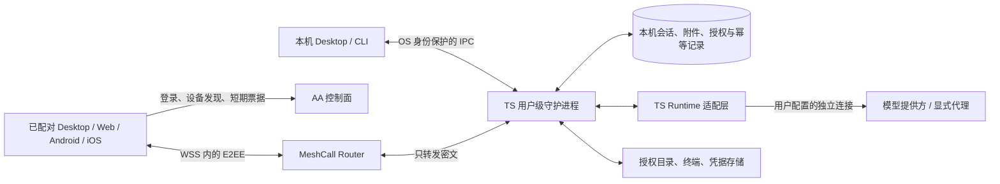

# AA NEXT（V3）：local first 与端到端加密方案（T48）

状态：完整评审稿，待 t4wefan 在 Effi 确认后定稿。方案通过、进入研发、上线切换分别记录；本文不授权实施、发布或删除数据。核对日期：2026-11-10（UTC）。本文描述 V3 目标，不描述 2.x 当前行为。

## 1. 依据与已经确认的决定

- Effi P5 的 M20/M29/M41：工作设备持有数据，MeshCall 承载远程操作，先在 Effi Cloud 验证核心再复用；提供自助删除/注销；上线清空旧对话和 Timeline，保留账号、必要设备和运营数据。
- T81 的 D3 已答复「不需要 PY 了，只需要 TS」：V3 守护进程及 Runtime 适配层采用 TypeScript，不保留 Python Connector 桥接方案。此决定不要求重写现有 AA 账号控制面。
- T81 的 D4 已选 A：本机独立信任，带外配对固定公钥、客户端持钥证明、本机授权；控制面登录和 Router principal 均不能代替设备同意。
- [#266](https://github.com/anywhere-labs/Agents-Anywhere/issues/266#issuecomment-6664829859)：2.x 不引入内容扫描补丁，V3 从架构解决凭据随转录上传。E2EE 不会抹除已经上传的秘密，历史处置是交付的一部分。
- [T81 复用评估](meshcall-daemon-evaluation.md)及[验证记录](validation.md)提供固定源码基线和实测范围。本文额外核对 AA `849c1ed2` 的数据库定义、现行契约与通知路径，以及 Effi Cloud `46221a4ac213176673073ecfacc009e8c0621dd2` 的 agentd/客户端/契约源码；未重跑 T81 原型，旧测试成绩不外推到新基线。

用户本轮明确「很大程度上可以直接参考 Effi Cloud」。因此以现有 agentd 和客户端为实现底座，复用清单、源码入口及最小改动见 [Effi Cloud 直接复用与 AA 差异](effi-cloud-reuse.md)。不另建会话引擎、同步协议或数据库层。

本稿的新增取舍集中于第 10 节，全部是待批准提案；不能把推荐值当成已决定的产品政策。

## 2. 架构与状态归属

每台工作设备是独立实例和单一业务权威。客户端缓存是可丢弃副本，不参与多主合并；账号下跨设备列表由客户端拉各设备列表合成。跨设备搬迁采用显式导出/导入，不能把两个活跃工作设备同时指向同一状态目录。Router 是中继，不承诺 P2P 打洞；远程流量和可用性仍依赖中继。

| 组件 | 负责 | 禁止承担的隐含职责 |
| --- | --- | --- |
| AA 控制面 | 账号、最少设备发现、短票据、注销/撤销分发、白名单运营统计 | 对话/项目标题、工具结果、文件路径、附件、模型凭据、可重建内容的错误与通知正文 |
| Router | 按目标实例转发、外层限流、关闭隧道 | 解密业务或决定本机最终权限；方法/实例/大小/时间仍然可见 |
| TS 共享内核 | Cloud 已验证的 ACP 生命周期、item 模型、快照/watch、幂等和排队语义 | Cloud 容器权限、团队默认授权、家目录初始化或公钥自动信任 |
| AA 本机宿主 | OS 服务、独占锁、本地身份/存储、授权目录、Runtime/终端适配、恢复升级 | 自动关闭工作区信任、扩大宿主权限、暴露无认证 TCP 服务 |
| 客户端 | 配对密钥、pin、受保护缓存、能力展示、端到端解密 | 云端可覆盖 pin、以账号登录自动取得执行权、向遥测回传正文 |

共享内核以固定版本制品复用，Cloud 与 AA 独立发布，契约/兼容矩阵随版本记录；禁止复制整个 Cloud 容器入口。Effi Cloud agentd 是 private 包，源码授权、依赖许可证、制品发布位置和签名/SBOM 是代码分发前置检查，当前文档不授予私有源码再分发权。若授权无法满足，回到负责人决策，不静默改成双份实现。

守护进程用单 OS 用户权限运行：Linux 用户服务、macOS 用户 LaunchAgent、Windows 用户级后台进程；Desktop/CLI/DSH 只连接或管理同一个实例，OS 锁防双启动。Unix socket 校验权限/对端用户，Windows named pipe 使用显式用户 ACL；可选回环 HTTP 必须验证 origin、CSRF 和独立本地令牌。安装不暴露公网监听端口。本机服务不依赖账号登录，云不可达仍可启动、查看与运行已有本机 Runtime；模型提供方不可达时如实显示模型不可用。

## 3. 本地存储、同步和离线行为

沿用 Cloud 的状态布局：`<state>/conversations/`、`attachments/`、`agent-sessions.json`、会话排序与 Agent 设置文件；原有 JSON 类型和序列化逻辑直接复用。AA 只替换 `stateDir`/`home` 的宿主配置，按 OS 用户数据位置存放，不重做另一套 blobs/数据库目录。日志、可重建缓存与受保护密钥在宿主层分离；凭据不能放进可同步的普通配置。升级不因安装目录变化丢数据，Unix 权限和 Windows ACL 分别验证。

**耐久语义和最小补强**：Cloud 当前使用会话 JSON、临时文件加 rename，持久化消息及 `client_msgs` 幂等表，重启把未完成轮次标为 disconnected；这些直接作为 AA 起点。新增的必须项是把关键写入错误反馈到调用者，并为「已接收」明确提交边界：内容、队列和幂等记录成功落盘后才确认接收并派发 Runtime；附件先可靠保存再提交引用。审批/删除/回退同样不能写失败仍返回成功。序列化同一会话写入，遵循平台文件/目录同步要求并进行故障注入；优先在现有持久化函数补强，不预先选 SQLite 或另写存储引擎。若 JSON 在实际历史量/故障验证中无法满足要求，再把测量与迁移取舍交负责人决定。

发送确认不等于外部工具副作用可事务回滚。Runtime 崩溃时保持已接收消息并显示 interrupted/需确认恢复，不能自动重做命令。流式片段继续沿用 Cloud 合帧与关键节点保存；尚未落盘的片段可能丢失，不承诺逐字保存或未经测量的断电窗口。磁盘满、权限错误、损坏要停止接收变更并返回可见错误，不能只记日志；实测持久化延迟、损失窗口及大历史成本后再确定发布指标。

沿用 Cloud 的单权威快照模型，不引入对话全局 rev/epoch、CRDT 或文本 delta：

1. watch 先登记再取快照，随后按 item id 整条替换，control 整体替换；seq 只用于顺序和分页。
2. 重连、回退、恢复备份或切换授权视图时，以新快照整体替换当前列表，清空旧分页；客户端丢弃旧连接的迟到结果。页游标绑定设备/会话/过滤范围，过期返回需重取，不能混入旧页。
3. 发信按设备、会话和 `client_msg_id` 持久幂等；权限答复按请求 id 原子先答先得。回退释放语义与 Cloud 保持一致，跨回退的旧请求不能重放成新消息。
4. 终端输入、执行和文件变更不在重连时盲重放；文件写入用前置版本/内容摘要检测冲突，失败由用户决定重试。
5. 慢 watcher 达到字节/条数/排队时间上限就断开并重取快照，附件分块及背压；不得无限积压或把大单轮整份加载到所有端。具体容量由负载验收确定。

远程工作设备离线时，仅查看明确标记为旧数据的本端缓存、编辑本端草稿；不把消息交给云暂存，也不显示「已发送」。重连后用户确认发送草稿。手机后台恢复先验证授权再开新 watch，不后台重放审批或终端输入。卸载界面必须区分应用卸载与删除数据；清除 OS 凭据会导致重新配对，不自动信任旧缓存。

本地备份使用一致性快照，包含数据库、附件、幂等和格式版本；加密导出由用户自行保管恢复密钥，AA 不托管解密密钥。配对/私钥不默认进入可移植备份，恢复到新机器产生新实例和密钥、重新配对；恢复原机也不能复活已撤销授权或已删除会话，先应用当前删除标记。用户自管的离线旧备份无法保证被远程销毁，恢复旧内容须明确告知。默认不提供服务器对话备份；云备份若要进入范围需另行决定。

## 4. 威胁模型与端点信任

保护目标：不可信网络、控制面/Router 数据库泄露，以及云侧主动替换实例公钥、伪造 principal/票据时，不能读取业务或获得本机执行权。云仍可拒绝服务、观察流量元数据；这套协议不隐藏通信关系。

可信端点包含工作设备、已配对客户端、OS/密钥库与受信的安装/更新链。端点失陷、获准读取文件的 Agent、模型提供方及用户选择的代理不在 E2EE 的保护之外自动消失。运行终端或 Agent 本质上可访问 OS 用户权限内的内容；目录 scope 限制文件 RPC，不能当成 shell/Agent 的完整沙箱。执行/终端必须单独显式授权，不能把只读分享升级成执行。

**原生客户端与 Web**：签名原生客户端验证发布签名、固定更新信任根、防回退和可审计发布，能减少被攻陷业务控制面分发恶意代码的风险；签名基础设施/发布者本身仍受信，不声称能防恶意软件发布者。Web 页面 JS 由服务端分发，恶意更新可调用不可导出的浏览器密钥并读解密结果；浏览器配对不能解决这一点。提议保留 Web 的普通 E2EE 访问，但必须清楚标识此信任前提；要求防业务云主动冒用的使用者采用受信原生客户端。若首版不接受这一边界，需由负责人改为禁用 Web 远程敏感操作，不能静默降级承诺。

### 4.1 配对、认证和逐操作授权

以下是新增应用协议的设计要求，尚未实现或通过密码协议评审；不是宣称 MeshCall 已具备双向设备认证。

1. 工作设备本地产生长期设备身份及 Noise 传输公钥，客户端在 OS 密钥库产生身份签名密钥。用成熟库的标准签名/X25519 实现，不自创算法或把同一原始私钥跨用途复用。
2. 用户在本机打开一次性配对窗口：二维码包含版本、随机实例标识、身份/传输公钥指纹、至少 128 位一次性随机秘密、过期时间和路由提示。秘密不得放在查询参数、服务端配对表或日志；经 Router 传递也只在 pin 验证后的密文中。短数字码只能用于限流加双方指纹确认，不能单独作为远程认证秘密。
3. 客户端从本机二维码/独立可信渠道取得 pin，先验证 Noise 服务端，再在密文中交换公钥并证明持有私钥。二维码在不可信网页里转发不算独立信任来源。工作设备本机展示两端指纹、目录、读/写/执行/终端/凭据管理权限及期限，由本机人确认；抢先扫码不能自动获权。确认前无业务 RPC。
4. 每条新隧道从「已加密、未认证」开始，守护进程发新随机挑战；客户端证明签名覆盖协议版本/用途分隔、双方身份、实例、当前加密握手绑定值、双方随机数和本地授权 id。验签后本机查授权和撤销状态；范围以本地记录为准，客户端或 Router 声明只能收窄，不能扩权。
5. 握手绑定必须来自 MeshCall 加密层经过评审的 transcript/exporter 接口，且绑定值/证明不得在不同隧道复用；若当前 SDK 没有该接口，先扩展 MeshCall 并给出跨端测试向量。不能用可被 Router 改写的 tunnel id 或单独的 nonce 冒充加密会话绑定，也不能改用自制明文认证绕过这一门槛。
6. 每个 RPC、订阅、下载块及长流生命周期都检查客户端、本地授权、操作范围和有效期；请求体内路径先规范化，再用 OS 能力防符号链接/TOCTOU 越界。新扩权、本机执行和 Runtime 工具审批是不同确认；配对不等于自动同意所有工具。
7. 本机撤销先持久化，再关闭相关活动流、拒绝新请求、清除挑战/敏感缓存，最后尽力通知 Router。云撤销和 TTL 不能替代本机关闭；已发生的文件写入/命令无法撤回，已交给 Runtime 的操作需显式取消并报告是否停止。

首次无人值守接入必须事先在本机设置可信批准者或通过独立可信渠道完成同等确认；账号密码、邮件找回和客服不能绕过首次配对。协议版本不兼容、明文、pin 不匹配、签名无效都 fail closed，不回退旧明文 RPC。

### 4.2 密钥、轮换、撤销和恢复

| 事件 | 必须行为 |
| --- | --- |
| 正常传输密钥轮换 | 本机身份签名新旧传输公钥及实例/序号；已配对端验证后更新 pin，旧钥限定过渡期；期间禁止云侧代签 |
| 身份密钥丢失/疑似泄露 | 停止远程服务、吊销本地配对，可信渠道重新配对；不能靠同账号下载新公钥自动恢复 |
| 客户端换机/丢失 | 从本机或预先授予撤销权限的配对设备吊销该客户端；新设备重新配对；不承诺擦掉失窃端已下载内容 |
| 本机密钥存储不可用 | 原生密钥库/Windows DPAPI/Secret Service 等保护；无安全后端时拒绝开启远程或由用户显式解锁加密存储，禁止无提示退回普通 JSON |
| 账号禁用/注销 | 控制面立即拒绝新票据并发撤销，诚实在线守护进程关闭远程流；离线实例按远程授权新鲜度租约到期关闭，保留本机离线功能 |
| 离线撤销 | 设备失联时显示「本机待确认」；下次连接先应用撤销/删除再开放业务，不宣称立即擦除离线端 |

短票据、本地授权、账号租约分别限制路由、业务权限和账号撤销传播。提议票据 5 分钟、配对窗口 5 分钟、本地远程授权默认最多 30 天、账号租约最长 24 小时；租约到期主动断流，续租也不能超过本地授权。账号服务故障超过 24 小时将影响远程、本机继续工作，这项取舍须批准。若云已失陷，租约无法代表诚实账号注销，独立本机撤销仍是最终边界；不能承诺同一威胁下云注销自动可靠生效。时钟回拨、重启不能延长已记录的有效期。

## 5. #266：逐路径禁止敏感明文进入云

核心验收是：Agent 正常读取含合成秘密的文件后，原文只在获准端点/所选模型路径出现，AA 控制面、Router 持久化和运营管道找不到它；不依赖正则能识别所有秘密。业务内容保持原样供已授权端查看，运行前明确提示「会话可能含秘密，会同步给已配对且有权限的设备」。

| 路径 | V3 要求 | 不可混淆的边界 |
| --- | --- | --- |
| 用户文本、工具结果、diff、计划/Goal、错误 | 仅本机存储，经 E2EE RPC/watch 到授权端；Server 不建 Timeline 镜像 | 本机/客户端看到内容是预期；E2EE 不等于端点脱敏 |
| 附件、上传下载、文件预览 | 通过 E2EE 分块传输，名称/路径/摘要在内层；不走旧 Server transfers 或可公开对象 URL | 旧 HTTP 附件路径不因 Timeline 加密而被覆盖 |
| 终端与文件操作 | E2EE duplex，独立权限、背压及路径检查；回滚缓存本地受保护 | tmux/ConPTY 的本地回滚也可能含秘密 |
| 凭据与模型设置 | 模型/OAuth 秘密留本机凭据存储；远程设置在 E2EE 内用只写输入，读取仅显示非秘密状态 | 不把服务端可解密的 secret_ciphertext 当端到端加密 |
| 模型提供方/代理 | 本机直连用户选择的提供方；显式代理单列信任和告知，模型业务请求仍可含秘密 | Tokens/模型代理能看到内容时不得宣称它也是盲转发 |
| 预览、SSH、分享、第三方集成 | 文件预览在获准端渲染，禁自动执行主动内容；外链/HTTP/SSH 独立列策略 | 不自动沿用 Cloud 网关或公开分享链接；见首版范围提案 |
| 通知/APNs/FCM/邮件 | 仅通用「有待处理事项」与不透明设备标识，打开后端内取正文 | 不推标题、路径、提示、审批命令或附件名 |
| 日志、追踪、错误与崩溃报告 | 默认无正文/headers/环境变量/路径的结构化白名单；上传诊断需本地预览并同意 | 不上传 core dump、内存快照、URL query 或模型错误原文 |
| 客户端缓存/备份 | 本机加密存储；退出/撤销尽力清缓存；Web 不使用服务器日志/分析录屏采集内容 | 浏览器扩展/截图/用户导出以及失窃端离线缓存不能保证收回 |
| Effi/数字员工接入 | 作为独立设备/服务身份配对，明确 workspace/操作 scope；按用户授权共享数据 | 不能沿用团队全员身份、把完整对话发给控制面 Agent |

凭据已经出现在历史 Timeline 中时，应视为可能已泄露；清库不能替代凭据轮换。上线告知提供轮换指引，不为排查把真实秘密复制到 issue、测试或审计结果。清理和自助删除详见[数据保留与切换方案](data-retention-and-cutover.md)。

## 6. Runtime 与四端兼容范围

TS-only 决定改变实现，不等于批准删除现有能力。适配器可以驱动外部 Runtime/ACP 进程，但 AA 不再依赖 Python Connector。有效能力依适配器声明，UI 不按 provider 名写死。首版最低覆盖提案如下，不能把 Cloud 的 Claude/Codex 清单当完整 AA 范围：

| 能力 | V3 目标及证据要求 |
| --- | --- |
| Codex 原生 app-server/IPC | 原生双向会话接管、恢复、模型/权限/计划能力实测；ACP adopt 不能替代 IPC 接管 |
| Claude | 原生历史发现/恢复、权限、队列、配置与计划审阅，经 TS 适配验证 |
| DSH | 本机发现、双向同步、多实例、进程归属和附件；保留 DSH 契约语义，新增 TS 宿主兼容测试 |
| Pi/通用 ACP | ACP 初始化、能力协商、模型、错误、恢复与多平台探针，不宣称 ACP 等于所有原生能力 |
| 业务工作流 | Plan/Goal、排队/插话/撤回、多端审批竞争、附件、模型设置、文件/终端逐项迁移；任何缺失报负责人 |

| 客户端/宿主 | 实施及验收要求 |
| --- | --- |
| Desktop（Windows/macOS/Linux） | 同一 TS 守护进程；本机离线入口、OS 密钥/IPC、安装签名升级；Unix PTY 与 Windows ConPTY 分开验证 |
| Web | 原生浏览器加密及本地 pin/缓存、明确 JS 分发信任限制；清站点数据即重新配对，不向云恢复私钥 |
| Android | 原生加密/SDK 桥接、Keystore、后台/切网/通知、缓存删除；禁止引入临时云明文代理 |
| iOS/iPadOS | 原生加密/SDK 桥接、Keychain、休眠重连/通知、缓存删除；不能用 Web 已通过替代真机 |

V3 新增契约先进入 `contracts/`，包括配对/证明测试向量、授权/错误、快照/分页/幂等、文件流、Runtime 能力及删除状态，才进入业务实现。沿用现行 [Runtime](../runtime-protocol/README.md)、[能力](../api/capabilities.md)、[Runtime 控制](../../contracts/runtime-control/2.1/README.md)、[工作流](../../contracts/runtime-workflows/1.2/README.md)、[DSH](../../contracts/dsh-bridge/2.0/README.md)与[本机生命周期](../../contracts/local-machine/2.0/README.md)语义逐项核对。本稿没有变更 2.x 契约或版本；架构升级落地按版本规则统一升级所有端主版本，不与 2.x 混跑业务数据。

## 7. 成本、可用性和首版范围提案

减少的是 Server Timeline/Redis 业务写入、附件存储和内容解析；Router 仍付连接和转发成本。测量每实例输出字节 B、活跃 watcher N、持续时间 T、重连快照和附件；接收侧约 `B × N`，另计设备上传、方向计费、TLS/协议开销及跨区费用。长 item 全量替换可能造成累计流量放大，必须按实际 wire bytes 统计，不能从最终文本长度推算节约百分比。

提议首版保留四端与现有业务能力，暂不增加 P2P、远程唤醒、云端离线发信箱、云对话备份、公开分享及明文 HTTP/SSH 网关；已有分享用户须在迁移告知中说明替代方式/限制。模型代理和 Effi 数字员工接入先固定独立信任/最小权限契约，接入上线单独批准。任何现有功能被延后都需负责人确认，不能用「不在评估中」掩盖移除。

提议以单 Router 故障可恢复进入内部验证，不承诺公网 HA/SLA。Router 重启丢票据时重注册、重签发、重认证、重取快照；控制面故障影响新票据/租约，工作设备睡眠影响远程执行。公网发布前必须有实测容量、告警、账单模型和经批准的可用性目标；不能把 Effi Cloud 的暂不做 HA 决定外推到 AA。

## 8. 实施阶段与可核验的门槛

本节列交付包和证据，不创建研发 Todo。G8 定稿后再拆研发任务，先 Cloud 验证共享边界，再 AA 原型，四端齐备后才考虑公开切换。

| 阶段 | 必须交付的证据 / 退出条件 |
| --- | --- |
| 方案定稿 | D3/D4 已回填；第 10 节新增取舍经负责人决定；数据处置与范围无未批准项 |
| 共享/协议原型 | Cloud 与 AA 两宿主用同版本 TS 内核；分发许可明确；固定契约和跨语言测试向量；迁移成本、CPU/内存实测 |
| 安全原型 | 错 pin、替换 key、伪造 principal、盗票据、签名/挑战重放、跨隧道转发证明、明文降级、越权路径、活动流撤销和账号租约到期全部 fail closed；独立安全评审 |
| 本地可靠性 | 云完全离线可本机工作；安装/双启动/睡眠恢复/升级；accepted 消息和幂等耐久、磁盘满、断电、备份恢复；确认不重复执行外部工具 |
| 同步/负载 | 双端发信/审批、rewind+分页竞态、重连/Router 重启、慢客户端/大单轮/多 watcher；内存/带宽上限、背压和恢复时间报告 |
| 功能/平台 | 第 6 节逐项通过，Windows/macOS/Linux 与 Desktop/Web/Android/iOS 真机结果；差异由人批准，不静默降级 |
| #266 与数据处置 | 注入无效合成凭据，检查控制面/Router/Redis/对象存储/日志/通知均无秘密；离线设备删除、历史清理、备份到期和回滚不复活演练 |
| 上线评审 | 成本与可用性指标、用户告知、回滚、版本配套及清理演练齐备，由人另行决定窗口和是否上线 |

最低负载报告需覆盖 1/10/100 活跃实例，每实例 1/2/5 watcher，大小不等的文本、附件、终端和慢手机，给出 RSS、队列峰值、转发字节与 p95 重连时间；数值是测试组合，非已验证容量或产品 SLA。不能为方案定稿虚构真机/生产测量，工程验收仍须逐项补证。

## 9. 本次产出与验证边界

本次只补方案和历史处置设计，没有 Runtime 改写、数据库迁移、生产清理或上线，也没有新增 API 字段。开发者方案文档不写入 2.x CHANGELOG。T81 的编译和 32/9/23 测试结果只证明固定基线的现有 Cloud/MeshCall 能力，不能证明本稿新增身份协议和删除机制已经完成；本次文档检查记录在[验证记录](validation.md)。

## 10. 待负责人批准的具体取舍

以下作为一份完整方案交 t4wefan 审阅，可批准或逐项改动；未答复不默认采纳，也不标记 T48 完成。

| 项目 | 本稿推荐 | 代价 / 改动时的影响 |
| --- | --- | --- |
| 客户端信任与首版范围 | D4 独立本机信任；保留 Web 但明确网页分发受信，较强云侧主动攻击防护使用受信原生客户端；四端/既有 Runtime 业务保留，第 7 节网关/分享等需明确迁移限制 | Web 无法提供与受信原生程序相同的主动攻击保证；若不可接受，要收紧 Web 权限及既有分享范围 |
| 本机存储与授权 | 直接复用 TS 内核与 Cloud JSON 布局；补关键写入失败与确认边界，流式损失窗口以测量为准；票据/配对 5 分钟、授权默认 30 天、账号租约 24 小时 | 增加存储与故障验证；云故障超过租约影响远程，减少长离线撤销窗口 |
| 保留/删除 | 云不留业务内容；主存储/缓存清理目标 24 小时，诊断与明细运营 7 天、删除审计/隔离旧备份最多 30 天，匿名聚合 13 个月；本机内容默认用户保留直到删除 | 30 天内不能声称物理备份已擦除；用户自管离线副本无法保证销毁；具体白名单见数据方案 |
| 交付与发布边界 | 以上是设计批准；实际分发授权、安全评审、真机/负载/清理证据与上线窗口分别作为工程门槛 | 不把文档通过误报为功能实现、漏洞修复或已可上线 |

负责人答复后在这里记录决策编号、结果与日期；T48 完成表示方案定稿，不表示 G8 其他 Todo 完成或允许立即拆任务/上线。
