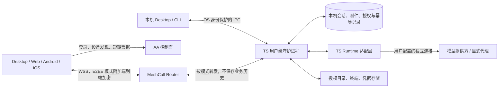

# AA NEXT（V3）：local first 与端到端加密方案（T48）

状态：完整评审稿，待 t4wefan 在 Effi 确认后定稿。方案通过、进入研发、上线切换分别记录；本文不授权实施、发布或删除数据。核对日期：2026-11-10（UTC）。本文描述 V3 目标，不描述 2.x 当前行为。

## 1. 依据与已经确认的决定

- Effi P5 的 M20/M29/M41：工作设备持有数据，MeshCall 承载远程操作，先在 Effi Cloud 验证核心再复用；提供自助删除/注销；上线清空旧对话和 Timeline，保留账号、必要设备和运营数据。
- Effi P5 的 M72（本轮用户补充）：离线可用是核心能力；当前主要成本压力是服务端 CPU 和内存，流量开支占比较小。V3 的主要预期收益之一是大幅降低服务端计算与内存成本，验证重点是量化下降幅度、可用服务器规格和承载量。
- T81 的 D3 已答复「不需要 PY 了，只需要 TS」：V3 守护进程及 Runtime 适配层采用 TypeScript，不保留 Python Connector 桥接方案。此决定不要求重写现有 AA 账号控制面。
- T81 的 D4 已选 A：本机独立信任。M75/M76 将适用范围明确为 E2EE 模式：每设备可选普通账号直连或 E2EE；E2EE 由客户端本地启用并锁定，每个客户端单独扫码/输入一次性配对密文，设备同时强制认证。账号身份或 Router principal 不能绕过 E2EE 配对。
- [#266](https://github.com/anywhere-labs/Agents-Anywhere/issues/266#issuecomment-6664829859)：2.x 不引入内容扫描补丁，V3 从架构解决凭据随转录上传。E2EE 不会抹除已经上传的秘密，历史处置是交付的一部分。
- [T81 复用评估](meshcall-daemon-evaluation.md)及[验证记录](validation.md)提供固定源码基线和实测范围。本文额外核对 AA `849c1ed2` 的数据库定义、现行契约与通知路径，以及 Effi Cloud `46221a4ac213176673073ecfacc009e8c0621dd2` 的 agentd/客户端/契约源码；未重跑 T81 原型，旧测试成绩不外推到新基线。

用户本轮明确「很大程度上可以直接参考 Effi Cloud」。因此以现有 agentd 和客户端为实现底座，复用清单、源码入口及最小改动见 [Effi Cloud 直接复用与 AA 差异](effi-cloud-reuse.md)。不另建会话引擎、同步协议或数据库层。

依据 M73/M74，新架构同时回应用户对隐私、性能和功能可用性的需求，并实现 M72 的运营成本目标。各项收益对应具体机制和验收，避免只以服务器资源下降代替用户体验改善：

| 用户目标 | 架构提供的改善空间 | 用户侧验收 |
| --- | --- | --- |
| 隐私更可控 | 数据以本机为主；用户可启用设备 E2EE，客户端本地锁定加密要求并逐个配对；明确访问与删除范围 | E2EE 模式下云端及旁路无业务明文，未经配对不能读取/执行；普通模式明确 Router 可见内容，两种模式均不持久化正文 |
| 性能与资源效率更好 | 减少重复进程/数据副本、不必要轮询与后台唤醒，控制缓存和流队列；本机直连也可减少网络往返 | 对照客户端、守护进程和适配器合计内存、空闲 CPU、轮询/唤醒次数及耗电；另测交互延迟和卡顿，不以更快作为唯一收益 |
| 功能可用且能及时演进 | 本机工作不依赖 AA 云服务；优先使用 ACP 标准、SDK 及上游适配器，减少自行定义协议和重复追赶 Runtime 更新 | 验证离线/断线恢复；按第 6 节核对 ACP 能力映射、四端覆盖及上游升级兼容，不因适配滞后长期缺失已有标准功能 |

这些是架构支持且要兑现的产品收益。按用户进一步补充，性能涵盖内存、CPU、轮询/唤醒与电量，功能演进优先依靠 ACP 上游维护。用户侧资源效率与云端 CPU/内存节省分别验收；模型推理时长单列，保持同一模型和请求条件，不把工作台交互改善误记为模型生成速度提高。

本稿的新增取舍集中于第 10 节，全部是待批准提案；不能把推荐值当成已决定的产品政策。

## 2. 架构与状态归属

每台工作设备是独立实例和单一业务权威。客户端缓存是可丢弃副本，不参与多主合并；账号下跨设备列表由客户端拉各设备列表合成。跨设备搬迁采用显式导出/导入，不能把两个活跃工作设备同时指向同一状态目录。Router 是中继，不承诺 P2P 打洞；远程流量和可用性仍依赖中继。

| 组件 | 负责 | 禁止承担的隐含职责 |
| --- | --- | --- |
| AA 控制面 | 账号、最少设备发现、短票据、注销/撤销分发、白名单运营统计 | 对话/项目标题、工具结果、文件路径、附件、模型凭据、可重建内容的错误与通知正文 |
| Router | 按目标实例转发、外层限流、关闭隧道；普通模式信任其账号鉴权 | E2EE 模式不得有解密能力或代替本机配对；两模式均不维护业务镜像，路由元数据仍可见 |
| TS 共享内核 | Cloud 已验证的 ACP 生命周期、item 模型、快照/watch、幂等和排队语义 | Cloud 容器权限、团队默认授权、家目录初始化或公钥自动信任 |
| AA 本机宿主 | OS 服务、独占锁、本地身份/存储、授权目录、Runtime/终端适配、恢复升级 | 自动关闭工作区信任、扩大宿主权限、暴露无认证 TCP 服务 |
| 客户端 | 本地模式要求、配对密钥/pin、受保护缓存、能力展示；E2EE 模式端内解密 | 云端不能改本地加密要求/pin，E2EE 不能仅凭账号获权；任何模式均不向遥测回传正文 |

共享内核以固定版本制品复用，Cloud 与 AA 独立发布，契约/兼容矩阵随版本记录；禁止复制整个 Cloud 容器入口。Effi Cloud agentd 是 private 包，源码授权、依赖许可证、制品发布位置和签名/SBOM 是代码分发前置检查，当前文档不授予私有源码再分发权。若授权无法满足，回到负责人决策，不静默改成双份实现。

守护进程用单 OS 用户权限运行：Linux 用户服务、macOS 用户 LaunchAgent、Windows 用户级后台进程；Desktop/CLI/DSH 只连接或管理同一个实例，OS 锁防双启动。Unix socket 校验权限/对端用户，Windows named pipe 使用显式用户 ACL；可选回环 HTTP 必须验证 origin、CSRF 和独立本地令牌。安装不暴露公网监听端口。本机服务不依赖账号登录，云不可达仍可启动、查看与运行已有本机 Runtime；模型提供方不可达时如实显示模型不可用。

## 3. 本地存储、同步和离线行为

离线可用是主使用路径：安装并准备好本机 Runtime 后，关闭 AA 控制面和 Router、账号会话失效或长时间无法续租，都不应阻止打开本机 UI、查看完整本机历史、管理本机文件/终端，以及按 Runtime 能力创建和继续会话、处理审批、停止任务。本机界面和必要资源随客户端安装，不依赖在线网页才能启动；云登录、设备发现和远程授权不能进入本机操作的必经路径。第 4 节的账号租约只限制远程访问，不为本机使用设置离线截止时间。

验收区分两种断网：AA 服务不可达但模型服务可达时，用户已有且可独立使用的模型连接继续工作；完全无网络时，本机历史、文件、终端等仍可用，推理取决于是否已配置可离线运行的模型/Runtime。依赖云提供方的推理如实显示不可用，不能因此锁住整个工作台。联网恢复只恢复必要的远程连接和同步，不向 AA 云补传离线期间的业务历史。

沿用 Cloud 的状态布局：`<state>/conversations/`、`attachments/`、`agent-sessions.json`、会话排序与 Agent 设置文件；原有 JSON 类型和序列化逻辑直接复用。AA 只替换 `stateDir`/`home` 的宿主配置，按 OS 用户数据位置存放，不重做另一套 blobs/数据库目录。日志、可重建缓存与受保护密钥在宿主层分离；凭据不能放进可同步的普通配置。升级不因安装目录变化丢数据，Unix 权限和 Windows ACL 分别验证。

**耐久语义和最小补强**：Cloud 当前使用会话 JSON、临时文件加 rename，持久化消息及 `client_msgs` 幂等表，重启把未完成轮次标为 disconnected；这些直接作为 AA 起点。新增的必须项是把关键写入错误反馈到调用者，并为「已接收」明确提交边界：内容、队列和幂等记录成功落盘后才确认接收并派发 Runtime；附件先可靠保存再提交引用。审批/删除/回退同样不能写失败仍返回成功。序列化同一会话写入，遵循平台文件/目录同步要求并进行故障注入；优先在现有持久化函数补强，不预先选 SQLite 或另写存储引擎。若 JSON 在实际历史量/故障验证中无法满足要求，再把测量与迁移取舍交负责人决定。

发送确认不等于外部工具副作用可事务回滚。Runtime 崩溃时保持已接收消息并显示 interrupted/需确认恢复，不能自动重做命令。流式片段继续沿用 Cloud 合帧与关键节点保存；尚未落盘的片段可能丢失，不承诺逐字保存或未经测量的断电窗口。磁盘满、权限错误、损坏要停止接收变更并返回可见错误，不能只记日志；实测持久化延迟、损失窗口及大历史成本后再确定发布指标。

沿用 Cloud 的单权威快照模型，不引入对话全局 rev/epoch、CRDT 或文本 delta：

1. watch 先登记再取快照，随后按 item id 整条替换，control 整体替换；seq 只用于顺序和分页。
2. 重连、回退、恢复备份或切换授权视图时，以新快照整体替换当前列表，清空旧分页；客户端丢弃旧连接的迟到结果。页游标绑定设备/会话/过滤范围，过期返回需重取，不能混入旧页。
3. 发信按设备、会话和 `client_msg_id` 持久幂等；权限答复按请求 id 原子先答先得。回退释放语义与 Cloud 保持一致，跨回退的旧请求不能重放成新消息。
4. 终端输入、执行和文件变更不在重连时盲重放；文件写入用前置版本/内容摘要检测冲突，失败由用户决定重试。
5. 慢 watcher 达到字节/条数/排队时间上限就断开并重取快照，附件分块及背压；不得无限积压或把大单轮整份加载到所有端。具体容量由负载验收确定。

设备端资源效率是设计约束：支持订阅的状态使用事件/watch 更新，多个界面共享订阅与已有适配器进程；不可见视图取消不必要的业务订阅，后台按平台策略暂停或合并刷新。对只能扫描发现的本地 CLI 历史等路径，按实际订阅需要启停、合并并退避，使用文件变化提示时做必要校验；避免固定高频轮询。连接保活、撤销检查和恢复校验按必要性设置，不能为了省电漏掉安全状态或消息。Cloud 的现有扫描/定时任务也要检查，不能因直接复用而原样常驻运行。

分页历史、附件和流式视图限制缓存/队列占用，避免客户端、守护进程和适配器各保留多份完整会话。验收覆盖前台活跃、空闲、后台、无订阅和断线重连场景，统计各进程及合计内存、空闲 CPU、定时器/轮询/唤醒频率与单位时间耗电；在相同设备、OS、电源和工作负载下比较，报告本机新增负担与节省，不能只凭服务器减负推断设备更省电。

远程工作设备离线时，仅查看明确标记为旧数据的本端缓存、编辑本端草稿；不把消息交给云暂存，也不显示「已发送」。重连后用户确认发送草稿。手机后台恢复先验证授权再开新 watch，不后台重放审批或终端输入。卸载界面必须区分应用卸载与删除数据；清除 OS 凭据会导致重新配对，不自动信任旧缓存。

本地备份使用一致性快照，包含会话状态文件、附件、幂等和格式版本；加密导出由用户自行保管恢复密钥，AA 不托管解密密钥。配对/私钥不默认进入可移植备份，恢复到新机器产生新实例和密钥、重新配对；恢复原机也不能复活已撤销授权或已删除会话，先应用当前删除标记。用户自管的离线旧备份无法保证被远程销毁，恢复旧内容须明确告知。默认不提供服务器对话备份；云备份若要进入范围需另行决定。

## 4. 威胁模型与端点信任

产品和协议边界详见[设备安全模式与信任](device-trust.md)。M75/M76 已明确：普通模式按用户身份连接 RPC 隧道，不要求逐客户端配对；E2EE 模式仍可发现设备在线，但客户端必须本地启用加密要求并分别配对，设备也拒绝所有未配对/未加密业务。

E2EE 的协议目标是在可信端点和密码学假设下，即使服务器运行任意恶意程序，也不能解密、冒充已配对端点或诱导静默降级。服务端不持有私钥、配对秘密或会话密钥，也不负责替换端点信任。客户端被修改后主动泄密不在通信协议保证内；算法/流程须经过分析审查，本文尚未宣称已证明绝无漏洞。

普通模式仍要求 TLS、账号/设备权限和本机路径/操作限制，但信任云端身份与转发，Router 可以读取传输内容。E2EE 不信任云端声明的模式或身份：客户端未知状态不能自动视为普通，已选择加密后失败只能拒绝，工作设备拒绝账号直接访问。两种模式都保持 local first、无云端业务持久化。

首次配对通过本机生成的二维码或一次性高熵配对密文建立可信引导，每个客户端获得独立身份；配对材料不得由服务器生成/保存或通过日志、URL 泄露。后续持钥认证绑定当前加密握手和本地授权，校验范围覆盖每个业务入口及长流。开关切换先关闭旧权限/连接，恢复或换钥匙不能自动解除 E2EE。具体状态和反例见设备信任文档。

终端和 Agent 执行权限能访问 OS 用户范围，目录 scope 不等于完整沙箱；工具审批仍独立。模型提供方/显式代理及获准客户端可能读取内容，不能纳入「服务器无法解密传输」的同一承诺。

Web 页面 JS 若被攻击者替换，端点已不再遵循协议；浏览器不可导出密钥不能阻止其读明文。E2EE 需要可信客户端/更新链，原生签名应用或独立可信分发 Web 的交付范围仍待审阅；不能用较弱网页信任前提冒充同等主动攻击防护。

### 4.1 密钥、轮换、撤销和恢复

身份密钥/配对相关规则针对 E2EE 模式；账号注销与离线访问边界适用于两种模式。

| 事件 | 必须行为 |
| --- | --- |
| 正常传输密钥轮换 | 本机身份签名新旧传输公钥及实例/序号；已配对端验证后更新 pin，旧钥限定过渡期；期间禁止云侧代签 |
| 身份密钥丢失/疑似泄露 | 停止远程服务、吊销本地配对，可信渠道重新配对；不能靠同账号下载新公钥自动恢复 |
| 客户端换机/丢失 | 从本机或预先授予撤销权限的配对设备吊销该客户端；新设备重新配对；不承诺擦掉失窃端已下载内容 |
| 本机密钥存储不可用 | 原生密钥库/Windows DPAPI/Secret Service 等保护；无安全后端时拒绝开启远程或由用户显式解锁加密存储，禁止无提示退回普通 JSON |
| 账号禁用/注销 | 控制面立即拒绝新票据并发撤销，诚实在线守护进程关闭远程流；离线实例按远程授权新鲜度租约到期关闭，保留本机离线功能 |
| 离线撤销 | 设备失联时显示「本机待确认」；下次连接先应用撤销/删除再开放业务，不宣称立即擦除离线端 |

短票据、本地授权、账号租约分别限制路由、业务权限和账号撤销传播。提议票据 5 分钟、配对窗口 5 分钟、本地远程授权默认最多 30 天、账号租约最长 24 小时；租约到期主动断流，续租也不能超过本地授权。账号服务故障超过 24 小时将影响远程、本机继续工作，这项取舍须批准。若云已失陷，租约无法代表诚实账号注销，独立本机撤销仍是最终边界；不能承诺同一威胁下云注销自动可靠生效。时钟回拨、重启不能延长已记录的有效期。

## 5. #266：E2EE 机密性与两模式的数据最小化

E2EE 模式核心验收是：Agent 读取合成秘密后，原文只在获准端点/所选模型路径出现，AA 控制面、Router 内存/持久化和运营旁路不能取得明文，不依赖正则检出秘密。下表的 E2EE 要求适用于启用保护的设备；普通模式仍执行本机存储、禁止日志/通知正文及旧 Timeline 镜像等要求，但 Router 能看到经过它的内容。#266 的「服务器不可读」保证只适用于 E2EE，不能把普通模式零持久化宣传成同等机密性。用户可见说明按模式区分。

| 路径 | V3 要求 | 不可混淆的边界 |
| --- | --- | --- |
| 用户文本、工具结果、diff、计划/Goal、错误 | 仅本机存储，经 E2EE RPC/watch 到授权端；Server 不建 Timeline 镜像 | 本机/客户端看到内容是预期；E2EE 不等于端点脱敏 |
| 附件、上传下载、文件预览 | 通过 E2EE 分块传输，名称/路径/摘要在内层；不走旧 Server transfers 或可公开对象 URL | 旧 HTTP 附件路径不因 Timeline 加密而被覆盖 |
| 终端与文件操作 | E2EE duplex，独立权限、背压及路径检查；回滚缓存本地受保护 | tmux/ConPTY 的本地回滚也可能含秘密 |
| 凭据与模型设置 | 模型/OAuth 秘密留本机凭据存储；远程设置在 E2EE 内用只写输入，读取仅显示非秘密状态 | 不把服务端可解密的 secret_ciphertext 当端到端加密 |
| 模型提供方/代理 | 本机直连用户选择的提供方；显式代理单列信任和告知，模型业务请求仍可含秘密 | Tokens/模型代理能看到内容时不得宣称它也是盲转发 |
| 预览、SSH、分享、第三方集成 | 文件预览在获准端渲染，禁自动执行主动内容；外链/HTTP/SSH 独立列策略 | 不自动沿用 Cloud 网关或公开分享链接；见首版范围提案 |
| 通知/APNs/FCM/邮件 | 仅通用「有待处理事项」与不透明设备标识，打开后端内取正文 | 不推标题、路径、提示、审批命令或附件名 |
| 日志、追踪、错误与崩溃报告 | 默认无正文/headers/环境变量/路径的结构化白名单；上传诊断需本地预览并同意 | 不上传 core dump、内存快照、URL query 或模型错误原文 |
| 客户端缓存/备份 | 本机加密存储；退出/撤销尽力清缓存；Web 不使用服务器日志/分析录屏采集内容 | 浏览器扩展/截图/用户导出以及失窃端离线缓存不能保证收回 |
| Effi/数字员工接入 | E2EE 模式使用独立配对身份；普通模式使用账号授权；均明确 workspace/操作 scope | 不能沿用团队全员身份、把完整对话发给控制面 Agent |

凭据已经出现在历史 Timeline 中时，应视为可能已泄露；清库不能替代凭据轮换。上线告知提供轮换指引，不为排查把真实秘密复制到 issue、测试或审计结果。清理和自助删除详见[数据保留与切换方案](data-retention-and-cutover.md)。

## 6. Runtime 与四端兼容范围

**ACP 优先**是功能接入和演进原则：直接使用 ACP 已有标准、SDK 和持续维护的上游适配器，沿用其会话、通知、权限请求及能力协商语义；AA 主要承担宿主、展示、设备安全与远程访问。先查询上游已有能力再实现功能，避免为同一业务重新定义一套 AA 协议或复制适配逻辑。上游维护通常更及时，采用标准有助于缩短 AA 跟进 Runtime 更新的时间；依赖固定版本，升级经过兼容与回归验证后发布。

TS-only 决定改变实现，不等于批准删除现有能力。每项现有功能先映射到当前 ACP/适配器协商能力；标准已覆盖的直接接入，不要求保留旧内部实现。尚未覆盖的列明具体缺口、上游支持情况和用户影响，优先推动上游或使用其扩展；只有确需保留的差异才增加薄的 TS 桥接，功能取舍由负责人决定。UI 按有效能力展示，不按 provider 名写死。以下是兼容核对范围，不要求把旧协议整体重写为 TS：

| 能力 | V3 目标及证据要求 |
| --- | --- |
| Codex | 会话/模型/权限等优先使用 ACP 与上游适配器；原生 IPC 双向接管作为单独兼容项核对，不能把 ACP adopt 当作等价能力 |
| Claude | 历史/恢复、权限、队列、配置与计划审阅先核对 ACP/上游覆盖，直接复用已支持能力，差异单列 |
| DSH | 本机发现、双向同步、多实例、进程归属和附件；保留 DSH 契约语义，新增 TS 宿主兼容测试 |
| Pi/通用 ACP | ACP 初始化、能力协商、模型、错误、恢复与多平台探针，不宣称 ACP 等于所有原生能力 |
| 业务工作流 | Plan/Goal、排队/插话/撤回、多端审批、附件、模型设置、文件/终端先映射 ACP/上游能力；AA 视图和多端同步沿用 Cloud，必要差异单列，不重复发明已标准化语义 |

| 客户端/宿主 | 实施及验收要求 |
| --- | --- |
| Desktop（Windows/macOS/Linux） | 同一 TS 守护进程；本机离线入口、OS 密钥/IPC、安装签名升级；Unix PTY 与 Windows ConPTY 分开验证 |
| Web | 原生浏览器加密及本地 pin/缓存、明确 JS 分发信任限制；清站点数据即重新配对，不向云恢复私钥 |
| Android | 原生加密/SDK 桥接、Keystore、后台/切网/通知、缓存删除；禁止引入临时云明文代理 |
| iOS/iPadOS | 原生加密/SDK 桥接、Keychain、休眠重连/通知、缓存删除；不能用 Web 已通过替代真机 |

ACP 已定义的 Agent 交互以固定上游版本与兼容测试为准，不重新发布一套竞争语义；Cloud item/watch 是多端展示与同步视图，不另造 Agent 协议。确需新增的 AA 宿主、安全与多端契约先进入 `contracts/`，包括配对/证明测试向量、授权/错误、快照/分页/幂等、文件流、Runtime 能力及删除状态，才进入业务实现。沿用现行 [Runtime](../runtime-protocol/README.md)、[能力](../api/capabilities.md)、[Runtime 控制](../../contracts/runtime-control/2.1/README.md)、[工作流](../../contracts/runtime-workflows/1.2/README.md)、[DSH](../../contracts/dsh-bridge/2.0/README.md)与[本机生命周期](../../contracts/local-machine/2.0/README.md)语义逐项核对。本稿没有变更 2.x 契约或版本；架构升级落地按版本规则统一升级所有端主版本，不与 2.x 混跑业务数据。

## 7. 成本、可用性和首版范围提案

用户明确当前昂贵服务器规格主要由 CPU 和内存需求驱动，流量开支占比较小。因此，**大幅降低服务端 CPU 和内存成本是本次架构调整的主要预期收益**。这一预期有明确机制支撑：会话内容解析、投影/合并、业务快照构建与缓存、Timeline 持久化、Redis 写缓冲和按内容分发都从中央服务退出，由工作设备和客户端承担；云端主要保留账号、设备发现、票据和密文转发。云端不再为所有用户的业务历史维护对象、索引或完整快照，资源增长主要取决于在线连接、认证请求和转发吞吐。

Router 必须保持转发职责：E2EE 模式不持有解密能力，两种模式均不建立业务对象镜像、不为重连维护完整会话快照，也不在服务端增加默认的全文扫描、内容压缩/差量计算等高 CPU 业务处理。每连接和全局转发缓冲都设硬上限及背压，慢客户端不能把云内存变成历史积压队列。本机 UI 与守护进程直接通信，使本机日常操作同时退出云端的数据路径。TLS、连接管理和转发仍有资源成本，但与原有中央业务状态维护的成本结构不同。

性能验证要回答「能用多低的 CPU/内存规格支撑多少活跃用户」，并量化架构收益。对照 2.x 与 V3 使用相同会话样本、生成速率、历史规模、在线设备/watcher 数、慢消费者和重连模式；记录统一硬件或等效资源配额下的总 CPU 时间、稳态/峰值 RSS、长期运行内存变化、数据库/Redis 负载及 p95 延迟。V3 统计控制面、Router 和仍需的云数据库/缓存合计，不能只展示某个进程的下降；另外报告本机新增开销。给出相同负载所需的云 CPU 核数、内存与月度实例费用，以及固定小规格的安全承载量。具体降幅和部署规格由测试确认，不在文档中虚构百分比。

带宽作为次级成本和容量指标保留：测量设备输出、watcher 副本、重连快照和附件的实际 wire bytes，检查长 item 全量替换是否放大流量。无需为了优先减少流量而在中央服务重引入昂贵的业务计算、内容缓存或持久化；总费用报告分别列 CPU/内存实例、存储和流量。

提议首版保留四端与现有业务能力，暂不增加 P2P、远程唤醒、云端离线发信箱、云对话备份、公开分享及明文 HTTP/SSH 网关；已有分享用户须在迁移告知中说明替代方式/限制。模型代理和 Effi 数字员工接入先固定独立信任/最小权限契约，接入上线单独批准。任何现有功能被延后都需负责人确认，不能用「不在评估中」掩盖移除。

提议以单 Router 故障可恢复进入内部验证，不承诺公网 HA/SLA。Router 重启丢票据时重注册、重签发、重认证、重取快照；控制面故障影响新票据/租约，工作设备睡眠影响远程执行。公网发布前必须有实测容量、告警、账单模型和经批准的可用性目标；不能把 Effi Cloud 的暂不做 HA 决定外推到 AA。

## 8. 实施阶段与可核验的门槛

本节列交付包和证据，不创建研发 Todo。G8 定稿后再拆研发任务，先 Cloud 验证共享边界，再 AA 原型，四端齐备后才考虑公开切换。

| 阶段 | 必须交付的证据 / 退出条件 |
| --- | --- |
| 方案定稿 | D3/D4 已回填；第 10 节新增取舍经负责人决定；数据处置与范围无未批准项 |
| 共享/协议原型 | Cloud 与 AA 两宿主用同版本 TS 内核；分发许可明确；固定契约和跨语言测试向量；迁移成本、CPU/内存实测 |
| 安全原型 | 两模式行为及客户端/设备双端策略测试；E2EE 错 pin、谎报普通模式、伪造 principal、配对包并发/重放、跨隧道认证、降级/切换竞态、恢复旁路均拒绝；独立协议分析与实现安全评审 |
| 本地可靠性 | 断开控制面/Router、退出云账号及超过远程租约期限后，本机 UI/完整历史/文件/终端与可用 Runtime 仍工作；分别验证 AA 断线和全网络断线；安装/双启动/睡眠恢复/升级；accepted 消息和幂等耐久、磁盘满、断电、备份恢复；确认不重复执行外部工具 |
| 同步/负载 | 双端发信/审批、rewind+分页竞态、重连/Router 重启、慢客户端/大单轮/多 watcher；内存/带宽上限、背压和恢复时间报告 |
| 用户侧资源与性能 | 固定设备/OS/电源/负载，对照前台、空闲、后台、无订阅、重连时客户端+守护进程+适配器内存、CPU、轮询/唤醒及耗电；另测操作延迟和卡顿，区分模型耗时，确认没有以设备端无界消耗换取云端节省 |
| 云资源成本 | 同负载对照 2.x，量化云端合计 CPU/内存的大幅下降；列出所需服务器规格、实例费用和固定小规格承载量，覆盖长历史、慢消费者、重连及长时间运行；本机新增开销单列 |
| 功能/平台 | ACP 能力映射、上游 SDK/适配器固定版本与升级兼容证据齐备，第 6 节逐项通过，Windows/macOS/Linux 与 Desktop/Web/Android/iOS 真机结果；差异由人批准，不静默降级 |
| #266 与数据处置 | E2EE 注入合成秘密检查云端转发/旁路均不可读；普通模式承认 Router 可读但验证无持久化/日志副本；离线设备删除、历史清理、备份到期和回滚不复活演练 |
| 上线评审 | 成本与可用性指标、用户告知、回滚、版本配套及清理演练齐备，由人另行决定窗口和是否上线 |

最低负载报告需覆盖 1/10/100 活跃实例，每实例 1/2/5 watcher，大小不等的文本、附件、终端和慢手机，优先给出云端合计 CPU、稳态/峰值 RSS、长期内存趋势及最小可用实例规格，并附队列峰值、转发字节与 p95 重连时间；数值是测试组合，非已验证容量或产品 SLA。不能为方案定稿虚构真机/生产测量，工程验收仍须逐项补证。

## 9. 本次产出与验证边界

本次只补方案和历史处置设计，没有 Runtime 改写、数据库迁移、生产清理或上线，也没有新增 API 字段。开发者方案文档不写入 2.x CHANGELOG。T81 的编译和 32/9/23 测试结果只证明固定基线的现有 Cloud/MeshCall 能力，不能证明本稿新增身份协议和删除机制已经完成；本次文档检查记录在[验证记录](validation.md)。

## 10. 待负责人批准的具体取舍

以下作为一份完整方案交 t4wefan 审阅，可批准或逐项改动；未答复不默认采纳，也不标记 T48 完成。

| 项目 | 本稿推荐 | 代价 / 改动时的影响 |
| --- | --- | --- |
| 客户端交付与首版范围 | M75/M76 双模式和客户端锁定已确认；E2EE 要求端点遵循协议。原生签名/可信更新或独立可信分发 Web 的交付方案，以及第 7 节网关/分享迁移限制仍待确认 | 任意服务端分发 JS 的在线 Web 无法在页面提供方恶意时维持端点可信，不能给予同等承诺 |
| 本机存储与授权 | 直接复用 TS 内核与 Cloud JSON 布局；补关键写入失败与确认边界，流式损失窗口以测量为准；票据/配对 5 分钟、授权默认 30 天、账号租约 24 小时 | 增加存储与故障验证；云故障超过租约影响远程，减少长离线撤销窗口 |
| 保留/删除 | 云不留业务内容；主存储/缓存清理目标 24 小时，诊断与明细运营 7 天、删除审计/隔离旧备份最多 30 天，匿名聚合 13 个月；本机内容默认用户保留直到删除 | 30 天内不能声称物理备份已擦除；用户自管离线副本无法保证销毁；具体白名单见数据方案 |
| 交付与发布边界 | 以上是设计批准；实际分发授权、安全评审、真机/负载/清理证据与上线窗口分别作为工程门槛 | 不把文档通过误报为功能实现、漏洞修复或已可上线 |

负责人答复后在这里记录决策编号、结果与日期；T48 完成表示方案定稿，不表示 G8 其他 Todo 完成或允许立即拆任务/上线。
