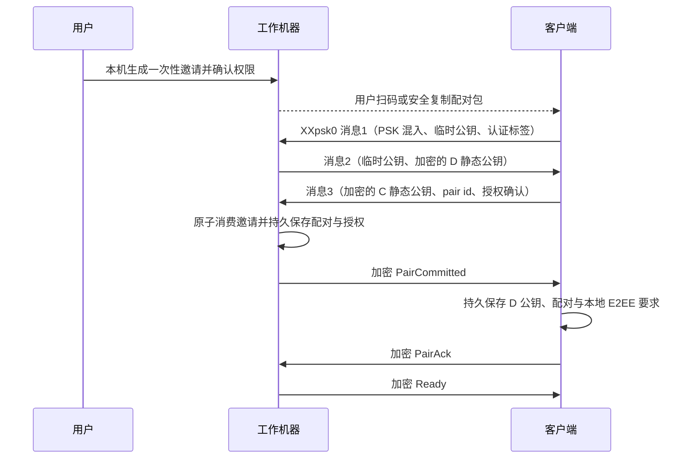

# E2EE 配对与认证握手草案（T48）

状态：算法与流程的具体推荐稿，尚未批准握手选型、实现、形式化分析或安全审查。产品规则见[设备信任](device-trust.md)，架构见[总方案](architecture-proposal.md)。用户已确认设备双模式、客户端本地启用与首次配对必须接触工作机器取得材料。

## 1. 角色与安全目标

C 为客户端，D 为工作机器，R 包含控制面、Router 和所有转发网络。普通模式沿用 TLS/WSS、账号权限和目标隧道，不使用本草案的配对握手；R 可以读取普通模式业务。E2EE 模式中 R 是完全恶意的攻击者，两端本地安全策略不信任 R 的配置或身份声明。

目标是在 C/D 遵循协议、可信带外配对、端点秘密未泄露和标准密码学假设成立时，提供业务机密性、完整性、相互身份认证、跨设备/会话隔离、防重放和防降级。R 可以观察元数据和阻断服务。端点被修改后主动泄密不由协议解决；不能以 R 运行非官方程序为理由排除攻击。

## 2. 推荐密码配置与准确边界

| 用途 | 推荐配置 | 原因 |
| --- | --- | --- |
| 工作机器与客户端身份 | X25519 静态密钥；D 持有自己的身份，每条 C—D 配对使用独立客户端密钥 | 直接参加标准 Noise 双向认证；无需额外自行拼接签名协议 |
| 首次配对 | `Noise_XXpsk0_25519_AESGCM_SHA256` | 一次性 32 字节高熵 PSK 在首条消息混入；双方静态公钥在握手内加密传输；通过公开 invitation id 选择正确 PSK |
| 已配对重连 | `Noise_KK_25519_AESGCM_SHA256` | 双方已存有对方静态公钥，握手无需重新传输静态公钥，完成双向持钥认证并协商新会话密钥 |
| 业务帧 | Noise Split 得到的方向独立会话密钥，AES-256-GCM；沿用并版本化 MeshCall 的认证帧思路 | 绑定调用上下文和序号，检查重放；不使用长期配对秘密直接加密业务 |

依据：[Noise 规范](https://noiseprotocol.org/noise.html)的握手模式、PSK 修饰符和安全性质章节。XXpsk0 是按标准 psk0 规则构造的候选 profile，不表示该 AA 组合流程已经被审计；跨端库支持、标准测试向量及独立分析通过后才可锁定实现。继续使用 X25519/AESGCM/SHA256 便于复用 MeshCall 当前基础，但现有 NK 实现不能直接冒充 XXpsk0 或 KK。

**公钥可见性必须如实说明**：Noise 的 `e` token 把临时公钥写入握手消息，PSK 不会自动隐藏它。推荐主线不向 R 分发长期身份公钥，但握手临时公钥仍可见；它不提供计算私钥或会话密钥的能力。此前“采用 PSK 就能隐藏所有握手公钥”的概括不成立。

如果产品还要求连临时公钥都不暴露，则要在 Noise 握手之外增加由带外秘密引导的加密封装，并为后续连接管理独立封装秘密、随机数和轮换。不能称这是 Noise 自带能力，也不能复用同一原始秘密跨用途；这是额外协议设计/分析与密钥生命周期成本。先由负责人确定是否保留这一额外目标，再定义封装，不能凭核心机密性目标擅自宣布“所有公钥不可见”。

## 3. 工作机器生成配对材料

用户必须能在可信工作机器上操作「添加客户端」。生成材料的动作本身完成本次授权同意：选择权限范围和期限；二维码或可复制字符串承载相同材料。已有客户端的日常连接不需要重新取码，但不能仅靠账号登录或云端操作给新客户端发码。

建议配对包包含：协议 profile 版本、随机 device id、D 的预期静态公钥、随机 invitation id、32 字节安全随机 PSK、过期时间，以及用户确认的权限摘要。路由提示可附带，但不能作为身份依据。D 本地保留实际权限、PSK 和邀请状态，R 只需看到用于定位的 device/invitation id，不能收到 PSK 或整个配对包。

配对材料是持有即有配对能力的秘密；其可信性来自用户接触工作机器及安全传递，不来自“密文”这个名称。使用足够长的编码字符串/二维码，不以六位数字代替 PSK；校验码只能辅助防输错。有效期和失败次数在 D 检查，不能依赖 Router 限流。配对包不进入服务端 URL、日志、诊断、剪贴板同步或备份。

## 4. 首次配对状态机

客户端先本地持久保存 `E2EE required`，再打开受限配对通道；这是协议策略，不是可被服务端改写的远程配置。C 生成该配对的静态身份和随机 pair id。双方使用确定编码的公开上下文作为 Noise prologue，绑定协议/profile、角色、device id、invitation id、E2EE 要求和授权摘要；使用规范化编码/长度界定，不能拼接有歧义的字段。D 以自己的邀请记录构造上下文，不能照抄攻击者提供的权限。

推荐消息流程如下，所有箭头经 R 转发，R 无需参与认证：

- 使用标准 XXpsk0 的全部处理步骤，即使第一条握手 payload 为空也带认证标签，D 验证成功后才继续；C 在消息2取得 D 静态公钥后须与配对包中预期公钥严格一致，否则拒绝。业务正文不进入任何握手 payload；消息3仅承载配对控制信息。
- D 只有在 Noise 完成且 C 证明持有 PSK/静态私钥后，才将邀请从 pending 原子变为 consumed，同时持久记录 pair id、C 公钥、授权与撤销版本。不得先写“已消费”再以另一份可丢失文件写授权；使用同一耐久记录或等价原子提交。
- 一份邀请至多创建一条配对；重复或并发尝试不能生成第二份权限。过期、目标/权限摘要不符、错误 PSK、非法公钥或校验失败都关闭，不回退普通协议。
- `PairCommitted` 丢失时，C 已从握手取得 D 身份且自己选择了 pair id，可按第5节重连查询该配对是否已提交；不得再次用已消费邀请替另一台客户端配对。未提交则只能在原邀请仍有效时重新尝试。
- D 提交后销毁 PSK，C 收到提交并完成本地保存后也销毁 PSK；持久配对只保留身份和授权，不保存可重放的邀请秘密。双方完成 Ready 之前不派发业务。

这里把“用户在本机产生一次性授权”和“持秘密者建立客户端身份”联系起来。若带外秘密被窃取，攻击者拥有本次配对能力，违反初始信任假设；可以增加本机二次核对来降低误分享风险，但不能声称已泄露秘密仍能认证原用户。

## 5. 已配对连接

C 通过账号发现设备及申请路由票据，但使用本地保存的 D 公钥、pair id 和自己的私钥。D 用 pair id 查本地已授权且未撤销的 C 公钥；Router principal/账号签发不能替代此查询。

1. 双方运行标准 Noise KK，静态公钥作为 pre-message 输入而非重新从云端取得。prologue 绑定 profile、角色、device id、pair id、E2EE 要求；临时随机密钥每次重新生成。任何路由转接到错误目标或身份替换均不能完成认证。
2. 完成两个握手消息后，C 先发加密的 `ClientFinished`，D 验证并重新检查本地模式、配对授权与撤销状态，再回复加密的 `Ready`，C 收到后才发送业务。禁止 0-RTT 业务和握手早期执行。Noise 对 K/I 模式的首个响应及前向安全有阶段性条件，不能省掉客户端完成确认就笼统宣称所有阶段具有同等安全性质。
3. 业务上下文来自 Noise 认证出的 pair id/密钥身份。有效权限由 D 本地记录决定，云端 scope 只能成为额外限制；私钥持有者也不能超出被授予的目录/操作权限。
4. 断线、进程重启或会话未知时重新完整握手；不恢复旧会话密钥/计数器，不根据服务器“建议”切换普通模式。普通请求重试与执行幂等另行处理，不能将握手恢复当作自动重做业务的理由。

## 6. 业务帧、重放和密钥生命周期

- 仅在 Ready 状态开放业务；每个方向使用独立密钥和单调计数器，严格保证同一密钥不复用 nonce，达到实现安全阈值前重建会话，计数器不得回绕。
- AEAD 认证上下文绑定协议/会话、方向、调用 id、service/method、流序号和帧种类；所有影响身份、授权或业务解释的字段必须处于加密内容或认证范围。Router 自行添加的字段不成为授权依据。
- 复用 MeshCall 的明确帧计数与防重放窗口，但须在新 profile 下给出测试向量/协议分析；不同客户端、连接、调用或方向间搬运密文必须失败。使用无歧义编码，不能仅靠 JSON 的展示顺序推导认证串。
- 先认证解密再把业务交给处理器；认证失败不产生工具/文件副作用。幂等键在端内持久处理，Router 对密文的去重不能替代业务幂等。
- 私钥与持久授权留端点保护存储；运行会话结束销毁临时私钥/会话密钥。不把密钥日志、诊断或服务端可恢复备份作为排障能力。前向安全依赖完整握手、必要确认及临时秘密销毁，按具体实现分析。
- 正常身份轮换在旧身份认证的管理通道中发起并确认新身份，要求具备本地安全管理权限；旧身份丢失/疑似失陷则重新在工作机器取得配对材料。没有通过账号重置替换身份的快捷路径。

## 7. 双模式、撤销和所有入口的一致性

客户端和 D 都独立执行安全策略；任一端要求 E2EE 时，未成功配对/认证就拒绝。D 开启保护时冻结普通入口并耐久提交新策略，关闭旧普通会话及流，使既有普通授权上下文失效；在此之前不能显示保护切换完成。关闭 E2EE 必须由可信端明确确认其后果，不能由普通远程账号接口操作，也不能自动清除其他客户端已固定的加密要求。

撤销时先提交本地拒绝状态，再关闭该 pair 的所有连接、流及待执行请求；恢复备份不能复活已撤销授权。会话、附件、文件、终端、模型配置、导出、诊断和管理接口全部经过同一模式/身份/权限门，不留“仅供服务端调用”的读正文入口。新协议未知/缺字段/认证失败一律关闭，不兼容旧明文旁路。

服务端主动丢包或伪造在线状态仍可造成不可用，不能因此让端点忽略认证或解除本地要求。普通模式曾经传输过的内容、已经获准端点下载的内容无法由后来启用 E2EE 收回。

## 8. 验证与发布门槛

1. 将首次配对、提交/恢复、KK 确认、模式切换和撤销建成明确状态机；分别论证密钥机密性、身份认证、唯一配对、无降级及无跨会话重放。使用形式化工具/专家分析时记录模型假设和未覆盖范围。
2. 标准 Noise 向量与独立实现互通；新增 profile 与 MeshCall 帧向量跨 TS/原生端一致。覆盖非法曲线公钥、认证失败、随机数异常、nonce 重用保护、乱序/重放和边界长度。
3. 使用恶意 Router 探针篡改模式/身份/权限/消息，重放旧邀请与握手，跨隧道搬运帧，制造切换竞态、崩溃/提交丢回复与撤销竞态；只有匹配本地状态的已认证会话可执行业务。
4. 对所有业务/管理入口和诊断路径检查绕过及明文外发。普通模式和 E2EE 模式的验证结果分开，不能以普通模式行为作为 E2EE 降级路径。
5. 密码配置选型、正式协议规范、安全分析、实现测试和上线批准是不同成果；本稿只提出可审阅的推荐，不借标准名称宣称已完成证明。
