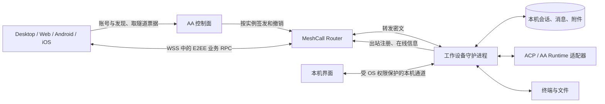

# AAV3 复用 Effi Cloud 守护进程与 MeshCall 的评估（T81）

状态：T81 历史评估，供 T48 方案定稿；D3/D4 已答复，见下方更新。不是开发或上线批准。核对日期：2026-11-10（UTC）。

更新：负责人在 Effi D3 明确「不需要 PY 了，只需要 TS」，D4 选择独立本机信任 A。下文 Python 桥接是当时的候选方案，已被 D3 取代；不能继续作为实施推荐。TS-only 的 Runtime 补齐、配对/授权、数据清理与新增待批取舍以 [T48 完整方案](architecture-proposal.md)为准，历史测试结论不变。后续 M75/M76 明确设备普通/E2EE 双模式及客户端本地启用；下文全局强制加密的历史建议仅适用于开启 E2EE 的设备，现行设计以 T48 为准。

## 结论

技术上可行，适合沿用「工作设备是实例、设备持有业务数据、客户端经 MeshCall 隧道访问」的方向。Effi Cloud 已经实现 ACP 宿主、对话同步、持久终端和端到端加密，值得复用。不能直接把 Cloud 镜像或 agentd 入口换个名字作为本机 Connector：Cloud 信任控制面分发实例公钥、Router 声明调用者，并把整个容器当执行边界；本机需要独立的配对、设备身份、授权撤销和宿主系统保护。

建议复用 TypeScript 对话与同步内核及 MeshCall SDK，把部署、身份、存储、终端和 Runtime 接入留在适配层；AA 原有 Codex、Claude、DSH、Pi 能力先保留，通过能力清单逐项对照。是否采用这个代码组织方式，以及本机 E2EE 的信任边界，交由 T81 的 Effi 决策确认。T48 的接入位置见 [方案草稿](architecture-proposal.md)。

## 核对基线与证据

| 对象 | 固定基线 | 本次核对范围 |
| --- | --- | --- |
| AA | `3b5a15d5`（[提交](https://github.com/anywhere-labs/Agents-Anywhere/commit/3b5a15d5)） | Server 状态归属、Runtime 接口、本机控制与 DSH 契约；2.x 仍依赖 MeshCall 0.3.0 |
| Effi Cloud | `34e8ad2ac38be3baf4c065bde4a0579c7efb7b47`（[提交](https://github.com/anywhere-labs/effi-evo/commit/34e8ad2ac38be3baf4c065bde4a0579c7efb7b47)） | agentd、控制面隧道签发、Web 客户端、同步契约及定向测试；本机原 checkout 为 `b88235e`，已另外取得 main 核对 |
| MeshCall | `93344059ada65735c6cc08fdf3247ea9fb808d6b`（[提交](https://github.com/t4wefan/meshcall/commit/93344059ada65735c6cc08fdf3247ea9fb808d6b)） | Router 隧道、协议和 TS E2EE；Cloud vendor 为 `0.4.0-dev.9334405`，不能用 AA 的 `0.3.0` 版本号推断已含这些能力 |
| Effi 项目记录 | P5 的 M20/M29/M41；P9 的 M28/M36/M37/M48；T89/T110/T133 | 方向已定为先在 Cloud 验证，再复用到 AA；M48 明确不做对话 rev/epoch 或差量同步 |

源码入口（Effi Cloud 仓库访问权限可能与 AA 不同）：

- [Cloud 服务契约与同步规则](https://github.com/anywhere-labs/effi-evo/blob/34e8ad2ac38be3baf4c065bde4a0579c7efb7b47/docs/cloud/CONTRACTS.md)：`cloud.v1.*`、watch、分页、幂等发送、权限应答、重启恢复。
- [Cloud ACP/对话内核](https://github.com/anywhere-labs/effi-evo/tree/34e8ad2ac38be3baf4c065bde4a0579c7efb7b47/cloud/agentd/src/conv)、[同步队列](https://github.com/anywhere-labs/effi-evo/blob/34e8ad2ac38be3baf4c065bde4a0579c7efb7b47/cloud/agentd/src/conv/sync.ts)。
- [agentd 隧道接入](https://github.com/anywhere-labs/effi-evo/blob/34e8ad2ac38be3baf4c065bde4a0579c7efb7b47/cloud/agentd/src/mesh.ts)、[密钥文件](https://github.com/anywhere-labs/effi-evo/blob/34e8ad2ac38be3baf4c065bde4a0579c7efb7b47/cloud/agentd/src/e2e.ts)、[控制面签发](https://github.com/anywhere-labs/effi-evo/blob/34e8ad2ac38be3baf4c065bde4a0579c7efb7b47/cloud/controlplane/internal/app/tunnels.go)、[Web 重连和公钥来源](https://github.com/anywhere-labs/effi-evo/blob/34e8ad2ac38be3baf4c065bde4a0579c7efb7b47/cloud/web/src/mesh/tunnel.tsx)。
- [MeshCall 实际协议](https://github.com/t4wefan/meshcall/blob/93344059ada65735c6cc08fdf3247ea9fb808d6b/docs/protocol.md)、[Router 实现](https://github.com/t4wefan/meshcall/blob/93344059ada65735c6cc08fdf3247ea9fb808d6b/meshcall-router/internal/router/tunnel.go)、[TS 加密实现](https://github.com/t4wefan/meshcall/blob/93344059ada65735c6cc08fdf3247ea9fb808d6b/meshcall-ts/src/e2e.ts)。[#63](https://github.com/t4wefan/meshcall/issues/63) 是早期需求，已随 [#64](https://github.com/t4wefan/meshcall/pull/64)、[#65](https://github.com/t4wefan/meshcall/pull/65) 合入；其中「加密稍后做」不是当前状态。
- AA 当前 [状态归属](../server-architecture.md)、[Runtime 接口](../runtime-protocol/README.md)、[本机生命周期契约](../../contracts/local-machine/2.0/README.md)、[DSH 契约](../../contracts/dsh-bridge/2.0/README.md)。

## 候选架构与数据边界

「直连实例」指业务不经过 AA 的 HTTP 业务层，仍通过 Router 转发；当前 MeshCall 不是 P2P 打洞或免费传输。工作设备和远程端都可出站连 Router，无需公开工作设备端口。WSS/TLS 保护网络链路，内层 E2EE 保护业务载荷经过 Router 时的机密性。

| 数据 | 建议权威位置 | 云侧允许保留的边界 |
| --- | --- | --- |
| 会话、item、权限待办、终端、文件和附件 | 工作设备；Runtime 自有历史由适配器衔接 | 不进 Server Timeline、Redis 写缓冲、附件桶、搜索索引或通知正文 |
| 本机设备私钥、客户端配对和授权记录、模型/OAuth 凭据 | 本机受保护存储；客户端私钥留客户端 | 公钥、注册凭据的摘要/撤销信息和最少路由信息；不上传私钥 |
| 账号、必要设备元数据与运营数据 | AA 控制面 | 明确字段白名单、保留期限及删除入口；设备名也可能敏感 |
| 客户端消息缓存 | 各客户端，受授权与本地清除策略约束 | 不自动变成云端明文备份；失窃设备上已下载的数据不能远程保证抹除 |

本地 UI 在无账号服务、Router 或网络时仍应能操作本机。远程端遇到设备睡眠/离线只能查看已缓存且有权查看的内容，显示离线；恢复连接后重取快照。远程唤醒、云端代跑、云端备份与离线发信箱都不是现成能力，不在本次评估中默认承诺。

## 复用矩阵

| 部件 | Cloud 已有成果 | AAV3 处理与缺口 |
| --- | --- | --- |
| MeshCall 隧道 | targeted 实例、按服务/方法 scope、实例绑定注册、offer 同意、hello 凭据、流与 duplex、revoke | 复用协议/SDK；固定同一已验证构建，增加本机授权检查。Router 重启丢票据，需要重新签发，不能误当业务数据丢失 |
| E2EE | X25519，`Noise_NK_25519_AESGCM_SHA256`；载荷与客户端 metadata 加密；拒绝错钥匙/明文；抗帧重放 | 复用密码实现，不自创算法。补配对 pin、客户端设备证明、授权撤销；见下文信任边界 |
| ACP 宿主 | initialize、每 Agent 共享适配器进程、会话恢复、权限先答先得、排队/插话、子 Agent 和后台任务 | 适合抽出共享 TS 内核；Cloud 当前 Agent 清单只含 Claude/Codex，不能替代 AA 全部 Runtime。进程共享的故障影响多个会话，要验证恢复与隔离 |
| 对话同步 | 每条 item 整体替换、Control 整体推送、watch 首快照、每 watcher 合并队列、流式 333 ms 合帧 | 可沿用 M48，不引入全局版本时钟；补连接切换时丢弃旧流、授权视图隔离、慢设备容量界限和历史分页验证 |
| 本地持久化 | 会话 JSON，临时文件加 rename，发送幂等表、重启将未完成轮次标 disconnected | 复用模型及恢复逻辑，存储实现需评估；当前关键节点落盘且错误仅记日志，未做 fsync，不能承诺逐字/断电不丢或发送成功即耐久 |
| 终端 | tmux 持久会话、node-pty attach、多端回滚、输出合批和背压 | Unix 可复用大部；Windows 需要 ConPTY 等后端及持久化设计，不能以 node-pty 支持 Windows 推断 tmux 可用。tmux 留存也不等于机器重启后保留运行进程 |
| 文件/Git/附件 | 文件浏览读写、上传下载、附件引用和清理 | 复用流式接口和 UI 经验；Cloud 路径权限以容器用户为边界，允许绝对路径和符号链接，本机要按授权目录和操作权限校验真实路径，防穿越及链接竞态 |
| 进程生命周期 | 容器 PID 1、tini、openvscode 监督、cgroup/proc 统计 | 改为用户级守护进程与单实例管理、睡眠恢复、安装升级和日志轮转；对接现有 Desktop/CLI/DSH 管理入口，不能跟随 UI stdin 关闭就退出 |
| 启动与家目录准备 | seed dotfiles、配置 Agent、写信任设置、容器内的宽执行权限 | 不直接复用这些策略；尊重已有用户配置，不自动 chown 家目录、关闭工作区信任或扩大宿主执行权限 |
| 控制面 | 签发、成员管理、隧道追踪、撤销、HTTP/SSH 网关、模型代理 | 复用授权/撤销思路，不搬 Docker 生命周期和团队全员访问假设。HTTP/SSH 网关及模型代理会接触明文，不因 RPC E2EE 自动纳入同一保证 |
| 多端客户端 | Cloud Web 已有生成客户端与快照 reducer | 复用契约、生成工具与恢复逻辑；AA 四端均需接入。Kotlin/Swift 原生接入及加密实现/桥接未验证，不能只迁 Web 后宣称跨端完成 |

### 代码组织的历史备选方案（已由 D3 取代）

| 选项 | 好处 | 代价 |
| --- | --- | --- |
| A：共享 TS 对话/同步内核，Cloud 与 AA 各有启动和安全适配层；AA Python Runtime 先桥接 | 直接利用 Cloud 运行反馈，减少两份同步引擎漂移，保留 AA 特有能力；推荐 | Node 与 Python 并存的安装、IPC、版本和故障管理更复杂，须证明模块边界与资源成本 |
| B：AA 保持 Python 守护进程，只共享 MeshCall、契约与测试样例，按 Cloud 经验实现 | 保留 AA 打包和 Runtime 生态，进程边界较少 | 对话引擎仍要维护两份，行为漂移和重复实现成本较高 |
| C：暂只定协议和适配边界，等待 Cloud 再稳定后决定抽取 | 降低跟随快速变化代码的成本 | AA 落地更晚；必须列清等待哪些验收结果，不能无限等待 |

推荐 A 是评估意见，未确定包名、独立仓库、许可证或版本发布机制。Effi Cloud 的 agentd 当前是 private 包，本次没有在 AA 复制其业务代码；真正共享/对外分发前需确认源码授权、依赖许可和稳定发布方式。M33 只决定 Cloud 技术栈，不代表已经决定 AA 改写为 TS 或控制面改为 Go。

AA 兼容核对必须覆盖 Codex 原生 app-server/IPC、Claude 原生会话、DSH 双向同步与本机发现、Pi/通用 ACP，以及计划审阅、Goal、队列、模型设置、附件和能力展示。Cloud 的 CLI adopt 不等同于 Codex IPC 双向接管。保留或移除任何原有功能都需在 T48 明确，不由 T81 静默缩减范围。

## 本机场景的安全差异

### 已有 E2EE 能保护什么

MeshCall 在客户端与实例之间加密业务 payload、客户端 metadata 和服务返回的错误正文；Router 仍看得到实例、隧道 principal、service/method、时间、大小、流结构及错误码。身份授权仍由 Router 执行，Noise NK 客户端没有静态身份密钥。

Cloud 的设备公钥由 agentd 上报控制面，再连同隧道票据发给 Web。agentd 的 offer hook 只核对 instance id，框架再验证 E2EE key；它没有让本机人批准每台远程设备。Cloud 的设备名称来自请求中的展示字符串，也不能作为密码学设备身份。

所以当前方案在信任控制面身份/公钥分发的前提下可防转发路径读取载荷；若控制面能替换公钥，或 Router 被攻陷后能声明新 principal/票据，现有本机授权语义不足。单独显示「sealed」不能证明接入的是用户配对过的设备。

### 推荐纳入 T48 的补强（D4 已选择独立本机信任）

1. 工作设备本地生成身份和传输密钥，通过本机确认的二维码/指纹等渠道，把实例公钥与客户端设备公钥互相绑定。登录账号仅作发现/找回入口，不能默认为远程执行同意。扫码包含短期随机挑战并防重复使用；远程无人在场首次接入如何批准需另定。
2. 把「配对信任」「每次建立连接」「Runtime 工具审批」分开。配对批准显示设备、用户、授权目录、读/写/执行/终端等权限和期限；日常重连复用仍有效的本地授权，扩权重新同意。
3. 若目标包含防被攻陷的控制面/Router 冒用客户端，则必须在加密会话内验证客户端持有配对私钥，并把证明绑定到实例、当前会话挑战和授权范围；仅校验 Router principal 或在 offer 中加同名白名单不够。这是新增协议设计和安全评审事项，当前 MeshCall NK 不是双向设备认证的完成品。
4. 本机守护进程在每个业务入口校验本地授权，包含订阅及下载；撤销时关闭本地活动会话/流、使挑战和授权失效，再通知控制面/Router revoke。票据 TTL 仅挡新连接，不能靠过期结束旧连接；未联网的撤销传播与吊销账号后的生效边界须明确。
5. 本机强制远程 E2EE，不让控制面布尔开关把它降为明文。密钥损坏或变化时暂停远程访问并重新确认；不能沿用 Cloud 自动换钥匙、客户端自动向 issuer 取新 key 后接受的体验。客户端 pin 记录不能被云侧返回覆盖。
6. 身份私钥采用 OS 密钥存储或等价保护，规定备份/轮换/恢复和 Windows ACL；0600 文件不是跨平台密钥管理。恢复不得让知道账号密码的人自动获得旧本机信任。
7. Web 的信任边界需明确：控制面提供的页面 JS 仍能读用户解密后的内容/使用浏览器密钥；本地配对不能防恶意网页更新。要承诺防运营方主动攻击，需要可信客户端分发与更新机制，不能给浏览器和签名原生客户端无区别承诺。

以上不防设备自身失陷或 Agent 已获准读到的秘密，也不让模型提供方、Tokens 模型代理、HTTP 预览或 SSH 网关自动看不到内容。T48 应按路径分别说明，不能用一个 E2EE 图标覆盖所有通道。

### #266 与数据删除

2.x 的 [#266](https://github.com/anywhere-labs/Agents-Anywhere/issues/266) 涉及上传内容可能含凭据。V3 从架构上收紧为：业务明文不进入 AA 控制面持久化或日志；敏感配置只在本地受保护的凭据存储使用；审计采用字段白名单，不上传提示、工具输入输出、文件绝对路径或认证头。E2EE 防转发泄露，日志/遥测约束防端点重新上传；两者都要做。

仍需处理本机日志、崩溃报告、移动端缓存、通知、预览与模型请求等旁路。对话内容本身也可能出现用户粘贴的凭据，不能承诺端点永不看到它。用户已决定 V3 上线清空旧对话与 Timeline，保留账号、必要设备和运营数据；T48 还需定义附件、Redis、索引、对象存储、日志和备份的清理/到期范围，以及账号注销、本机离线删除待办和各端缓存清除。这里只记录要求，不执行清库或迁移。

## 同步和耐久性的适用条件

沿用单工作设备权威、单条有序 watch 中的「首快照 + 后续按 id 替换」，不用全局 rev/epoch、跨设备 CRDT 或差量 patch。`seq` 只用于 item 位置与分页；快照约 100 条且不切开一轮，单轮过大时页数/内存仍可能很大。

必须保留：先登记 watcher 再取初始快照；重新连接拿新快照；rewind 等重置事件替换整个当前视图并使旧分页缓存失效；客户端丢弃旧连接后到的结果（客户端本地的连接代次仅用于取消旧任务，不是新的同步协议字段）；发送用 `client_msg_id` 做业务幂等，权限按请求 id 先到先得。终端输入和文件改动不能因为自动重连就盲重放。

Cloud 的合并队列只压缩同一 item 的更新：长时间不读、持续出现新 item 时仍会增长；333 ms 合帧也不能保证一个很长文本 item 的总传输字节线性。需要测大单轮、长文本、慢客户端和多 watcher，达到上限就断开慢订阅并要求新快照，不能宣称已有严格内存/带宽上界。

Cloud JSON 模型可用于原型。生产选继续 JSON、增加日志式存储或本机数据库，应由耐久性、历史量和故障注入结果支持；T81 不直接决定 SQLite 等实现。需要先定义发送成功的落盘时点、fsync/断电损失窗口、磁盘满/权限错误如何反馈、备份恢复和幂等记录一起恢复的语义。

## 成本与可用性

会减少 Server 的 Timeline 写入、Redis 协调、附件存储和业务解析，但 Router 仍承载全部远程业务转发。容量估算至少分开计算：隧道数、并发连接数、活跃 watcher 数、每设备输出量、每个接收端的副本量、Router 双向转发和部署区域的实际计费流量；没有流量样本与账单不能给节省百分比。大文件/终端仍须背压、限流和流量配额。

当前单 Router、内存票据方案不是 HA：Router 重启后实例重新注册、客户端重新取隧道并开 watch；已有业务历史留在设备。控制面故障会挡新授权/票据恢复，工作设备故障会挡远程执行。后续要用手机休眠、网络切换、长流和 Router 重启测恢复时间。P9 暂不考虑 HA 的决定不能自动视为 AA 公网产品的 SLA 决定。

## 验证与进入下一阶段的门槛

本次复跑记录在 [验证记录](validation.md)。Cloud 历史记录中，T133 已有人确认 9334405 的运行效果；T110 的单项状态仍等待，不能据此声称所有 Cloud 安全与终端验收均已结束。本次本地测试不能代替 AAV3 真机验证。

以下是 T48 定稿后拆任务的候选验收项，尚未创建研发 Todo：

| 门槛 | 应提供的证据 |
| --- | --- |
| 共享边界 | 用 Cloud 和 AA 两种启动外壳运行同一对话/同步内核；契约固定并检测生成物偏差；记录 Node/Python IPC、资源及版本成本 |
| 本机配对与权限 | 首次拒绝/同意、客户端伪造、盗用账号/票据、Router principal 伪造、实例公钥替换、明文降级、改钥匙、撤销活动流；若仍信任云侧授权必须明确接受该风险 |
| local first 与耐久 | 云不可达仍可本机工作；睡眠恢复、双宿主启动互斥、崩溃/断电、磁盘满、幂等重发；实测声明的丢失窗口 |
| 同步与负载 | 两设备同看/同答、断线重取快照、rewind+分页竞态、慢消费者、大单轮和长文本、背压、订阅内存/字节量 |
| Runtime 与平台 | AA 四种 Runtime 能力逐项对照；Windows/macOS/Linux 安装升级；Desktop/Web/Android/iOS 加密、后台和重连验证；不支持项须人确认 |
| 敏感数据与切换 | 抓取 Router/控制面/遥测确认无业务正文及凭据；清库与账号删除演练含备份期限；发布回滚不得恢复已要求删除的旧对话 |

T81 完成的是可行性和复用边界评估。T48 才负责把负责人选择、安全信任边界、功能覆盖、数据清理和验收条件整合为正式方案；G8 达成后再拆研发任务。本文不授权实施、合并、发布、重启服务或删除数据。
