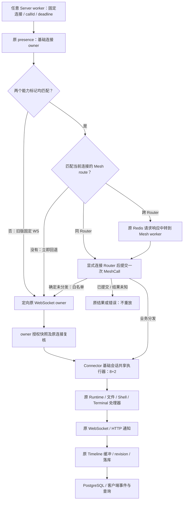
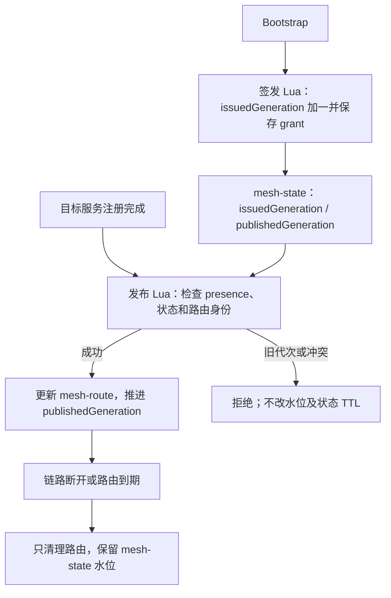
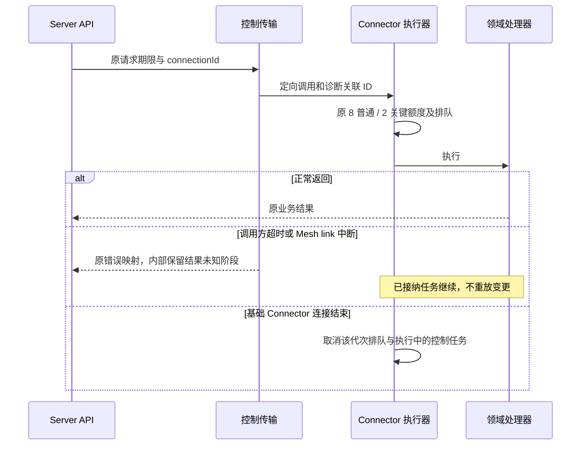
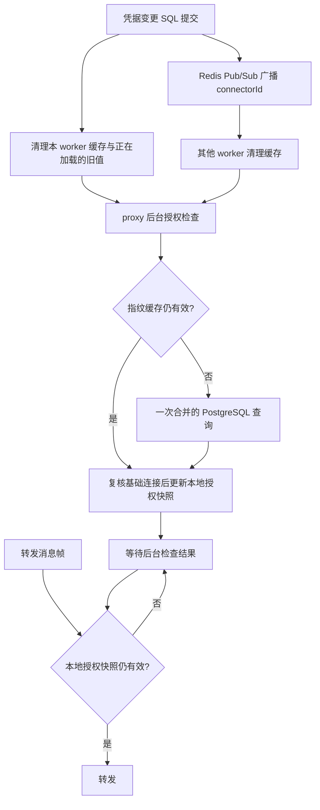
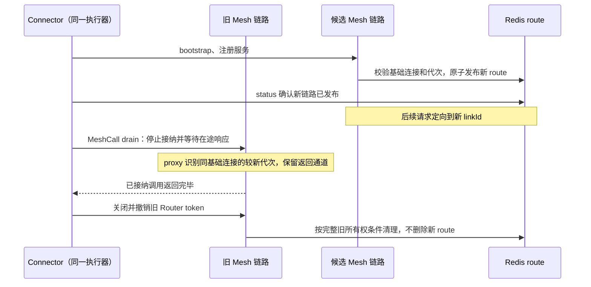

# Server–Connector 控制传输迁移

PR #441 只替换控制请求的传输。用户 API、领域参数/结果、Redis 共享状态和数据库
结构保持不变；本机 Electron Control/Logs、Runtime 原生协议、通知接入、附件及
PTY 数据面不属于本次替换。下面的“完成”指各方法原有的完成语义，不统一解释成
消息送达、回合结束或通知落库。

## 迁移前后



跨实例定位和请求/响应中转仍使用原 Redis 通道：Mesh 定向到 Mesh worker，WS 定向到
基础连接 owner；目标 worker 直接执行指定通道，不再次自动选路。Router 注册和 token
属于本 Router；接收 Mesh WebSocket 的实例签发本地 token 并发布路由，Bootstrap
授权不绑定签发实例，负载均衡无需粘性会话。

基础连接同时声明 `X-AA-Control-Transport: meshcall/1.0` 与
`X-AA-Control-Fallback: websocket/1.0` 才启用新策略。presence 增加可选布尔字段
`controlFallbackCapable`，缺省 false；旧版即使发布 Mesh route 也固定走 WS。
该标记不替代设备认证。先升级 Server，再升级 Connector；策略只在基础连接重建时协商。

每个请求固定连接身份、`controlCallId` 与完整 deadline，没有 route 时立即走 WS，
不轮询等待注册。一个逻辑请求最多一次 Mesh 尝试及一次 WS 尝试。回退沿用剩余预算，
不能换绑新连接；新 route 发布后的后续请求恢复 Mesh，已选 WS 的请求继续完成。

| 原因 | 是否允许一次 WS 回退 |
| --- | --- |
| route 不存在或与已绑定基础连接不匹配 | 是，仍复核基础连接 |
| 目标 Mesh worker 的 Redis 发布返回零订阅者 | 是 |
| 目标 worker 提交 SDK 前发现 route 已替换 | 是 |
| Router 明确拒绝 `no_instances` / `instance_unknown` / `instance_draining` | 是 |
| 显式 `Mesh.connect()` 的连接、握手或阶段超时 | 是，业务调用尚未提交 |
| Redis 查询失败、参数错误、帧超限、凭据失效或基础连接替换 | 否，返回相应错误 |
| 已提交后的超时、断线、响应丢失、中转响应丢失 | 否，结果未知 |
| 领域异常、`ok:false`、`accepted:false` | 否，保留原领域语义 |

`Mesh.connect()` 阶段最多使用 `min(1秒, 剩余预算/2)`，SDK 禁用自动重连和重试。
开始调用 `call_unary` 就按可能分发处理；只接受表中的明确 Router 拒绝，不按异常类名
或 retryable 标记推断安全。编程异常和调用方取消保持原行为。预留的 `workspace.refresh`
不在41个已实现业务方法中，也不提供 WS 回退。

| 状态 | 迁移前 | 迁移后 |
| --- | --- | --- |
| 基础连接 owner、在线租约 | Redis presence | 保留 |
| 跨 worker/实例定位与中转 | Redis Pub/Sub | 同 Router 直达，跨 Router 保留中转 |
| Timeline 待落库条目、实时序号 | Redis / 单进程内存 | 保留 |
| 锁、广播、终端与传输协调 | 原协调模块 | 保留 |
| Mesh link 位置 | 无 | 60 秒租约，每 20 秒续期 |
| 代理授权 | 无 | `mesh-grant`，900 秒 |
| 签发代次与发布水位 | 无 | 同一个 `connector:mesh-state` Hash，900 秒保护期 |
| 业务操作结果账本 | 无 | 不新增 |

## 连接代次的 Redis 存储

下面省略 `AGENT_SERVER_REDIS_PREFIX` 指定的统一前缀：

| key | 类型 | 职责 |
| --- | --- | --- |
| `connector:presence:{connectorId}` | String / JSON | 基础连接 owner 与连接身份，沿用原租约 |
| `connector:mesh-route:{connectorId}` | String / JSON | 当前 Mesh 链路所在 Router/worker，60 秒租约、20 秒续期 |
| `mesh-grant:{tokenHash}` | String / JSON | 900 秒代理授权，使用 token 哈希定位 |
| `connector:mesh-state:{connectorId}:{connectionId}` | Hash | `issuedGeneration`、`publishedGeneration` 两个整数 |

`issuedGeneration` 表示签发时已分配的最大代次，`publishedGeneration` 表示成功发布的
最大代次，满足 `0 ≤ publishedGeneration ≤ issuedGeneration`。签发使用一次 Lua 操作
递增前者、保存 grant，并设置共同的 Redis 到期基准；允许响应丢失造成编号空洞。
成功发布路由时原子推进后者。只要代次不小于发布水位且不大于已签发水位，就继续按
原 presence 与路由所有权规则检查；不会因为签发了更新授权就立即拒绝较早的有效授权。



Hash 整体使用 900 秒保护期，两个字段不单独过期。签发时覆盖 grant 的存续时间；
成功发布时延长至至少当前时间后 900 秒，已有更晚到期时间不缩短。读取、路由续租、
删除和失败发布均不续期或删除 Hash。发布时状态缺失或损坏会失败，不能重建零值。
因此，2 号已发布后即使路由被清除，迟到的 1 号仍不能重新占位。

无 Redis 模式以同一临界区维护相同的连接状态、grant 和到期时间。代次限制为
Lua 可精确表示的安全整数范围，越界或损坏不归零，避免精度丢失造成错误覆盖。

本修订只支持新存储格式，不读写旧 `mesh-generation`、`mesh-published` key。
切换时先退出旧格式 Server，再运行统一的新构建；多实例和多 worker 能力保留。
旧 key 自然过期，不扫描删除共享数据，也不增加过渡双写。Connector 协议与逐帧授权
校验逻辑保持原样，连接恢复后沿现有流程重新注册。

## 方法与完成条件对照

逐方法参数、结果、并发、错误和拓扑核对见 [迁移对照清单](connector-control-parity.md)。

以下 41 个方法保持原始业务字典参数与结果，不由传输层补默认值或解释 `ok`。
领域异常 code/message 保留；无显式 code 的 Python 异常沿用类名。`ok:false` 的
业务结果原样返回，由现有业务层处理。

| 服务 | 方法 | 原有完成条件 |
| --- | --- | --- |
| RuntimeControl | `runtime.discover`、`runtime.configSchema`、`runtime.config`、`runtime.validateConfig`、`runtime.capabilities`、`runtime.commands`、`runtime.modelCatalog`、`runtime.permissionCatalog` | 当前查询/校验处理器返回 |
| RuntimeControl | `runtime.start`、`runtime.stop` | Runtime 生命周期处理器返回；后续状态仍由现有上报维护 |
| Sessions | `session.discover`、`session.state`、`session.capabilities`、`session.notices`、`session.commands` | 当前查询处理器返回；查询所产生的状态通知继续走原接入 |
| Sessions | `session.create`、`session.send_message`、`session.steer` | Runtime 处理结果，保留消息接收与业务拒绝字段；不代表整个回合结束 |
| Sessions | `session.sync` | 原后台同步任务已接纳；不代表历史全部落库 |
| Sessions | `session.selections.update`、`session.command.execute`、`session.interrupt`、`interaction.respond` | 原 Runtime 操作结果；中断请求不等于回合已结束，审批结果不等于后续工作完成 |
| Files | `fs.prepareDownload`、`fs.uploadPreparedDownload`、`fs.writeFile`、`fs.readDir`、`fs.readText` | 原文件处理器结果；保存已执行写入并返回 hash，后台上传接纳与传输完成分开 |
| Shell | `shell.exec`、`shell.task.start`、`shell.task.cancel` | 原同步执行或任务控制结果，异步完成沿用原事件 |
| Terminals | `terminal.create`、`terminal.write`、`terminal.resize`、`terminal.close`、`terminal.rename`、`terminal.setPersistent`、`terminal.list`、`terminal.release`、`terminal.snapshot`、`terminal.relay.connect` | 保留 PTY 操作、relay 接纳及 broker 等待各自的完成条件 |

`workspace.refresh` 是 #413 的预留映射，没有业务实现或调用入口时不能计为支持。
生成器 `--check` 同时核对服务方法、Server 映射和 dispatcher 的覆盖关系。

## 超时、连接与任务



执行器跨 Router 重连、token 更新复用。只有基础连接结束才按旧 WebSocket 的边界
取消任务。明确未分发才允许按上述白名单回退一次，SDK 不自动重试变更。

### 授权缓存与失效通知

设备凭据指纹缓存在每个 worker 内存中，单个设备最多保留30秒，不因读取续期；
同一设备并发 cache miss 合并为一次 SQL 查询。缓存最多4096项，也缓存已撤销或
已删除的空指纹；数据库查询失败不能作为有效授权缓存。Mesh 与基础 WS 授权复用此缓存，
不替代设备 access token 登录验证，也不保存操作结果。

凭据创建、轮换、开始删除和完成删除的数据库事务成功后，Repository 调用应用绑定
的失效回调，清理本 worker 并通过已有 Redis namespace 下的 Pub/Sub 通道通知
所有 worker。安装注册重试触发的凭据轮换也走同一入口。通知只包含 connectorId，
不包含 token 或指纹，不新增 Redis 存储 key；无 Redis 模式直接清理本地缓存。
查询期间收到失效通知时，旧结果不能重新填回缓存。

每条 proxy 有独立的后台授权检查，约每秒复核基础连接身份和缓存指纹；旧、新两条
Mesh 链路在同一 worker 上共享指纹缓存。incoming/outgoing 转发帧只检查本地授权
快照及 grant 到期时间，不直接查询 PostgreSQL 或 Redis。快照过期时等待后台检查
完成再放行，避免慢检查期间继续使用过期快照。`/connector/mesh/status` 同样复用
指纹缓存，仍读取原有 grant、route 和基础连接租约。

基础 WS 的 owner 从同一次 token 认证读取的凭据值生成摘要，仅保存于该连接内存，
不写入 Redis、日志和元数据。后台约每秒检查缓存指纹及原连接归属，单次最多5秒；
业务提交前使用有效快照，快照过期时等待检查，并在收到响应后再次复核。凭据变化、
撤销或授权依赖失败时按 connectionId 关闭原基础连接，取消两路共享任务；旧回包不能
解析新连接的 pending 请求。grant 到期不等同于设备凭据撤销，仍有效的基础通道可以使用。
单次授权检查的5秒期限覆盖缓存读取及基础连接查询，依赖阻塞时结束 proxy，
不让转发帧永久等待后台授权结果。



失效通知正常送达时，proxy 在下一次后台检查发现换密钥或撤销并关闭，status 在
缓存失效后重新验证。Pub/Sub 连接失败或监听任务退出时停止使用缓存授权，proxy
关闭且 readiness 报错；重新订阅时清空缓存。若单条通知漏掉，最多在原缓存30秒
到期后重新读取 SQL；原有撤销/删除 API 的基础连接断开和 relay 清理仍继续执行。
失效通知发送失败有独立警告，不让它跳过数据库提交后的既有断开流程。

授权探针检查缓存并发、取消、加载与失效竞态、容量、订阅恢复和跨实例通知；真实
Router 样本中分别发出80次文件/终端调用，并等待6秒覆盖空闲检查及 status 轮询，
核对指纹查询不随消息帧增加。`--with-database` 额外使用一次性测试库统计真实 SQL
查询次数，并检查 Repository 提交后的失效回调。从 `server/` 执行：

```bash
PYTHONPATH=.:../connector uv run --no-sync python -m tools.probe_connector_mesh_auth --redis-url redis://127.0.0.1:6379/15 --output ../.local-dev/mesh-auth
# 已设置 AGENT_SERVER_TEST_DB_URL，且数据库名称包含 test 时，可加 --with-database。
```

### 授权轮换与旧链路排空

Connector 按 bootstrap 返回的授权有效期，在有效期一半时建立候选链路；默认900秒
授权约在450秒开始轮换。计时从发起 bootstrap 前的本机单调时钟开始，扣除认证和
注册所耗时间。候选链路失败时保留原链路并重试，不先拆除健康连接。
状态查询的临时网络故障、5xx 或限流不等同于发布失败：候选链路可能已经承接请求，
因此在授权预算充足时继续保留并确认；收到401/403或授权实际到期时按授权失效处理，
临期则由独立排空任务停止新接纳。SDK 已确认
登记且物理连接仍存活的候选继续等待发布，不凭短期未就绪响应主动拆链；连接建立
本身最多30秒，物理连接关闭时按真实传输故障收尾。当前链路的状态查询暂时
不可用时同样保留链路，撤销和到期仍由 Server proxy 及 Router 执行。



两条链路共享原来的普通8、关键2额度及任务生命周期。旧 proxy 不再续租或重新发布
旧 route。排空使用 Router 的 drain 确认和 SDK 在途调用计数，等待结果发送完成，
不以领域处理器刚返回作为关链依据。旧 proxy
继续检查凭据撤销、基础连接身份和原 grant 到期时间。排空预算最多为
旧授权剩余时间并预留 Router 整秒 token 的安全余量；不延长900秒授权，不放宽权限。
正常轮换预留约450秒。每条已接入链路还独立设置到期排空任务：最迟在授权到期前
320秒停止接纳新工作，覆盖最长310秒 Shell 控制等待及安全余量。即使候选 bootstrap
持续失败或发布确认挂起，排空任务也会运行。Router 明确拒绝新请求后，Server 按
原白名单回退 WS；旧请求仍在原链路完成，不事后重放。排空任务不依赖新 route 发布。
基础连接结束时先取消
该连接的执行器任务，再收尾链路；不会为了等待排空而继续执行已失去基础连接的任务。
请求读到旧路由后才遇上排空或关闭时，仅对 Router 明确在分发前返回的
`instance_draining`、`instance_unknown`、`no_instances` 按白名单回退一次WS；结果未知不重放。

轮换探针在独立进程注入短授权，使用真实 Router、HTTP/WebSocket 和 Redis，领域
处理器受控；其中一条调用等待真实 Python 子进程完成并核对 stdout。探针覆盖候选
认证失败、发布确认延迟和临时503、旧路由与排空/关闭的竞态、跨轮换在途响应、
共享8+2额度、旧 token 到期、连续
轮换、重叠链路的凭据撤销，以及基础连接结束时先取消业务、再等待慢清理的顺序。
从 `server/` 执行（Redis 使用专用测试实例；不新增生产 TTL 配置项）：

```bash
PYTHONPATH=.:../connector uv run --no-sync python -m tools.probe_connector_mesh_renewal --redis-url redis://127.0.0.1:6379/15 --output ../.local-dev/mesh-renewal
PYTHONPATH=.:../connector uv run --no-sync python -m tools.probe_connector_mesh_renewal --output ../.local-dev/mesh-renewal-local
```

响应与通知异步处理在旧传输中也存在；不新增全局落库等待，也不把传输成功当作业务
成功。既有业务状态机缺陷应与传输回归分别定位。

本地集中日志中的调用关联 ID 只用于诊断，不是幂等键。日志可以降级，不保存完整
消息/文件/终端输入，也不从日志重放业务。沿用原日志保留与脱敏策略。

### 调度链路日志

控制链路统一使用 `connector.control` 前缀，后跟一段 JSON。`callId` 是 Server 生成并
经现有 metadata 传递的 `controlCallId`；`routeRequestId` 标识一次 Redis 往返，
`meshCallId` 是 SDK 调用 ID。结合 `connectorId`、`connectionId`、`linkId`、
`routerId`、源/目标 `workerId` 与 `processId`，可以在 Server 进程日志和 Connector
现有日志读取渠道之间关联同一次调用。没有新增日志数据库或 Redis key。

| 事件 | 含义 |
| --- | --- |
| `request.started / request.finished` | Server 调用开始及唯一终态；正常返回、失败、超时、取消均收尾 |
| `redis.request.sent / redis.target.received` | Redis 发送与目标接收，DEBUG 记录；使用相同 callId 和 routeRequestId |
| `redis.request.finished / redis.target.finished` | 来源等待和目标处理/回包分别结束；含阶段、耗时、订阅数与错误码 |
| `redis.response.late` | 来源已停止等待后回包到达，只记录诊断，不重新执行 |
| `execution.queued / execution.started / execution.finished` | Connector 排队、开始和结束；含普通/关键通道、队列深度、活动数、queueWaitMs 和 runMs |
| `caller.detached` | Mesh 服务已停止等待；领域任务仍由原生命周期持有，最终 execution.finished 继续记录 |
| `grant.issued / grant.issue_failed` | 授权签发结果、连接身份和代次，不记录凭据 |
| `route.published / route.rejected / route.lease_lost / route.removed` | 路由生命周期；拒绝原因区分旧代次、同代次 owner 冲突、状态缺失/损坏和连接替换 |
| `proxy.task_failed / proxy.closed` | 明确记录 incoming、outgoing 或 watchdog 的异常及链路关闭原因 |
| `router.ready / router.restarted`、`link.retry / link.registered` | Router 与 Connector 链路恢复阶段，携带对应身份 |
| `notification.handled / timeline.persisted` | 接入处理完成与实际数据库写入完成分开记录，按已有 sessionId、itemId、revision、updatedSeq 关联 |

`outcome=returned` 只表示处理器返回；`businessOutcome=rejected` 单独标记 `ok:false`
或 `accepted:false`，不修改原结果。`deliveryState` 区分确定未分发、结果未知、收到
响应、响应发布和 Connector 已开始执行。`callerDetached=true` 不代表领域任务已取消。
通知可能早于或晚于 RPC 返回；后台通知保持独立来源，不强行归属于某次 RPC。

正常调用的 Server 开始/结束、Connector 开始/结束保留 INFO；即时入队和中转细节为
DEBUG，实际发生排队时入队提升为 INFO。通知/落库仅慢项使用 INFO，正常高频事件
使用 DEBUG。正常续租、授权逐帧校验和轮询等待不逐条输出 INFO。

Connector 诊断记录先进入最多 1024 条、4 MiB 的线程安全队列，由独立 daemon
线程按最多 64 条批量写入原日志存储；业务事件循环不等待文件锁或写盘。队列满时
丢弃新增诊断记录，保留已有顺序；超过字节预算的记录同样丢弃。sink 统计累计的
`enqueued/written/dropped/failed`，写入恢复后通过 `Diagnostic log records lost`
告警及 `details.logSink` 报告丢弃和失败计数。退出刷新最多等待 2 秒，剩余排队记录
计入丢弃；无法中止的在途同步写入留在 daemon，完成后再关闭日志存储，退出不再
等待该线程。异步 notifier 到期会取消。保留原日志保留和脱敏策略；Bridge 的
`Logs.write` 仍直接等待原持久化确认，不经过诊断队列。

Connector 持久化记录的 `details.control` 保存这些结构化字段；控制台 message 中也
包含同一 JSON。字段使用白名单和长度限制，错误记录类型、错误码与文件名/函数/行号
组成的栈位置，不记录异常消息、局部变量、token、指纹、完整参数/结果或业务正文。
日志 sink 异常不能覆盖业务结果。进程强制退出或 sink 故障可能使终态日志缺失，
需结合 worker/Router 退出及对端日志判断，不能据此认定请求未执行。排查时例如：

```text
request.finished   callId=ctl_example outcome=timeout deliveryState=outcome_unknown
execution.finished callId=ctl_example sessionId=s_example outcome=returned callerDetached=true
timeline.persisted sessionId=s_example phase=items_committed updatedSeq=42
```

这表示来源停止等待后，Connector 仍返回了结果，相关 Timeline 随后完成持久化；
不能因第一条超时日志重放变更。实际顺序按各事件记录和现有 revision/序号核对。
日志行为的定向复核可运行：

```bash
PYTHONPATH=.:../connector uv run --no-sync python -m tools.probe_connector_control_logs
PYTHONPATH=.:../connector uv run --no-sync python -m tools.probe_connector_request_limits
```

该探针在进程内使用受控处理器，覆盖超时、业务拒绝、迟到失败、排队/取消、代理
子任务异常、真实临时日志文件读写及日志 sink 故障；真实 Router/Redis 传输继续由
下述原有探针单独核对。CI 另外读取跨实例探针的 Server 与 Connector 日志，检查
全部已实现方法的完整关联链、Redis 往返 ID、迟到返回、业务拒绝和 8+2 额度。

业务请求在选择 Mesh/旧 WebSocket 之前建立一个单调时钟 deadline，覆盖能力和
presence 查询、连接身份校验、路由读取、注册等待、发送锁、Redis 发布和响应等待；
内部适配层复用剩余预算，不重新计时。跨 worker 消息携带内部 `deadlineAt`，目标端
扣除中转时间，且不超过信封中的剩余时长；跨机器部署应保持系统时钟同步。超时只结束
Server 的等待：尚未分发时标记 `not_dispatched`，开始向传输提交后标记
`outcome_unknown`，不自动重试变更；已接纳的 Connector 任务仍由基础连接生命周期
持有。定向探针覆盖卡住的查询/发布/发送、过期中转、调用方取消、已接纳任务收尾，
以及真实日志文件锁、批量顺序、队列溢出、写入故障恢复和限时退出。

帧预算沿用 MeshCall SDK 默认的 64 MiB，Router、SDK、WebSocket 代理保持一致。
新回退基础 WS 接收预算也为64 MiB，Server 按各自封装的实际编码后字节数检查。
旧版下行控制帧预算保留1 MiB，超限在发送前返回资源限制错误，大请求需升级 Connector。
通知限制不扩大。Server 在 Redis 中转前按实际 Mesh 编码检查预算，防止一个必定被 SDK 拒绝的请求先
挤断 Redis 订阅通道。该预算不改变领域原有的文件读取、Shell 截断或 PTY scrollback
范围；附件仍走原数据面。超限请求不分发，后续正常调用仍可使用同一连接。

### Redis 中转的大帧与恢复

64 MiB是Router/SDK/WS的控制帧预算。默认Redis Pub/Sub还有32 MiB硬输出缓冲，
因此中转不会把一个大信封一次发布到频道。超过256 KiB的请求和响应使用内部
`relay.open / relay.pull / relay.data / relay.abort` 帧；接收worker全局每次只拉取
一个256 KiB原始片段，编码后的单片约342 KiB。一个大信封完整校验、重组后只提交
一次，重复pull不能倒退发送序号。小消息和审批等控制请求不等待大信封队列。
控制中转的 `PUBLISH` 使用独占池连接并关闭自动重试，释放前恢复原连接策略，避免
Redis 命令响应丢失后重新发布变更。已经开始分片后即使订阅者消失，也按结果未知
处理，不能据此回退并重复执行业务。

该协议仅使用原worker频道和进程内临时组帧状态，没有新增Redis key、数据库表或
操作结果存储。原逻辑请求的deadline覆盖排队及分片；单片停滞最多5秒便中止组帧，
不会永久阻塞后续大帧。部分帧丢失、取消或订阅断开不触发业务重传。失去订阅时
终止等待并清理部分帧，重新订阅后接收新请求；已提交工作的结果仍按未知处理。
Server workers使用同一构建，完整业务信封和客户端接口保持不变。

WS发送锁内再次校验原连接和有效授权快照；ready发布前已经绑定授权入口，避免
初次快照完成前出现绕过检查的窗口。基础连接清理使用独立任务，重复stop取消会
等待执行器、Mesh、reader、heartbeat和RPC清理完成，再传播原取消信号。
执行器的停止接纳状态独立于 generation；关闭开始后新服务即使绑定到 `closed`
哨兵也无法执行。Bootstrap 和 SDK 注册完成后都重新核对进入 Bootstrap 前固定的
会话代次，旧候选不能归入新基础连接。执行器关闭任务被调用方取消后继续持有并
回收已接纳任务，关闭完成前不允许重新打开会话。

远端服务使用 MeshCall 公开的 `RpcServer` 与 Router Driver 接口。每条链路只创建
一个底层 stop 任务；正常轮换等待已有 SDK 调用排空，基础连接结束则唤醒 Driver
结束排空等待，再正常执行连接关闭和 worker 停止。外层取消不传入底层 stop，
无需等待剩余320秒排空预算；清理真正完成后才移除 link 并输出 `link.drained`。
SDK 启动也由链路持有独立任务，外部重复取消只向 SDK 传递一次取消；Driver.start
在失败和取消路径关闭部分注册，再让 SDK 释放 binding 与 worker。Router 已接受
注册但 SDK 尚未完成启动的窗口，同样保证关闭后不留下没有处理器的 Router 实例。

授权缓存把最多4096条已完成结果与在途加载分开保存，LRU 淘汰不等同于凭据变更，
超过缓存容量的并发读取不会互相废弃已完成结果、循环重查数据库。凭据失效和订阅
重连仍会标记全部相关在途结果；即使结果被 LRU 淘汰，只要调用方尚未取走，撤销
检查仍有效。最后一个等待方离开后释放加载记录；关闭缓存后不重新启动授权加载。

首次授权订阅和关闭共用生命周期锁；关闭开始后，等待中的启动不能再发布监听任务。
订阅清理期间的重复取消必须等待实际关闭完成。本地 Router 的启动线程也保留明确
归属，取消启动或同时关闭时先等待线程返回，再停止 Router 并恢复原进程环境，
避免只取消 `to_thread` 的等待方却留下运行中的 Router。

代理的 grant 查询、授权和 Router 连接共用10秒握手预算。代理、授权订阅和 Server
控制路由的收尾任务由各自 owner 持有，重复取消不跳过清理；收尾中的路由删除、
订阅关闭、lease 释放与 socket 关闭各最多等待5秒。Redis 停滞、关闭报错会留下
结构化失败日志并继续其他资源的清理，Router 侧 token 撤销保留原2秒预算。
Server 关闭 Mesh 后不能重新创建控制客户端；凭据清理失败仍会关闭 Mesh 和 RPC
资源。授权订阅关闭失败不会阻止重新订阅，恢复前拒绝使用缓存授权。

## 健康检查与上线

初次启动仍要求 Router 程序存在且成功启动。运行期 Router 故障由
`GET /api/v2/health/mesh` 严格返回503；共同依赖健康时 `/health/ready`
返回200、`status=ready`，并以可选 `checks.mesh=error` 报告，让负载均衡继续
分配可由 WS 完成的请求。数据库、Redis、路由订阅、Timeline 或授权订阅失败仍使
整体就绪返回503。忽略 Router 故障不会忽略独立授权订阅的健康状态。

上线先统一升级 Server，再升级 Connector。未声明回退标记的基础连接固定 WS；
新 Connector 重建基础连接后才声明双通道共享调度能力。新策略无新增 Redis key
类型、数据库表或持久操作收据，基础连接及 Mesh 路由仍独立续租与条件清理。

## 复核方式

普通 `pytest` 已覆盖控制传输的单元行为，由现有 Connector、Server CI job 自动
收集，不依赖 Mesh 探针 job：

| 测试文件 | 核对内容 |
| --- | --- |
| `connector/tests/test_remote_control_executor.py` | 普通8/关键2、排队与取消、基础连接结束、重叠服务注册共享额度、调用方取消后已接纳任务继续、领域错误和业务拒绝 |
| `server/tests/test_connector_mesh_control.py` | 错误来源、明确未分发的单次 Mesh 尝试、结果未知不重放、旧连接响应、剩余预算与关联 ID、各阶段阻塞的 deadline |
| `connector/tests/test_control_transport_fallback.py` | 两条入口共享并发、基础连接取消与独立引导握手 |
| `server/tests/test_connector_control_fallback.py` | 能力兼容、回退白名单、未知结果不重放、连接绑定、WS 帧预算与跨 worker 路由 |
| `server/tests/test_connector_rpc_frames.py` | 编码后分片、背压、小消息绕行、片段丢失/损坏、重复帧与订阅状态清理 |
| `server/tests/test_connector_session_auth.py` | 基础连接授权快照、凭据变化、撤销及连接归属 |
| `server/tests/test_connector_request_deadline.py` | 嵌套预算、ContextVar 隔离与恢复、外部取消、领域超时、中转耗时扣减 |
| `server/tests/test_connector_mesh_routes.py` | 同一套状态机断言分别运行内存实现和 fakeredis 的实际 Lua，核对代次、所有权、清理、状态损坏及过期边界 |
| `server/tests/test_connector_mesh_auth.py` | 指纹缓存并发、失效与读取竞态、取消、错误与容量、跨 worker 通知、订阅失败时拒绝缓存授权 |
| `server/tests/test_connector_mesh_proxy.py` | 过期授权拒绝、断线清理与子任务回收、新路由发布后旧响应继续、空闲连接撤销与身份替换 |
| `server/tests/test_infrastructure_health.py` | Router 独立故障时继续就绪、共同授权订阅故障阻断就绪 |

按仓库开发流程配置一次性测试数据库后，可直接运行 `cd connector && uv run pytest -q`
和 `cd server && uv run pytest -q`。Server 的统一 fixture 要求数据库名称包含 `test`，
运行时会清空该库；这些新增单元用例本身不依赖真实 Redis、Router 或 Runtime。
Lua 用例使用已有的 `fakeredis[lua]` 开发依赖，不新增测试框架依赖。

真实传输探针继续核对跨进程、跨 Router、Redis 故障和数据边界。从 `server/` 运行：

使用一次性 Redis：

```bash
PYTHONPATH=.:../connector uv run python tools/probe_connector_mesh.py \
  --redis-url redis://127.0.0.1:6379/15
PYTHONPATH=.:../connector uv run python tools/probe_connector_mesh.py \
  --single-process --output ../.local-dev/mesh-parity-local
uv run python -m tools.probe_connector_mesh_state \
  --redis-url redis://127.0.0.1:6379/15
```

探针会创建临时 API 进程、Router 和独立 Redis namespace，结束时关闭自己的进程并
只删除自己的 key。`--redis-container` 只能指定专用 QA 容器，该选项会暂停再恢复它；
不要指向共享或生产 Redis 容器。单进程模式不需要 Redis。

探针使用真实 Redis、Router、WebSocket、HTTP 和多 worker，认证及领域处理器为
合成实现。它比较旧 WebSocket 最后一跳与新 Mesh 适配，不代替真实 Runtime 和页面
验收。报告输出到忽略的 QA 目录，包含映射对照、并发、异常、大帧、断线取消及恢复。
真实验收还需分别核对 Runtime 接收/执行、独立文件 hash、PTY/relay，以及 Electron
本机控制和日志订阅。

代次探针同时检查 Redis 和内存模式，覆盖并发签发、乱序发布、路由清理后旧授权迟到、
同代次 owner 冲突、状态损坏、TTL、连接替换及 Redis 异常。短 TTL 仅在探针内注入，
不增加生产配置项。

回退探针在 bootstrap 503、404 和代理拒绝 Mesh WS 升级时逐项调用41个领域方法，
统计处理器执行次数。它用真实文件、独立 hash、Shell 子进程、PTY 和 relay 验证
本地领域行为，并核对两路混合8+2额度、握手不占业务额度、新路由恢复和旧版固定 WS。
Runtime 方法在此探针中使用受控处理器，与真实模型会话验收分开报告：

```bash
PYTHONPATH=.:../connector uv run --no-sync python -m tools.probe_connector_fallback \
  --redis-url redis://127.0.0.1:6379/15 --output ../.local-dev/mesh-fallback
PYTHONPATH=.:../connector uv run --no-sync python -m tools.probe_connector_fallback \
  --output ../.local-dev/mesh-fallback-local
```

修复回归探针（从 `server/` 运行）：

```bash
PYTHONPATH=.:../connector uv run --no-sync python -m tools.probe_connector_rpc_frames \
  --redis-url redis://127.0.0.1:6379/15 --output ../.local-dev/mesh-frames
PYTHONPATH=.:../connector uv run --no-sync python -m tools.probe_connector_mesh_expiry \
  --output ../.local-dev/mesh-expiry
PYTHONPATH=.:../connector uv run --no-sync python -m tools.probe_connector_control_shutdown \
  --output ../.local-dev/mesh-shutdown
PYTHONPATH=.:../connector uv run --no-sync python -m tools.probe_connector_control_edges \
  --output ../.local-dev/mesh-edges
```

关闭探针核对关闭后的新任务拒绝、迟到 Bootstrap、取消关闭等待和真实 SDK drain
中的重复停止；断言连接和 worker 已退出，并在此后才输出完成日志。
统一边界探针覆盖注册前后取消、启动清理中的重复取消、注册失败、超容量并发读取、
撤销与结果消费交错、订阅启动/关闭竞态、真实本地 Router 启动取消、订阅失败恢复、
代理握手/收尾停滞以及 Server 关闭失败隔离。
另外使用10组固定种子的调度交错组合 LRU、单设备/全局失效与调用方取消，最终检查
没有遗留的后台任务。该探针与关闭探针都纳入控制传输 CI job。

大帧探针独立核对63 MiB实际文件写入/hash、编码后约36 MiB响应、片段丢失及路由
订阅恢复。临期探针只在探针内缩短授权和对应排空窗口，使用真实Router/HTTP/WS
确认候选持续503时的旧调用排空，以及超过旧grant到期点才完成的WS调用。
