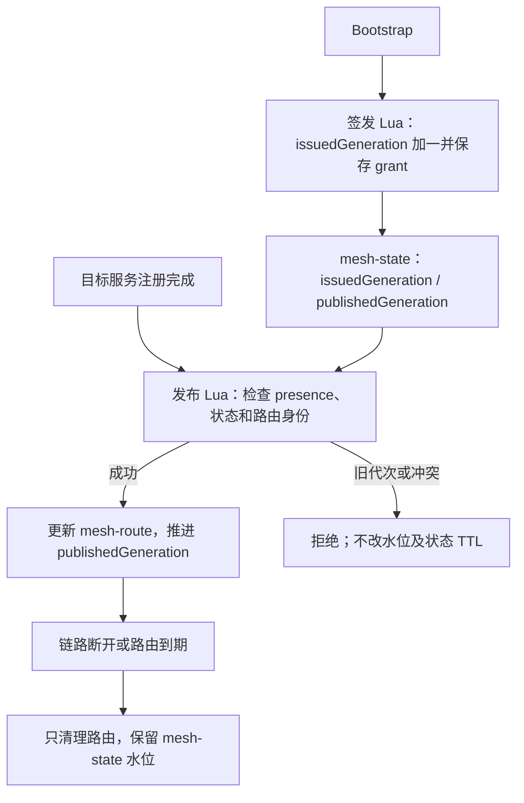
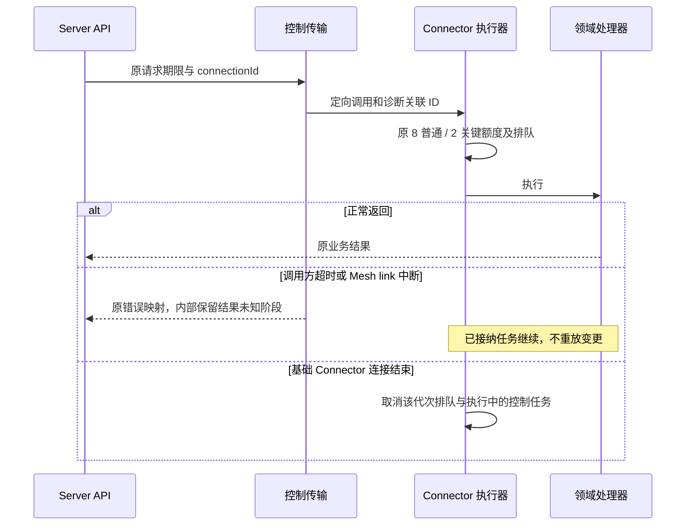

# Server–Connector 控制传输迁移

PR #441 只替换控制请求的传输。用户 API、领域参数/结果、Redis 共享状态和数据库
结构保持不变；本机 Electron Control/Logs、Runtime 原生协议、通知接入、附件及
PTY 数据面不属于本次替换。下面的“完成”指各方法原有的完成语义，不统一解释成
消息送达、回合结束或通知落库。

## 迁移前后

```mermaid
flowchart LR
  API[任意 Server worker] --> Presence[Redis 基础连接租约]
  Presence --> Route[当前 Mesh link 路由]
  Route --> Local[同 Router 直接调用]
  Route --> Redis[跨 Router Redis 请求响应中转]
  Redis --> Target[目标 worker]
  Target --> Local
  Local --> Mesh[MeshCall Router]
  Mesh --> Connector[Connector 原有 dispatcher]
  Connector --> Runtime[Runtime / 文件 / Shell / Terminal]
  Runtime --> Notify[原 WebSocket / HTTP 通知接入]
  Notify --> Buffer[原 Timeline 缓冲与序号]
  Buffer --> DB[PostgreSQL]
```



旧传输的最后一跳为手写 WebSocket 请求/响应；新传输为定向 MeshCall。跨实例定位
和请求/响应中转仍使用现有 Redis 通道。Router 内存中的注册和 token 不会因为各
Server 共享 Redis 而自动共享，因此接收 Mesh WebSocket 的实例需要签发本机 token，
并发布自己的路由。Bootstrap 的代理授权不绑定签发实例。

基础 WebSocket 使用 `X-AA-Control-Transport: meshcall/1.0` 声明能力，随 presence
租约传递给其他 worker。旧 Connector 没有该声明时沿用原 RPC；新连接明确采用
MeshCall 后，不因超时、缺少注册或响应丢失而退回旧传输。协商发生在分发之前，
不使用“先尝试 Mesh、出错再试旧 RPC”的方式处理变更。

| 状态 | 迁移前 | 迁移后 |
| --- | --- | --- |
| 基础连接 owner、在线租约 | Redis presence | 保留 |
| 跨 worker/实例定位与中转 | Redis Pub/Sub | 同 Router 直达，跨 Router 保留中转 |
| Timeline 待落库条目、实时序号 | Redis / 单进程内存 | 保留 |
| 锁、广播、终端与传输协调 | 原协调模块 | 保留 |
| Mesh link 位置 | 无 | 60 秒租约，每 20 秒续期 |
| 代理授权 | 无 | `mesh-grant`，900 秒 |
| 签发代次与发布水位 | 无 | 同一个 `connector:mesh-state` Hash，900 秒保护期 |
| 业务操作结果账本 | 无 | 不新增 |

## 连接代次的 Redis 存储

下面省略 `AGENT_SERVER_REDIS_PREFIX` 指定的统一前缀：

| key | 类型 | 职责 |
| --- | --- | --- |
| `connector:presence:{connectorId}` | String / JSON | 基础连接 owner 与连接身份，沿用原租约 |
| `connector:mesh-route:{connectorId}` | String / JSON | 当前 Mesh 链路所在 Router/worker，60 秒租约、20 秒续期 |
| `mesh-grant:{tokenHash}` | String / JSON | 900 秒代理授权，使用 token 哈希定位 |
| `connector:mesh-state:{connectorId}:{connectionId}` | Hash | `issuedGeneration`、`publishedGeneration` 两个整数 |

`issuedGeneration` 表示签发时已分配的最大代次，`publishedGeneration` 表示成功发布的
最大代次，满足 `0 ≤ publishedGeneration ≤ issuedGeneration`。签发使用一次 Lua 操作
递增前者、保存 grant，并设置共同的 Redis 到期基准；允许响应丢失造成编号空洞。
成功发布路由时原子推进后者。只要代次不小于发布水位且不大于已签发水位，就继续按
原 presence 与路由所有权规则检查；不会因为签发了更新授权就立即拒绝较早的有效授权。



Hash 整体使用 900 秒保护期，两个字段不单独过期。签发时覆盖 grant 的存续时间；
成功发布时延长至至少当前时间后 900 秒，已有更晚到期时间不缩短。读取、路由续租、
删除和失败发布均不续期或删除 Hash。发布时状态缺失或损坏会失败，不能重建零值。
因此，2 号已发布后即使路由被清除，迟到的 1 号仍不能重新占位。

无 Redis 模式以同一临界区维护相同的连接状态、grant 和到期时间。代次限制为
Lua 可精确表示的安全整数范围，越界或损坏不归零，避免精度丢失造成错误覆盖。

本修订只支持新存储格式，不读写旧 `mesh-generation`、`mesh-published` key。
切换时先退出旧格式 Server，再运行统一的新构建；多实例和多 worker 能力保留。
旧 key 自然过期，不扫描删除共享数据，也不增加过渡双写。Connector 协议与逐帧授权
校验逻辑保持原样，连接恢复后沿现有流程重新注册。

## 方法与完成条件对照

逐方法参数、结果、并发、错误和拓扑核对见 [迁移对照清单](connector-control-parity.md)。

以下 41 个方法保持原始业务字典参数与结果，不由传输层补默认值或解释 `ok`。
领域异常 code/message 保留；无显式 code 的 Python 异常沿用类名。`ok:false` 的
业务结果原样返回，由现有业务层处理。

| 服务 | 方法 | 原有完成条件 |
| --- | --- | --- |
| RuntimeControl | `runtime.discover`、`runtime.configSchema`、`runtime.config`、`runtime.validateConfig`、`runtime.capabilities`、`runtime.commands`、`runtime.modelCatalog`、`runtime.permissionCatalog` | 当前查询/校验处理器返回 |
| RuntimeControl | `runtime.start`、`runtime.stop` | Runtime 生命周期处理器返回；后续状态仍由现有上报维护 |
| Sessions | `session.discover`、`session.state`、`session.capabilities`、`session.notices`、`session.commands` | 当前查询处理器返回；查询所产生的状态通知继续走原接入 |
| Sessions | `session.create`、`session.send_message`、`session.steer` | Runtime 处理结果，保留消息接收与业务拒绝字段；不代表整个回合结束 |
| Sessions | `session.sync` | 原后台同步任务已接纳；不代表历史全部落库 |
| Sessions | `session.selections.update`、`session.command.execute`、`session.interrupt`、`interaction.respond` | 原 Runtime 操作结果；中断请求不等于回合已结束，审批结果不等于后续工作完成 |
| Files | `fs.prepareDownload`、`fs.uploadPreparedDownload`、`fs.writeFile`、`fs.readDir`、`fs.readText` | 原文件处理器结果；保存已执行写入并返回 hash，后台上传接纳与传输完成分开 |
| Shell | `shell.exec`、`shell.task.start`、`shell.task.cancel` | 原同步执行或任务控制结果，异步完成沿用原事件 |
| Terminals | `terminal.create`、`terminal.write`、`terminal.resize`、`terminal.close`、`terminal.rename`、`terminal.setPersistent`、`terminal.list`、`terminal.release`、`terminal.snapshot`、`terminal.relay.connect` | 保留 PTY 操作、relay 接纳及 broker 等待各自的完成条件 |

`workspace.refresh` 是 #413 的预留映射，没有业务实现或调用入口时不能计为支持。
生成器 `--check` 同时核对服务方法、Server 映射和 dispatcher 的覆盖关系。

## 超时、连接与任务



执行器跨 Router 重连、token 更新复用。只有基础连接结束才按旧 WebSocket 的边界
取消任务。Router 明确未分发时才允许继续等待或重新定位路由，SDK 不自动重试变更。
响应与通知异步处理在旧传输中也存在；不新增全局落库等待，也不把传输成功当作业务
成功。既有业务状态机缺陷应与传输回归分别定位。

本地集中日志中的调用关联 ID 只用于诊断，不是幂等键。日志可以降级，不保存完整
消息/文件/终端输入，也不从日志重放业务。沿用原日志保留与脱敏策略。

### 调度链路日志

控制链路统一使用 `connector.control` 前缀，后跟一段 JSON。`callId` 是 Server 生成并
经现有 metadata 传递的 `controlCallId`；`routeRequestId` 标识一次 Redis 往返，
`meshCallId` 是 SDK 调用 ID。结合 `connectorId`、`connectionId`、`linkId`、
`routerId`、源/目标 `workerId` 与 `processId`，可以在 Server 进程日志和 Connector
现有日志读取渠道之间关联同一次调用。没有新增日志数据库或 Redis key。

| 事件 | 含义 |
| --- | --- |
| `request.started / request.finished` | Server 调用开始及唯一终态；正常返回、失败、超时、取消均收尾 |
| `redis.request.sent / redis.target.received` | Redis 发送与目标接收，DEBUG 记录；使用相同 callId 和 routeRequestId |
| `redis.request.finished / redis.target.finished` | 来源等待和目标处理/回包分别结束；含阶段、耗时、订阅数与错误码 |
| `redis.response.late` | 来源已停止等待后回包到达，只记录诊断，不重新执行 |
| `execution.queued / execution.started / execution.finished` | Connector 排队、开始和结束；含普通/关键通道、队列深度、活动数、queueWaitMs 和 runMs |
| `caller.detached` | Mesh 服务已停止等待；领域任务仍由原生命周期持有，最终 execution.finished 继续记录 |
| `grant.issued / grant.issue_failed` | 授权签发结果、连接身份和代次，不记录凭据 |
| `route.published / route.rejected / route.lease_lost / route.removed` | 路由生命周期；拒绝原因区分旧代次、同代次 owner 冲突、状态缺失/损坏和连接替换 |
| `proxy.task_failed / proxy.closed` | 明确记录 incoming、outgoing 或 watchdog 的异常及链路关闭原因 |
| `router.ready / router.restarted`、`link.retry / link.registered` | Router 与 Connector 链路恢复阶段，携带对应身份 |
| `notification.handled / timeline.persisted` | 接入处理完成与实际数据库写入完成分开记录，按已有 sessionId、itemId、revision、updatedSeq 关联 |

`outcome=returned` 只表示处理器返回；`businessOutcome=rejected` 单独标记 `ok:false`
或 `accepted:false`，不修改原结果。`deliveryState` 区分确定未分发、结果未知、收到
响应、响应发布和 Connector 已开始执行。`callerDetached=true` 不代表领域任务已取消。
通知可能早于或晚于 RPC 返回；后台通知保持独立来源，不强行归属于某次 RPC。

正常调用的 Server 开始/结束、Connector 开始/结束保留 INFO；即时入队和中转细节为
DEBUG，实际发生排队时入队提升为 INFO。通知/落库仅慢项使用 INFO，正常高频事件
使用 DEBUG。正常续租、授权逐帧校验和轮询等待不逐条输出 INFO。

Connector 诊断记录先进入最多 1024 条、4 MiB 的线程安全队列，由独立 daemon
线程按最多 64 条批量写入原日志存储；业务事件循环不等待文件锁或写盘。队列满时
丢弃新增诊断记录，保留已有顺序；超过字节预算的记录同样丢弃。sink 统计累计的
`enqueued/written/dropped/failed`，写入恢复后通过 `Diagnostic log records lost`
告警及 `details.logSink` 报告丢弃和失败计数。退出刷新最多等待 2 秒，剩余排队记录
计入丢弃；无法中止的在途同步写入留在 daemon，完成后再关闭日志存储，退出不再
等待该线程。异步 notifier 到期会取消。保留原日志保留和脱敏策略；Bridge 的
`Logs.write` 仍直接等待原持久化确认，不经过诊断队列。

Connector 持久化记录的 `details.control` 保存这些结构化字段；控制台 message 中也
包含同一 JSON。字段使用白名单和长度限制，错误记录类型、错误码与文件名/函数/行号
组成的栈位置，不记录异常消息、局部变量、token、指纹、完整参数/结果或业务正文。
日志 sink 异常不能覆盖业务结果。进程强制退出或 sink 故障可能使终态日志缺失，
需结合 worker/Router 退出及对端日志判断，不能据此认定请求未执行。排查时例如：

```text
request.finished   callId=ctl_example outcome=timeout deliveryState=outcome_unknown
execution.finished callId=ctl_example sessionId=s_example outcome=returned callerDetached=true
timeline.persisted sessionId=s_example phase=items_committed updatedSeq=42
```

这表示来源停止等待后，Connector 仍返回了结果，相关 Timeline 随后完成持久化；
不能因第一条超时日志重放变更。实际顺序按各事件记录和现有 revision/序号核对。
日志行为的定向复核可运行：

```bash
PYTHONPATH=.:../connector uv run --no-sync python -m tools.probe_connector_control_logs
PYTHONPATH=.:../connector uv run --no-sync python -m tools.probe_connector_request_limits
```

该探针在进程内使用受控处理器，覆盖超时、业务拒绝、迟到失败、排队/取消、代理
子任务异常、真实临时日志文件读写及日志 sink 故障；真实 Router/Redis 传输继续由
下述原有探针单独核对。CI 另外读取跨实例探针的 Server 与 Connector 日志，检查
全部已实现方法的完整关联链、Redis 往返 ID、迟到返回、业务拒绝和 8+2 额度。

业务请求在选择 Mesh/旧 WebSocket 之前建立一个单调时钟 deadline，覆盖能力和
presence 查询、连接身份校验、路由读取、注册等待、发送锁、Redis 发布和响应等待；
内部适配层复用剩余预算，不重新计时。跨 worker 消息携带内部 `deadlineAt`，目标端
扣除中转时间，且不超过信封中的剩余时长；跨机器部署应保持系统时钟同步。超时只结束
Server 的等待：尚未分发时标记 `not_dispatched`，开始向传输提交后标记
`outcome_unknown`，不自动重试变更；已接纳的 Connector 任务仍由基础连接生命周期
持有。定向探针覆盖卡住的查询/发布/发送、过期中转、调用方取消、已接纳任务收尾，
以及真实日志文件锁、批量顺序、队列溢出、写入故障恢复和限时退出。

帧预算沿用 MeshCall SDK 默认的 64 MiB，Router、SDK、WebSocket 代理保持一致。
Server 在 Redis 中转前按实际 Mesh 编码检查预算，防止一个必定被 SDK 拒绝的请求先
挤断 Redis 订阅通道。该预算不改变领域原有的文件读取、Shell 截断或 PTY scrollback
范围；附件仍走原数据面。超限请求不分发，后续正常调用仍可使用同一连接。

## 复核方式

在一次性 Redis 上，从 `server/` 运行：

```bash
PYTHONPATH=.:../connector uv run python tools/probe_connector_mesh.py \
  --redis-url redis://127.0.0.1:6379/15
PYTHONPATH=.:../connector uv run python tools/probe_connector_mesh.py \
  --single-process --output ../.local-dev/mesh-parity-local
uv run python -m tools.probe_connector_mesh_state \
  --redis-url redis://127.0.0.1:6379/15
```

探针会创建临时 API 进程、Router 和独立 Redis namespace，结束时关闭自己的进程并
只删除自己的 key。`--redis-container` 只能指定专用 QA 容器，该选项会暂停再恢复它；
不要指向共享或生产 Redis 容器。单进程模式不需要 Redis。

探针使用真实 Redis、Router、WebSocket、HTTP 和多 worker，认证及领域处理器为
合成实现。它比较旧 WebSocket 最后一跳与新 Mesh 适配，不代替真实 Runtime 和页面
验收。报告输出到忽略的 QA 目录，包含映射对照、并发、异常、大帧、断线取消及恢复。
真实验收还需分别核对 Runtime 接收/执行、独立文件 hash、PTY/relay，以及 Electron
本机控制和日志订阅。

代次探针同时检查 Redis 和内存模式，覆盖并发签发、乱序发布、路由清理后旧授权迟到、
同代次 owner 冲突、状态损坏、TTL、连接替换及 Redis 异常。短 TTL 仅在探针内注入，
不增加生产配置项。
