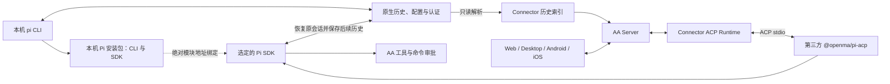

# ACP Runtime 与 Pi 当前实现

本文按当前工作树源码整理，描述 Connector 的通用 ACP 适配和默认 Pi 接入。源码入口见文末；能力是否可用以实例和会话实际返回值为准。

## 默认执行路径

```text
Web / Desktop / Android / iOS
  → Server runtime-workflows / 会话 API
  → Connector AcpRuntime
  → 官方 Python ACP SDK（stdio v1）
  → @openma/pi-acp 发布包
  → Pi SDK
```

默认 Provider 为 Codex、Claude、DSH、Pi。Pi 使用 `runtimeType=pi`、`implementationType=acp-stdio`，ACP 是内部对接协议。通用 `AcpRuntime` 通过注入 `AgentProfile`、启动配置、准备策略复用协调逻辑，其他 Agent 可以有自己的 Provider 身份；默认列表没有单独名为 ACP 的入口。

Pi 的 `PiProvider` 直接实现 `RuntimeProvider` 的配置、发现和启动流程，优先复用本机 npm 安装的 Pi SDK，第三方 `@openma/pi-acp` 提供 ACP 入口并在自己的进程内调用该 SDK。

## 本机安装与原生历史



CLI 和 AA 对同一会话按顺序切换。浏览直接读取默认目录及额外历史目录，不启动 Pi、ACP 或用户扩展；模型、认证或执行环境不可用不影响历史浏览。四端通过有效能力提供「继续任务」和「结束 AA 执行」：退出 CLI 对应会话并确认后，恢复同一文件、原生 ID 和工作目录；实例实际释放后才可切回 CLI。不会自动新建或分叉。

| 配置 | 含义 |
| --- | --- |
| `executionMode=auto` / `local` | 使用本机 Pi；不兼容或找不到时明确报错，不静默回退 |
| `cliPath` | 可选的真实 CLI 入口；自动发现支持 PATH、活动 Node 版本管理器入口和 npm Windows 启动器 |
| `agentDir` | 原生配置目录；默认遵循 `PI_CODING_AGENT_DIR`，否则 `~/.pi/agent` |
| `historyDirs` | 额外历史目录，直接恢复其原文件 |
| `executionMode=managed` | 使用 AA 隔离环境，需要模型网关配置 |

当前本机执行支持经过验证的 `@earendil-works/pi-coding-agent@1.4.0` npm 安装形态。CLI 和 SDK 是同一个包的入口，不另装 `pi-sdk`；通过绝对模块地址绑定，不依赖 Node 对全局包的自动解析。独立二进制、无 SDK 导出的入口和其他版本保持可浏览并返回兼容性原因。

上游适配器发布包经过固定文件摘要校验，在 AA 自己的缓存内应用 SDK 绑定、准确文件定位和审批装配的兼容补丁，不改用户安装。记录 Node、SDK、可解析依赖、适配器补丁及守卫摘要；来源变化不自动切换旧会话。已有只含模型网关的配置保留受管语义。

浏览不初始化原生配置。执行允许 SDK 正常维护认证与缓存，不覆盖用户既有模型和设置；AA 权限文件保存在 AA 状态目录。当前原地恢复仅开放原生 v3 历史，需迁移的旧历史仍可浏览，避免未经确认的源文件重写。

恢复前检查最新来源修订，执行期间在受控 SDK 写入前再次核对，同时监测外部变化。AA 内部锁防止重复执行实例；原版 CLI 不受该锁约束，因此不支持独立实例并发写入，也不承诺文件系统级原子独占。检测冲突后停止接纳并释放实例，不合并或重投未知消息。详细请求、状态与失败语义见 [Pi 原生历史契约](../api/pi-native-history.md)。

## Pi 实例配置与安装

受管模式复用现有模型网关表单，必填 `modelGateway`，可填写 `customModels`。未填写自定义模型时，在启动实例时从网关 `/models` 获取最多 64 个模型；获取失败或目录为空时返回明确错误，提示填写模型 ID。

当前 Provider 固定安装以下依赖：

| 包 | 源码固定值 |
| --- | --- |
| `@openma/pi-acp` | `0.1.8` |
| `@earendil-works/pi-coding-agent` | `1.4.0` |
| `@earendil-works/pi-ai` | `1.4.0` |
| `@earendil-works/pi-agent-core` | `1.4.0` |

安装器优先复用本机带 npm 的 Node `>=22.19 <23`；否则下载 Node `22.23.2` 并检查官方 SHA-256。下载目标覆盖 macOS、Windows、Linux 的 x64/arm64，Linux 要求 glibc。这里描述代码中的平台选择逻辑，不表示各目标已有运行验证结果。

依赖按固定依赖表的摘要缓存到 `npm-runtimes/`，安装过程使用文件锁、临时目录和原子重命名。npm 使用 `--omit=dev --ignore-scripts --package-lock=false`，安装发布包，不在工作设备编译应用源码。直接依赖版本固定，但没有锁定完整传递依赖树，不能把缓存身份当作可重现制品摘要。

每个实例以 `session_namespace` 和 `runtime_id` 的摘要隔离协调与 Pi 数据：

- `coordination.sqlite` 保存绑定、操作、交互、配置、投影和 outbox。
- `configurations/<配置摘要>/pi/` 中的 `models.json`、`settings.json` 和 `aa-permissions.json` 保存实例配置，避免已取消的旧配置准备覆盖新配置；写入采用私有权限和原子替换。
- `sessions/` 作为受管 Pi 原生会话目录。
- 网关密钥通过子进程环境 `AA_PI_GATEWAY_KEY` 传递，模型配置引用该变量。

受管模式启动经兼容处理的发布包入口 `@openma/pi-acp/dist/bin.js`，传入隔离的 `--agent-dir`、`--session-dir`、`--quiet-startup` 和 `--no-delegation`。此路径不使用用户全局 `~/.pi/agent` 配置。

## 准备、创建与消息

客户端选定 Agent 和工作区后自动准备。默认会话式准备启动独立 ACP 进程并打开 Agent 会话，返回实际配置与模型目录；正式创建预留并接管同一准备上下文。准备过期、取消和关闭负责释放进程。

Web、Desktop、Android、iOS 复用既有新建、模型、权限、发送和停止入口，保留必要的授权问答与错误恢复。独立 Agent 配置页面和原生执行位置面板已移除；Server 和 Connector 的配置 API 仍保留。

创建工作流分别记录平台会话、原生会话和首条消息接纳事实。消息使用稳定 `clientMessageId` 和输入摘要，同一 ID 的不同输入被拒绝。状态区分未发送、发送中、已接纳、确定拒绝和结果未知。

PiClient 在观察到 Pi SDK 的运行开始标记，或助手、思考、工具及交互事件时发布执行观察，Connector 据此记录接纳；标准 ACP prompt 完成响应也是接纳证据。执行观察不等同于 Agent 的持久早期回执。连接丢失且没有确定证据时保留未知，不自动重投。

首条及后续消息均已接入附件转换：Server 保存上传附件并传递引用，Connector 下载整批校验媒体类型、大小与摘要，图片转 ACP 图片块，其他文件提供本机资源链接。客户端仍按有效附件能力和限制控制入口。

## 权限、配置与命令

PiClient 将 Pi 的模型和推理配置映射到现有目录，并补充三个权限选项：

| 权限 | 扩展行为 |
| --- | --- |
| 写入与命令审批（`ask`） | `read`、`ls`、`find`、`grep` 直接执行，其他工具询问 |
| 全部工具审批（`ask_all`） | 每次工具调用均询问 |
| 只读（`readonly`） | 允许上述读取工具，阻止其他工具 |

Connector 显式加载 `permissions.mjs`，在首次加载、恢复及重载后将守卫放在扩展分发顺序首位，并核验加载报告，缺失则阻止执行。扩展冻结工具输入，通过 Pi 的确认请求等待用户回答；PiClient 将该请求转换为 AA 工具审批。权限配置按原生会话 ID 存储，缺失或无效配置默认询问；原生 `/bash` 命令另在适配层执行同一权限检查，确定拒绝不会把会话置为需要恢复。此机制是工具事件层控制，不是操作系统沙箱，也不代表已实现旧方案的全部资源信任、最终请求守卫或外部写入所有权保证。

配置保存完整快照、内容摘要和单调 revision；逐项更新部分成功时保留真实结果。模型与权限选择通过会话配置更新。命令来自 Agent 的 `available_commands_update`，执行前再次核验命令仍在目录中，并保留原始输入的引号和换行，再交由 ACP prompt 处理。运行中追加指示复用既有 steer 入口，消息身份与普通发送共享去重记录。认证状态查询说明认证来自执行来源的原生配置与环境，资源查询返回当前命令；其他通用操作只在 Agent 明确提供对应能力时可用。

## 同步、恢复与进程

通用应用层经 SQLite 事务保存操作事实与 outbox；同步服务按序发送，收到 ACK 后删除。投影将 ACP 文本、思考、工具与来源信息转换为平台 Timeline。PiClient 补充平台消息身份与附件元数据，使执行观察与用户消息投影关联。

恢复创建新的连接代际，重新连接同一原生会话，核验 Agent 保证和返回身份，再更新配置与绑定。只有 Agent 宣告 `durable_prompt_receipts` 时才查询持久接纳回执；默认 PiClient 只宣告 `managed_tool_permissions`，没有该保证。不能以通用恢复分支存在推定未知消息已被确认。

启动采用后台准备，沿用 Runtime 的「正在准备」状态与失败重试；环境就绪前不开放运行能力，下载不会占满启动 RPC 的等待时间。

会话使用独立进程，执行配额和超时由协调层管理。关闭先阻止新请求并失效交互，实际释放进程后收敛状态；异常退出进入恢复状态。进程监督实现包括 POSIX 进程组和 Windows Job，相关受控检查入口见下文。

## 通用 ACP 与运行环境管理

通用 ACP 适配、协调和同步服务由各 Agent Profile 复用。Pi 直接使用 npm 发布包。

TUI 协作、最终模型请求守卫、持久接纳回执和原生位置选择未在默认路径开放。通用原生历史快照按来源完整性处理，不能用部分结果删除其他历史；默认 Pi 没有独立的原生位置选择界面。

## 源码与维护入口

- [默认 Provider 注册](../../connector/connector/runtimes/providers.py)
- [Pi Provider 与固定依赖](../../connector/connector/runtimes/acp/profiles/pi/provider.py)、[配置生成](../../connector/connector/runtimes/acp/profiles/pi/settings.py)
- [PiClient](../../connector/connector/runtimes/acp/profiles/pi/client.py)、[工具权限扩展](../../connector/connector/runtimes/acp/profiles/pi/permissions.mjs)
- [npm / Node 安装器](../../connector/connector/runtimes/acp/infrastructure/npm.py)
- [通用 Runtime](../../connector/connector/runtimes/acp/runtime.py)、[会话用例](../../connector/connector/runtimes/acp/application/sessions.py)、[同步](../../connector/connector/runtimes/acp/application/synchronization.py)
- [工作流契约](../../contracts/runtime-workflows/1.2/manifest.json)、[ACP 增强契约说明](../../contracts/acp-runtime/1.1/README.md)

在 `connector/` 可运行下列受控检查。它们是检查入口，不是本文整理时的执行结果；受控 Peer 不代替默认 Pi 发布包的实际运行。

```sh
uv run python scripts/verify-acp-runtime.py
uv run python scripts/verify-acp-generic-boundary.py
uv run python scripts/verify-acp-processes.py
```

实现变更时同步更新本页。

默认 Pi 的直接功能检查为 `PYTHONPATH=connector connector/.venv/bin/python connector/scripts/verify-pi-managed.py --scenario allow`；另有 `deny`、`readonly`、`attachment`、`steer`、`slow`、`reasoning` 和 `interrupt` 场景，使用真实 OpenMA/Pi 包与本地 SSE 模型，不调用付费供应商。

本机原生历史的直接功能检查为 `PYTHONPATH=connector connector/.venv/bin/python connector/scripts/verify-pi-native.py`，覆盖实际本机 CLI、ACP 恢复、允许与拒绝写入、重载、切回 CLI 和外部来源冲突，使用临时原生配置及本地 SSE 模型。
