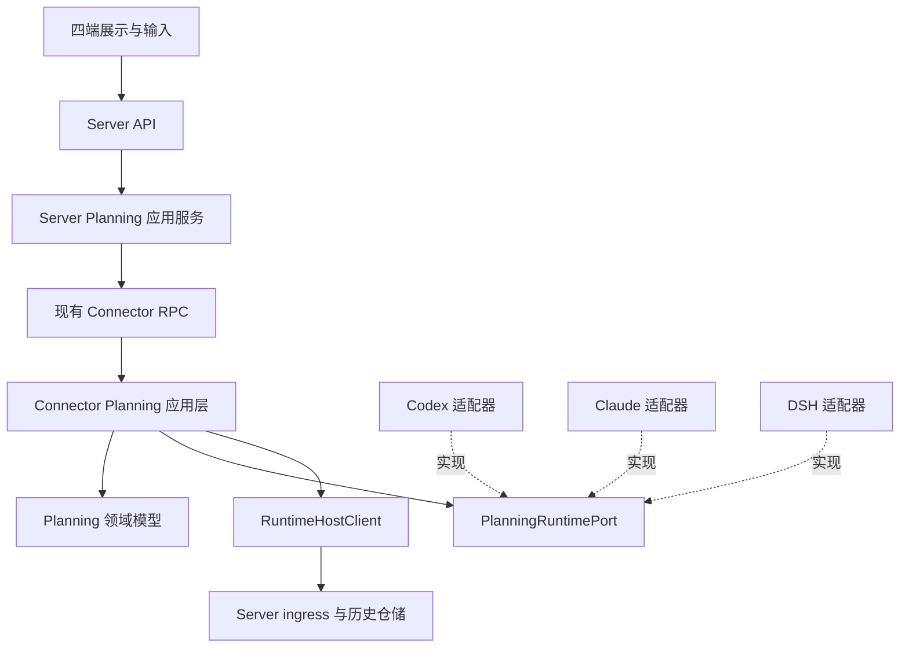

# AA 统一原生 Plan：领域设计与完整实施计划

> 状态：设计已在本分支落地，2026-10-30。实际接口见统一 Plan 文档，验证记录见第 15 节。
> 基线：执行 `git fetch origin` 后的 `origin/main`，提交 `27b89aba79cd7e04c77c2aa91688983dbc857747`。
> 工作分支：`feat/con+be+fe+dsk+apk+ios+dsh/unified-plan`。产品版本保持原值；新增数据库迁移 `v2_45`。

## 1. 目标、范围与交付边界

用户在 AA 的 Codex、Claude Code、DSH 会话中，都能使用 `/plan` 进入对应 Runtime 的原生规划模式。AA 统一规划规则、计划文档、审阅决定和客户端体验，Runtime 适配器负责原生输入输出转换。

完整交付必须包含下面的闭环，不能把其中一个阶段作为整个功能完成的依据：

```text
/plan 或 /plan <任务>
  → 原生规划模式生效
  → Agent 探索、按需提出澄清问题
  → 计划专用卡片显示生成状态，并接收真实正文增量
  → 计划正文定稿并持久保存到 AA
  → 输入区显示绑定当前计划版本的内嵌确认面板
  → 同意并执行 / 提出修改 / 暂不执行
  → 执行结果与模式被原生状态校准
  → 卡片和计划全文仍可在 AA 历史中打开
```

### 1.1 本次功能必须覆盖

- Codex 的 AA-owned app-server 路径和现有 IPC follower 路径；Claude SDK；DSH Bridge。
- Web、Desktop、Android、iOS 的新建会话和已有会话入口。
- `/plan`、`/plan <任务>`、`/plan off`；附件沿已有能力与 MIME 限制处理。
- 流式计划卡片、生成中扫光、定稿、生成中断、全文阅读、复制与导出 Markdown。
- 计划输入区确认面板、批准当前版本并实施、反馈修改、取消审阅、多端仲裁。
- 首轮生效、重复请求、部分成功、断线、重启、外部客户端变更、历史恢复。
- 原生能力不足时明确说明，不降级成发送一段“请只做计划”的普通提示词。

### 1.2 不扩展的范围

消息队列、Goal、Agent 执行引擎重写、替换原生规划提示词、独立 Planning 微服务、用户编辑计划全文不属于本计划。阅读器首期只读；反馈修改通过 Agent 产生新版本。ACP/Pi 预留适配端口，本次不以合入 ACP 工作分支为前提。

规划协作状态与权限策略分开。原生 Plan 模式不等于统一的操作系统只读隔离；AA 不因进入或退出 Plan 自动扩大权限。

## 2. 实际基线与已有能力

用户指定的 origin 是 fork `congwa/Agents-Anywhere`。本次拉取后的 main 最后提交日期为 2026-10-20；它不是此前调研过的 ACP 工作分支 `610c9684`，不混用两棵代码树的实现结论。

| 模块 | main 上实际已有 | 本功能的缺口 |
| --- | --- | --- |
| Runtime 边界 | `AgentRuntime`、`RuntimeHostClient`、typed models、能力与会话状态 | 没有统一 Planning 用例、状态及文档模型 |
| slash commands | 会话命令目录、参数原文、结果未知语义，四端有相关入口 | 新建会话独立入口；尚无统一 `/plan`；现有命令通道不发送附件 |
| Codex | IPC 携带 `latestCollaborationMode`；已有 Plan item/delta 解析 | 正文被投影为系统消息；普通 start-turn DTO 没有模式字段；owner 状态固定 default |
| Claude | permission catalog 含 plan，SDK options 传 `permission_mode` | 命令能力、动态模式控制、审批模式变更与正文专用投影未统一；文本流忽略 `input_json_delta` |
| DSH | 原生问答、plan-review 与回应；工具参数增量投影 | Python 与 TS 两层都只开放 compact；尚无 Plan 模式状态投影 |
| Server | 会话授权、RPC、Timeline、Redis 实时状态缓存、PostgreSQL 历史 | 没有不可变的计划版本、计划读取 API 和 Planning 操作记录 |
| 客户端 | slash 入口、普通 Markdown、交互表单、会话事件恢复 | 专用卡片、阅读器、版本绑定的内嵌确认面板和统一模式状态 |

实施入口参见：

- [Runtime ABC](../../connector/connector/runtime_protocol/protocol.py)、[Host](../../connector/connector/runtime_protocol/host.py)、[会话命令分发](../../connector/connector/server/runtime_turn_rpc.py)。
- [Codex 事件投影](../../connector/connector/runtimes/codex/timeline/typed_events.py)、[SDK 请求](../../connector/connector/runtimes/codex/sdk/runtime_client.py)、[IPC 控制](../../connector/connector/runtimes/codex/ipc/control.py)。
- [Claude selections](../../connector/connector/runtimes/claude/turns/selections.py)、[工具审批](../../connector/connector/runtimes/claude/domain/approvals.py)、[流式消息](../../connector/connector/runtimes/claude/timeline/stream.py)。
- [DSH Python Runtime](../../connector/connector/runtimes/dsh/runtime.py)、[原生命令](../../dsh-bridge-next/src/host/dsh-runtime/commands.ts)、[问答表单](../../dsh-bridge-next/src/host/dsh-runtime/question-form.ts)、[增量历史](../../dsh-bridge-next/src/host/dsh-runtime/history.ts)。
- [Server 会话路由](../../server/agent_server/api/sessions.py)、[会话用例](../../server/agent_server/services/session_run.py)、[实时状态缓存](../../server/agent_server/services/session_runtime_state_cache.py)。

现有[队列、Plan、Goal 综合提案](../api/session-queue-plan-goal-proposal.md)中 Plan 部分由本文接续。其“DSH 没有模式”“Codex 尚未解析 plan”以及将计划正文、Todo 和步骤进度混为一个实体的假设不再用于实施。

## 3. 统一产品规则

| 输入或动作 | AA 的唯一语义 | 成功依据 |
| --- | --- | --- |
| `/plan` | 幂等请求进入规划，不发空任务 | 原生确认或明确的待生效状态 |
| `/plan <任务>` | 保留任务原文，在规划模式下提交一次 | 模式与任务交付状态分别记录 |
| `/plan off` | 请求退出规划，不表示批准某份计划 | 原生模式确认；需要关闭待答审阅时先完成该步骤 |
| 同意并执行 | 批准指定 planId、revision、contentHash 并请求实施 | 决定已应用与实施回合已开始分别确认 |
| 提出修改 | 返回用户意见，保持规划，下一份定稿重新审阅 | 原生接收反馈，旧审阅不再允许批准 |
| 暂不执行 | 关闭当前原生审阅，保留计划供阅读 | 不启动实施，不伪造“已批准” |
| 打开计划 | 读取指定不可变版本 | Server 持久正文存在，不要求 Connector 在线 |

- 只匹配完整命令 token `plan`，保留后缀和换行；`/planning`、普通绝对路径不被误识别。
- 精确后缀 `off` 为退出；`/plan off 修复登录` 不是退出命令，按任务后缀处理并在文档解释。进入模式不提供 `/plan on` 别名，避免与 DSH 原生任务参数冲突。
- 支持该功能的新客户端将 `/plan` 作为保留控制入口；目录未加载、能力不足或执行失败时保留草稿并显示原因，不回落为普通模型消息。后端独立验证结构化请求。
- 没有正式会话时，裸 `/plan` 只改变本地创建意图，显示“新会话将使用计划模式”，不能宣称原生已生效，也不为此创建空会话。
- 初次 `/plan <任务>` 必须把模式意图纳入 create-and-start，不采用“先普通发送，之后再改模式”。
- 运行中切换只影响原生允许的后续边界，不撤回已执行的工具；不支持运行中提交任务时返回 busy 并保留草稿，不顺带实现通用排队或自动打断。
- 所有写操作沿用会话接管、账号授权、设备在线和有效能力校验。只读查看历史与实际控制是不同权限。

## 4. 领域模型、聚合与不变量

Planning 是会话协作领域中的独立模块。共享规则在 Connector 执行，各 Runtime 通过防腐层映射原生概念；不把条件分支集中到 Server 或前端。

### 4.1 模型

| 模型 | 核心字段 | 责任 |
| --- | --- | --- |
| `SessionPlanning` 聚合根 | session identity、effectiveMode、requestedMode、currentProposal、currentReview、revision | 当前规划协作的一致性边界 |
| `PlanDraft` | draftId、generation、seq、content、contentState、nativeSource | 生成中正文，允许替换、撤销和中断，不可批准 |
| `PlanProposal` | planId、revision、contentHash、title、markdown、sourceTurnId、createdAt | 一份不可变的最终计划版本 |
| `PlanReview` | reviewId、target planId/revision/hash、status、availableActions | 审阅具体版本，不负责普通工具权限策略 |
| `PlanProgress` | sourceTurnId、entries、revision | 执行步骤的独立投影，不驱动计划批准 |
| `PlanningOperation` | operationId、fingerprint、actor、phase、modeEffect、decisionEffect、executionEffect | 幂等、部分成功和结果未知 |

会话完整身份使用已有 connector/runtime 实例绑定及稳定 sessionId。原生 thread/call/request 身份留在适配器内部，客户端不持有可直接回应原生请求的令牌。

`effectiveMode` 为 `plan | normal | unknown`；`normal` 不代表自动通过工具权限。`requestedMode` 可为空；观测新鲜度单独用 `fresh | stale | unknown` 表达，不能通过把缓存模式改成 normal 来表示断线。

`contentState` 为 `drafting | ready | interrupted | failed`。审阅状态单独为 `open | responding | approved | revision_requested | dismissed | withdrawn | unknown`。计划完成生成不等于审批完成，也不等于实施完成。

### 4.2 必须强制的不变量

1. 模式、计划内容、审阅决定、实施进度分别更新；不能由一个状态推断另一个状态。
2. 只有 ready 且有完整可读正文的不可变版本能进入审阅。
3. 批准必须匹配 reviewId、planId、revision、contentHash 和当前控制世代；版本变化返回 conflict，不自动批准最新版。
4. contentHash 按统一 Unicode 约束后的正文 UTF-8 字节计算；不 trim、不因客户端平台改变换行。完整原文作为最终依据。
5. 相同 operationId 和相同 fingerprint 返回已有结果；同 ID 不同参数返回冲突。
6. API 200、RPC 收到、模式已应用、审批已接受、消息已接收、回合开始是不同事实；结果中分别体现。
7. 外部端退出模式不等于同意计划；待答请求消失只表示已不再等待，未知原因标为 withdrawn，不能猜测 approved。
8. 原生等待不能通过重启后历史回放伪造恢复；保留历史计划，当前交互必须重新向原生校准。
9. 同会话用乐观版本和短时互斥保证变更顺序，等待模型或用户时不持有聚合锁。
10. 有外部 writer 时严格沿现有所有权路由操作，不启动第二个 writer，不通过 SDK 争锁接管。

### 4.3 审阅前后正文的时序

DSH、Claude 可能在工具仍等待用户时就需要显示完整正文，因此不能等 `tool/result` 才生成待审版本。

- Codex：完成的原生 plan item 形成最终版本，随后由 AA 建立对应的续跑确认。
- DSH：`exit_plan_mode` 的完整入参／原生审阅 detail 形成待审版本，再发布确认交互。
- Claude：审批前从原生补充后的工具输入或已确认的原生计划文档取得完整正文，冻结版本后发布交互。正文来源缺失时标记不可批准并返回明确原因，不能只显示一个 Approve 按钮。
- 审批后的结构化结果用于记录实际执行事实。若原生端编辑了正文，应记录新的外部版本与实际来源，不覆盖 AA 用户此前看到并批准的版本。

## 5. 模块划分与依赖

```text
connector/connector/
  planning/
    domain/          session、draft、proposal、review、operations、events
    application/     enter、exit、submit_task、review、reconciliation、ports
    infrastructure/  operation_store、draft_store、host_publisher
  runtime_protocol/planning.py       对外 typed DTO，不放业务状态机
  runtimes/codex/planning/            SDK / IPC 规划适配
  runtimes/claude/planning/           SDK 控制、计划来源、权限回应适配
  runtimes/dsh/planning/              Bridge 端口及原生事实映射

dsh-bridge-next/src/host/dsh-runtime/planning/
  commands.ts、state.ts、projection.ts、review.ts

server/agent_server/
  core/planning/                     wire-neutral 值对象与输入校验
  services/planning/                 授权后编排、计划历史、操作查询
  services/planning_ports.py          仓储与 RPC 端口
  infra/repositories/planning.py     PostgreSQL 实现
  api/session_planning.py            HTTP / WS 映射
```



- Domain 只依赖标准库及本模块值对象；不依赖 SDK、RPC、文件系统或数据库。
- Application 依赖 Domain 和声明的 ports；不识别原生字段或 SDK 类。
- `PlanningRuntimePort` 提供读取／订阅规划事实、设置模式、回应审阅和继续指定计划的能力。原生实现可将设置模式与首轮任务一起提交。
- 普通消息、附件下载、回合启动和中断复用已有会话执行能力，不另建 Agent loop。
- `AgentRuntime` 门面组合共享 Planning 应用服务与各自端口，现有 `execute_command` 中的 plan 入口委托相同用例。不能再让通用 plan 用例回调同一个 command 入口形成循环。
- 原生事件先转换为 typed observation，再由 Planning 应用服务校准并发布；SDK 对象不能穿过 Runtime 包边界。
- Server 的 core 不导入外层，services 不导入 FastAPI、API 或具体 Store；复用[现有 Server 分层](../server-architecture.md)。Server 不复制 Connector 的原生状态机。
- 客户端只依赖 AA 契约和能力。原生字段、原生权限模式恢复和 `intent.approve` 标签解释不进入 UI。

## 6. AA 契约与输入输出

以下是拟新增的协议，实施阶段先落 Server wire models，再生成 schemas；不是现有 API 的描述。

### 6.1 操作请求

统一操作字段：`operationId`、`command`、`expectedRevision`；任务使用 `content`、`clientMessageId`、既有 attachment refs；审阅使用 `reviewId`、`planId`、`planRevision`、`contentHash`、`feedback`。

`command` 是 `enter_plan | exit_plan | submit_task | approve_and_execute | request_revision | dismiss_review`。未知命令明确拒绝。Actor、userId、runtime 绑定由鉴权与会话元数据确定，不信任客户端自报身份。

```json
{
  "operationId": "op_unique",
  "command": "approve_and_execute",
  "expectedRevision": 12,
  "reviewId": "review_1",
  "planId": "plan_1",
  "planRevision": 2,
  "contentHash": "sha256:..."
}
```

统一结果：`outcome = applied | pending | rejected | unknown`，附 `operationId`、`code`、`message`、`retryable`、状态版本和各副作用阶段。

- 模式已生效、任务尚未送达：返回保留事实的部分完成操作；恢复只继续未完成且可证明安全的阶段。
- 批准已接受但实施启动失败：保留批准历史和启动失败，不再次回应同一个原生审批。
- unknown 必须 `retryable:false`；不能把 unknown 翻译成普通 failed 后自动重试。
- 已开始的证据是关联实施回合／原生执行事件，不是 command 的 accepted。

### 6.2 路由与兼容入口

| 拟新增或扩展的路由 | 用途与边界 |
| --- | --- |
| `GET /api/v2/sessions/{id}/runtime/planning` | 当前规划快照与新鲜度；离线不伪造实时事实 |
| `POST /api/v2/sessions/{id}/runtime/planning/commands` | 上述结构化操作 |
| `GET /api/v2/sessions/{id}/planning/operations/{operationId}` | 操作记录及最后确认的阶段；离线显示 unknown/stale |
| `GET /api/v2/sessions/{id}/plans` | 持久计划版本索引 |
| `GET /api/v2/sessions/{id}/plans/{planId}/revisions/{revision}` | 指定版本完整正文 |
| 同版本路径的 `/download` | 鉴权后导出 Markdown，安全文件名与 MIME |
| 扩展现有 create-and-start | 增加可选 `planningIntent`，首轮模式和交付关联同一操作身份 |
| 现有 commands / notices respond | 兼容入口，转换到同一 Planning 应用用例，不维护第二份状态 |

新建阶段 operationId 的作用域包含账号、connectorId、runtimeId、稳定创建请求身份；正式 sessionId 分配后绑定原操作。重试不能分配第二个原生会话。

Notice 新增明确的计划审阅呈现类型和版本引用。已有回应路由进入统一应用服务；客户端不因它是 Notice 就把“同意执行”解释为永久允许工具。不要直接复用 permission 的 allow_always/reject_always 来表达计划批准与放弃。

### 6.3 能力

- `session.planning`：模式及任务入口；metadata 包含 actions 和当前可用时机。
- `session.plan_document`：最终正文、只读打开、可用的流式生成。
- `session.plan_review`：有效审阅及其实际可用动作。
- 流式内容 metadata：`contentStreaming = native_delta | native_document | final_only`。未提供真实正文增量时显示准备状态，不模拟打字。
- `final_only` 仅用于低版本或原生暂时没有正文增量的兼容阶段，不计为用户要求的三家目标版本流式卡片验收通过。目标版本没有可信连续正文来源时，应记为具体阻塞，继续研究官方输出路径，不能静默降低完整交付标准。
- `supported / available / allowed` 和当前不可用原因沿用有效能力机制；读历史计划不以 Runtime 在线为前提。
- 不同客户端、原生版本、owner 路径分别探测；不因 provider 名叫 Codex/Claude/DSH 就宣称全部能力可用。

### 6.4 事件与恢复

| 事件 | 内容 |
| --- | --- |
| `planning.state.updated` | 模式、待生效目标、新鲜度、聚合版本 |
| `planning.proposal.started` | 稳定 draftId、generation、原生来源、初始正文 |
| `planning.proposal.delta` | draftId、generation、seq、baseSeq、增量 |
| `planning.proposal.completed` | 不可变计划版本、完整正文或正文引用、hash |
| `planning.proposal.interrupted` / `.failed` | 保留的草稿与明确原因 |
| `planning.review.updated` | 目标版本、当前状态、有效动作 |
| `planning.progress.updated` | 独立步骤快照 |
| `planning.operation.updated` | 模式、审阅、交付和执行的阶段事实 |

事件携带现有完整 Runtime 身份、稳定控制世代与序号。控制世代在实际 owner/原生进程身份失效时变化；普通传输重连不能任意生成一个新世代造成重复计划。

增量只用于草稿：相同 seq 去重，baseSeq 不连续时暂停应用并请求快照，不在前端猜补；完成事件整体替换正文。订阅与快照使用游标栅栏避免读快照期间漏事件。历史加载直接读取完整版本，不回放成新的待审任务。

对现有通知缓冲区增加明确的事件类别：全量草稿快照可按同一 draft 合并，append delta 不能被“只保留最后一条”的合并策略丢弃。背压时退化为完整草稿快照并携带游标；最终定稿与审阅状态使用可确认、可幂等重传的发布路径。

Codex 的规范化审阅由 AA 创建，其重启恢复使用原有持久 reviewId、目标版本、操作记录与当前原生计划校准，不能换一个新身份反复发起确认。Claude／DSH 的原生 pending 则必须仍能从原生待答状态读到；两种恢复依据在适配器中区分。

## 7. 持久化、恢复与可靠性

### 7.1 状态所有者

| 数据 | 所有者与存储 |
| --- | --- |
| 原生模式、当前有效待答请求 | Runtime；Connector 校准，Server 仅缓存投影 |
| 草稿与可恢复来源游标 | Connector 内的 Planning store；可合并发布临时快照，不逐 token 写数据库 |
| 最终计划正文与不可变版本 | Server PostgreSQL，供跨设备、离线 Runtime 阅读 |
| 审阅历史、用户决定与原生确认 | Server 历史事实，不能作为当前 pending 的权威 |
| native review 引用与执行阶段 | Connector 持久操作记录，避免重启后重新发副作用 |
| 用户尚未创建会话的模式意图 | 客户端草稿；发送前与当前能力核对 |

建议新增计划索引、计划版本、Planning 操作及审阅事实表。版本正文直接保存为受限大小的 UTF-8 Markdown；唯一键覆盖 session、planId、revision，绑定原生身份映射以避免回放重复。操作表按操作作用域和 operationId 唯一，并记录请求 fingerprint。

主线当前最大 Alembic 迁移为 `v2_44`；真正实施迁移时重新查询最大值再分配下一个编号，本文不预占迁移号。产品版本一律保持不变。

Connector 基线使用 JSON KV 的临时文件原子替换，并非事务数据库。原生副作用与文件写入之间没有分布式事务：通过 Planning store 端口持久记录 dispatch 前后的阶段；崩溃在不可确定窗口内时置 unknown 并校准。若无法用既有存储满足单 writer 下的原子“聚合＋操作”记录，新增局部持久实现并做故障验证，不能把独立 set() 当跨进程 CAS 或宣称 exactly-once。

### 7.2 最终计划保存顺序

1. Connector 形成完整冻结正文、稳定身份和 hash，并持久记录待发布版本。
2. Server 幂等接收计划版本与相关历史引用，提交后才确认保存成功。
3. 对应的可执行审阅投影发布；即使先收到原生待答请求，正文保存失败时也不能展示可点击批准而正文不可读的确认面板。
4. 断线重传复用同一版本和 hash；冲突的相同版本拒绝覆盖并请求校准。
5. Timeline 卡片引用持久计划版本；不要只存本机绝对路径，也不要仅依赖 Redis 临时缓存。

### 7.3 资源和安全边界

计划初始上限为每份正文 2 MiB UTF-8、单个增量事件 64 KiB；大于事件上限时按字符边界分片，最终正文通过读取 API 获取。超出正文上限明确显示受限状态，不能截断后仍允许批准。首次真实样本验证后可通过配置调整，不改产品版本。

Markdown 禁用任意 HTML／脚本执行，外链、附件与本机文件访问沿现有策略鉴权。原生文件路径只在 Connector 内使用，读取必须关联本次会话原生计划来源，不能把任意 Write 或名叫 PLAN.md 的文件都认作计划。操作日志只保留身份、阶段和错误码，不打印正文、回答、认证信息或访问凭据。

## 8. Runtime 防腐层：输入、输出与具体工作

### 8.1 Codex

输入映射：

- `/plan`：支持的版本通过 `thread/settings/update.collaborationMode` 设置后续模式；不发空 turn。裸切换接口不存在时返回明确 capability 原因，不能用空模型回合伪装。
- `/plan <任务>`：在同一 `turn/start` 发送原生 collaborationMode 与用户内容，保留当前 model/effort、权限配置、clientMessageId 和附件。
- 模式 settings 使用 `developer_instructions:null` 取得内置规则，不自行复制一份 Codex Plan 系统提示词。
- AA-owned 路径通过低层实验接口保留模式字段；核对 `experimentalApi` 和实际 payload。研究时 SDK 0.163.0 的稳定类型会丢弃该字段，字典路径可以保留。
- IPC 路径更新真实 owner 的 thread settings，使用 owner 回包与后续快照校准，不在 follower 本地写一个 plan 标志了事。

输出映射：

- `item/started` 的 plan 与 `item/plan/delta` → 稳定草稿与增量。
- `item/completed` 的 plan → 最终正文；不能假设 delta 拼接必然等于最终文本。
- `turn/plan/updated` → PlanProgress，而不是正文或审阅。
- `thread/settings/updated`、resume 返回的 collaborationMode、IPC snapshot → 模式事实。
- 现有 `item/tool/requestUserInput` → 普通澄清问答，不自动变成批准计划。

Codex 没有与 DSH 相同的原生 exit-plan 待答工具。AA 对最终 plan 建立规范化审阅，批准后按指定版本切到 default 并启动关联实施回合；反馈作为 Plan 模式下的新请求。模式改变和实施启动之间若部分失败，按操作阶段恢复。

必须覆盖 SDK owner、IPC owner 两条路径，外部修改和重启后不能再固定上报 default。低版本选择能力探测或明确最低兼容依赖；不能据此擅自升级 AA 产品版本。

### 8.2 Claude Code

- 新建：先以 `ClaudeAgentOptions(permission_mode="plan")` 建立连接，再提交任务。
- 已有流式连接：用 `set_permission_mode("plan")`，等待控制确认后更新 effectiveMode；现有仅改 selections 并重建空闲连接的路径要与该控制路径统一，避免旧 selections 把模式改回去。
- 读取 `system/init.permissionMode` 和 `system/status.permissionMode`；Python 通用 SystemMessage 也要解析。原生主动 Enter/ExitPlanMode 同样进入观察通道。
- 维护进入 plan 前的有效权限策略及来源。裸退出恢复该策略；如果规划期间用户已修改权限，应保留较新的明确选择，不能恢复陈旧策略或自动升级 bypass。
- `AskUserQuestion` 继续沿原有回调处理。`ExitPlanMode` 专门映射 PlanReview，批准回应携带会话级 `PermissionUpdate(type="setMode", ...)`，反馈携带拒绝原因；关闭审阅与继续修改的中断行为分别适配。
- 模型工具输入类型、SDK 权限回调输入、完成工具输出不是同一份 schema。不能要求所有版本的模型参数中都存在 plan。
- 审阅前优先采用原生回调补充的完整 plan 或已确认的原生计划文档；完成后的 `tool_use_result.plan`、filePath、planWasEdited 用于历史校准，不能等它们出现才提供批准前正文。
- `isAgent` / `awaitingLeaderApproval` 要保留来源区别，不把子 Agent 或等待 leader 的计划自动作为主会话待批准计划。
- 流式接入需要处理当前被忽略的 `input_json_delta`，仅提取已识别原生计划文档的真实内容；没有确定来源时使用 final_only，不能把探索文字充当计划正文。

优先保持原有权限的批准并执行为默认动作。原生可提供的 auto 等其他策略只有在用户明确选择且能力可用时才执行，不把“同意计划”等同于“永久允许工具”。

### 8.3 DSH

- Python Runtime 和 TS Bridge 同时取消仅 compact 的硬编码限制，但只增加实际可用的 plan 入口，不无条件透传所有命令。
- 通过原生 registry 或 Plan service 实现 `/plan`、精确 `/plan off`；`/plan <任务>` 使用原生 Plan 命令提交或等价的原生“设置＋交付”流程，接入 AA 稳定 operationId 与任务身份，防止重复 steer。
- DSH 的 Agent preset、permission preset 与 Plan 状态是不同对象，不把“新会话默认模式”preset 当作规划开关。
- `plan/mode` 与 plan projection `{active,pending}` 归一为 AA 的已生效／待生效状态。注意投影 pending 是存在未生效变更，service get() 的可选 pending 可能表示目标值，适配时不能直接按字段名互换。
- `tool-call-delta.argumentsDelta` 中的 `exit_plan_mode.plan` → 草稿。使用可验证的增量 JSON 字符串解析，处理转义、Unicode 与不完整字段；完整入参和审阅 detail 定稿校准。
- 原生 plan 必须非空且以一级 Markdown 标题开始；校验失败不生成可批准计划。
- 保留 `intent.kind`、approve label 和可用时的 callId 关联。AA 按显式 approve label 反查原生选项，不能默认第一个选项就是批准。
- 原生答案形状为 `{answers:[{id,selected,custom?}]}`；与 Codex 的 answers map、Claude 的 updated_input 不混用。
- 批准返回 approved=true，退出在后续原生 step 边界生效；Keep planning／自填意见以工具错误携带反馈并继续规划；ASK_CANCELLED 返回 approved=false、结束回合且保持规划。三者映射到不同 AA 结果。
- 用户要求修改所产生的原生工具错误是已接受反馈的业务结果，不等同整个 Planning 操作失败；有意结束回合的诊断也不能直接显示为模型故障。通过原生关联身份和意图分类，而不是只检查 error 标记。
- Host 没有挂载 Plan／commands／userQuestions 时分别报告能力，不将读取历史工具记录变成新的等待。

DSH 主线开发依赖为 0.2.0-rc.2；先用该基线核对原生服务与字段。研究用的上游新提交只能作为行为参考，不能直接认为已安装 Host 提供同样字段。支持范围在真实探针通过后写入兼容说明。

## 9. 计划卡片、全文阅读与输入区确认

### 9.1 卡片状态

| 状态 | 展示 | 可用动作 |
| --- | --- | --- |
| drafting | “正在生成计划”、轻量扫光、真实 Markdown 增量 | 展开预览；不允许批准 |
| ready + open review | 标题、摘要、待确认标记 | 打开全文、复制、导出、定位输入区确认面板 |
| ready + approved | 同一计划版本与批准状态；实施状态单独显示 | 随时查阅与导出 |
| ready + dismissed/withdrawn | 已保存计划和真实审阅状态 | 查阅；不重新启用失效审批 |
| interrupted/failed | 已收到的草稿及明确状态，停止扫光 | 阅读草稿；不能按完整计划批准 |

卡片始终使用稳定 plan/draft 身份。每个正文增量不新增一张卡片、不重置折叠或滚动状态。用户已向上滚动时不强制滚到底；避免大 Markdown 每个 token 全量重排，按短时间窗口合并呈现。后台标签、离屏卡片、减少动态效果设置下停止扫光。

生成完成事件与审阅开放事件可能先后到达，卡片只依据各自状态显示；不能一看到 turn ended 就把草稿标记为最终计划。

### 9.2 统一输入区确认面板

- 聊天流卡片显示已经保存的不可变版本和正文预览；输入区确认面板显示同一版本的标题、版本及“打开计划”。完整 Markdown 在独立阅读器呈现。
- 默认动作是“同意并执行”“提出修改”“暂不执行”；按当前真实能力决定可用性。
- 修改意见提交后关闭旧审阅，后续新定稿形成新审阅；不能让旧按钮仍然有效。
- 当前会话有有效待审阅请求时，输入区呈现内嵌确认面板，保留普通输入草稿和附件；不使用模态弹窗、不遮罩聊天、不自动抢焦点。卡片的审阅入口定位该面板。反馈草稿按会话、控制世代、审阅身份及正文版本隔离；原生撤回、其他端回应或版本变化后立即更新面板。
- 多端允许查看同一审阅；先被原生接受的回应生效，其他端移除失效确认或显示冲突。面板本地状态不能作为唯一仲裁。
- 关闭后可重新打开已保存计划阅读；原生请求已关闭时不能伪造同一请求重新批准。继续规划须发起新的有效原生交互。
- 提交后区分“提交中”“原生已接受”“等待开始”“已开始”“失败”“结果待确认”，不在点击时直接显示已执行。

### 9.3 阅读器与四端入口

| 端 | 主要改动位置 | 阅读呈现 |
| --- | --- | --- |
| Web | task-composer、session-composer、session-detail、Markdown、Notice 入口 | 非模态侧栏，与聊天并排；窄屏切换全文视图，保存阅读位置 |
| Desktop | renderer 对应组件与本机外链／下载边界 | 与 Web 同语义，使用现有本机下载能力 |
| Android | NewSession 状态、RuntimeCommandModel、SessionDetailController、会话屏与 Markdown | 全屏阅读页、返回后保留卡片位置 |
| iOS | 创建草稿、RuntimeCommandModel、SessionChatModel、SessionChatView、ChatMarkdownView | 全屏或自适应阅读页与系统复制／导出 |

阅读器读取 Server 计划版本，不要求当前审阅仍然 open。支持进入历史卡片、重新打开会话、Connector 离线后打开、复制全文和导出 `.md`。页面当前显示版本与确认按钮目标版本必须一致，不能静默切到较新正文。

## 10. 验收场景矩阵

每条成功链路使用同一用户、同一会话、同一 planId 串联事件、持久化、UI 和原生行为，禁止用不同成功样本拼成验收结论。

| 编号 | 场景 | 必须观察到的结果 |
| --- | --- | --- |
| A01 | 三家新建 `/plan <任务>` | 第一轮原生已是 Plan，任务只交付一次 |
| A02 | 已有会话 `/plan` 后发送 | 裸命令不消耗空模型回合，任务沿原生 Plan 执行 |
| A03 | 重复 `/plan`、重复 operationId | 状态幂等，不重复任务；不同参数同 ID 冲突 |
| A04 | `/plan off` | 模式按原生边界退出，不自动批准或启动计划 |
| A05 | 带附件任务与非法 MIME | 原生读取有效附件；拒绝时草稿／附件保留且不重复创建 |
| A06 | 计划正文生成 | 一张稳定卡片增长正文，扫光只在生成阶段开启 |
| A07 | delta 重复、缺口、乱序、完成正文不同 | 去重、快照恢复、最终正文正确替换，UTF-8/hash 一致 |
| A08 | 完整计划与内嵌确认 | 正文先保存，面板能打开同版本全文，草稿不可批准 |
| A09 | 同意并执行 | 目标版本匹配，原生收到决定／续跑，关联实施回合开始 |
| A10 | 提出修改 | 反馈到达原生，模式保留，新版本重新确认，旧批准拒绝 |
| A11 | 暂不执行 | 不实施；按 Runtime 原生语义结束交互，历史正文保留 |
| A12 | 两端同时批准、原生端先回答 | 仅有效回应生效，其他端不重复执行并撤掉失效表单 |
| A13 | 版本更新与迟到点击 | 返回冲突，用户已读版本不会被替换后自动批准 |
| A14 | 断线发生在派发前／派发后／原生回应后 | 明确拒绝与 unknown 区分，不自动重发有副作用阶段 |
| A15 | 模式成功但任务失败／批准成功但实施失败 | 保存部分事实，只恢复安全阶段，不重新批准 |
| A16 | Connector、Server、DSH Host 分别重启 | 历史可读，当前模式重新校准，不从历史伪造原生等待 |
| A17 | Codex IPC owner／所有权冲突 | 使用 owner 路径；不并发 SDK 写入，不清锁接管 |
| A18 | 外部端进入、退出、修改计划 | AA 跟随事实，退出不推断为批准，版本来源清晰 |
| A19 | 离线打开历史计划与导出 | 不访问原生文件，账号权限正确，Markdown 原文完整 |
| A20 | 卡片离屏、减少动态效果、长文、切会话 | 动画／滚动正确；迟到回包不污染新页面或清掉新草稿 |
| A21 | 超大、非完整正文和恶意 Markdown | 有界拒绝或安全显示，不能截断后批准，不执行脚本 |
| A22 | 低版本 Runtime、旧 Bridge、旧客户端 | 能力门控与错误准确，不把 `/plan` 当普通消息降级 |

## 11. 实施顺序、交付物与关卡

阶段用于控制依赖和评审范围，不代表前半段可以被标为整个 Plan 功能已交付。

| 阶段 | 主要工作与交付物 | 进入下一阶段的条件 |
| --- | --- | --- |
| P0 原生输入输出探针 | 在专用临时会话记录三家模式、正文、审阅、批准、反馈、取消、外部修改与版本；覆盖 Codex SDK/IPC；明确 Claude 审批前正文来源 | 每条映射有真实脱敏事件证据；不能用固定模型输出替代全部原生验证 |
| P1 领域与契约 | typed Planning 模型、用例、端口、能力、错误、生成 schema、跨端 DTO、操作持久阶段 | 不变量、版本冲突和部分失败验证；无原生字段穿过边界 |
| P2 Server 与存储 | 计划版本、历史、操作记录、迁移、读取／下载、ingress、实时快照与事件 | 最终正文幂等持久；Connector 离线仍可读取；授权和身份隔离通过 |
| P3 三家适配 | Codex owner/follower、Claude 动态控制与审阅、DSH 模式与参数流；原生状态校准 | A01–A18 的原生链路与阶段事实成立；缺失能力明确关闭 |
| P4 四端模式入口与流式卡片 | 创建草稿、slash、参数／附件、模式提示、专用卡片、Markdown 渲染、恢复 | 四端首轮与增量完整，生成结束／中断行为正确 |
| P5 四端阅读器与内嵌审阅 | 持久版本路由、复制导出、统一确认面板、批准／反馈／取消、版本冲突、多端仲裁 | A08–A13、A19–A22 四端实际演练通过 |
| P6 集成与文档 | 全链路故障恢复、兼容矩阵、用户说明、CHANGELOG、必要发布说明 | 下面定义的完整交付门槛逐条有证据，无未解释业务失败 |

实现工作按依赖保持可运行，拆分评审时各 PR 只处理一个明确主题，不能在协议尚不可用时向用户开放半成品能力。实施分支从届时最新指定 main 创建，重新核对本文基线；不把当前其他 worktree 的未提交改动带入。

必须更新的文档包括 Runtime 协议、API、Connector 原生命令、DSH 问答与技术说明、四端使用说明，以及实际用户可见改动对应的 CHANGELOG。中英 README 如有修改必须同步。本文作为实施计划保留，完成后标注实际提交与验证证据。

## 12. 验证方式与仓库约束

### 12.1 本计划采用的验证原则

- 不新建、不修改、不扩充，也不提出新增任何 `tests/` 内文件；现有测试可以读取或运行。
- 新增协议兼容样例放 `contracts/` 的既有 fixtures 结构；必要的直接功能探针放模块脚本位置或忽略的 `.local-dev/plan-qa/`，不提交账号、日志或截图。
- 新探针要覆盖版本冲突、部分成功、真实原生输入输出和恢复，避免仅复刻实现。不能因既有测试未覆盖新业务就声称新功能已验收。
- 使用一次性且名称包含 test 的数据库，绝不对开发／生产库执行清表测试；所有构建在本机完成。
- 验证表逐条记录实际执行环境、SHA、Runtime/SDK/Bridge 版本、退出码、业务结果及脱敏证据；模拟、协议探针和真实 Runtime 演练分开标记。

### 12.2 实施阶段要执行的检查（本次尚未执行）

独立运行各项并记录结果，不用一次 `&&` 链隐藏后续检查：

```text
Connector:
  uv run ruff check connector tests
  uv run pytest -q

Server:
  uv run ruff check . --exclude .venv
  uv run pytest -q
  uv run python -m scripts.export_protocol_schemas

Web:
  corepack yarn protocol:generate
  corepack yarn protocol:check
  corepack yarn typecheck
  corepack yarn test

Desktop:
  corepack yarn workspace agents-anywhere-desktop-renderer protocol:check
  corepack yarn renderer:typecheck
  corepack yarn test:main

DSH Bridge:
  corepack yarn check

Android:
  ./gradlew :app:compileDebugKotlin :app:assembleDebug

iOS（从 ios/ 运行）:
  xcodebuild -project 'Agents Anywhere/Agents Anywhere.xcodeproj'
    -scheme 'Agents Anywhere' -configuration Debug -sdk iphonesimulator
    -destination 'generic/platform=iOS Simulator'
    -derivedDataPath /tmp/aa-plan-ios CODE_SIGNING_ALLOWED=NO build
```

Server 测试前按开发指南把 Connector 包安装到 Server 测试环境，并验证 `AGENT_SERVER_TEST_DB_URL` 的用途。协议生成后运行差异检查，确认 manifest hashes、Web/Desktop 生成类型以及 Android/iOS 手写 DTO 一致。Rust、Vite、Docker 部署规则如后续涉及仍照仓库执行；本功能计划本身不授权部署。

最后使用三个真实 Runtime 与四个客户端演练验收矩阵；Codex 另含 IPC owner。只在所有核心链路完成后声称完整功能已交付；构建通过不替代原生模式、正文和实际实施证据。

### 12.3 版本与当前文档任务

本次及实施默认保留全部产品／应用／包／构建版本。协议和数据库修订按各自兼容规则处理，不能顺带提升产品版本；若发布机制硬性要求，单独说明冲突后再由用户决定。本计划不预选产品发布版本，也不承诺合并或发布。

本次交付仅为 worktree、本文和文档索引。实际只检查文档、相对链接、diff 与工作区隔离，不运行服务、模型、数据库迁移或产品构建。

## 13. 完整交付门槛

- [ ] 三家都能从 AA 裸 `/plan` 进入原生模式，且首轮 `/plan <任务>` 已按 Plan 执行。
- [ ] 三家目标版本在四端都有专用卡片与真实流式正文，动画随生成状态结束；final_only 兼容降级有明确标记且不替代此项验收。
- [ ] 最终计划持久保存在 AA，Connector 离线与会话重开后仍能查阅和导出。
- [ ] 最终版本出现统一输入区确认面板，批准、修改、暂不执行三条链路都有真实原生结果。
- [ ] 批准绑定确切正文版本；重复、多端、原生端先回应和版本更新不会错误执行。
- [ ] 模式、决定、任务交付、实施开始分别确认；unknown 和部分成功不会盲目重试。
- [ ] 原生重启与所有权变化后状态可校准；不并发控制同一原生会话，不恢复假的 pending。
- [ ] 契约生成、相关 headless 检查、四端构建与直接功能验证结果准确可复核。
- [ ] 用户文档和 CHANGELOG 描述最终行为，产品版本未被未经授权修改。

## 14. 研究依据与仍需原生证据确认的事项

### 14.1 已做的研究，不等于当前 main 已实现

- [Codex app-server 官方文档](https://learn.chatgpt.com/docs/app-server)：collaborationMode、Plan item/delta、最终 item 权威性与实验 API。
- 研究时本机 Codex CLI/SDK 为 0.163.0：生成 `--experimental` schema 确认 thread/settings/update、turn/start 模式字段、settings 事件与 resume 状态；离线序列化确认稳定 typed params 丢弃模式字段。不是目标安装版本的真实模型回合验证。
- 公开 Codex 源码研究固定至 [c9750d7f](https://github.com/openai/codex/tree/c9750d7f50052b29f53def02b5cf2160ae49a3d9)。桌面专用卡片、输入区执行确认与非模态阅读标签页另核对本机发行前端 26.1023.51421（22530）的 plan-summary-item-content、composer-content、pending-request-item-panel、请求卡片容器、plan-side-panel、plan-tab-content；Writing plan 标题扫光和流式 Markdown 属于发行前端，不能说成公开仓库已经提供同一 UI 源文件。
- [Claude 权限文档](https://code.claude.com/docs/en/agent-sdk/permissions)、[Python SDK](https://code.claude.com/docs/en/agent-sdk/python)；研究时本机 CLI 2.1.309、Python SDK 0.2.168，另读官方 JS SDK 0.3.314 类型。模型 ExitPlanModeInput 不要求 plan 与文档示例不同，适配时区分模型参数、补充回调输入和结构化结果。
- [Claude ACP 的计划正文提取参考](https://github.com/agentclientprotocol/claude-agent-acp/blob/2fd46c866d4ff2939fe1b1245b15a536d6de7c0b/src/exit-plan.ts#L134)：结构化最终输出与补充输入的区别。这里只参考公开实现，不引入该依赖或要求迁移 Claude 接入架构。
- [DSH 原生 Plan 固定源码](https://github.com/deepseek-ai/deepseek-harness/blob/ce7073d51254c26cd63b22a60835b8f948deb447/packages/plan/plan-mode/src/index.ts)、[原生状态类型](https://github.com/deepseek-ai/deepseek-harness/blob/ce7073d51254c26cd63b22a60835b8f948deb447/packages/plan/plan-mode/src/types.ts)。该提交包版本为 0.2.2-alpha.2，与 AA main 开发依赖不同。

### 14.2 P0 必须消除的具体不确定性

| 问题 | 验证方法 | 不成立时的既定处理 |
| --- | --- | --- |
| 当前 Codex owner 是否接受模式设置、何时回流 snapshot | 专用会话实际请求＋owner 快照关联 | 关闭该 owner 路径的切换能力，明确最低兼容条件，不能本地伪造已生效 |
| Claude 当前安装版本能否在批准前提供完整计划与可信文件来源 | 记录权限回调、Plan 文档事件与工具结果的同一 tool-use 身份 | 不开放可批准动作；补官方支持的原生读取路径，不能只取审批后的正文 |
| Claude 原生拒绝／取消是否继续同轮或结束回合 | 分别做反馈、关闭、批准并捕获 terminal 事件 | 适配结果和 UI 文案按事实区分，保持 Plan 意图，不无条件重发 |
| DSH main 依赖版本是否有 Plan 状态／projection／命令服务 | 按基线版本检查服务并实际演练 | 明确需要的兼容依赖范围或不可用原因，不把上游 master 等同当前 Host |
| 原生计划正文能否提供可识别的连续增量 | 同一计划来源的实际流与最终正文对照 | 声明 final_only，准备态后显示真实完整正文，不伪造流式内容 |

这些是实施顺序中的验证关卡；本计划已经确定它们对统一协议的处理方式，不需要把原生差异上推为客户端 provider 分支。


## 15. 本分支实施记录

统一协议、Connector 领域／应用／基础设施层、Codex／Claude／DSH 原生端口、Server 持久化 API，以及 Web／Desktop／Android／iOS 的命令、卡片、阅读器和版本绑定审阅已落地。实际接口及模块说明以[统一 Plan](../api/planning.md)和 schemas 为准；数据库迁移为 `v2_45`，产品版本保持原值。

原生直接演练已确认：Codex 0.163.0 的无模型模式控制；Claude Code 2.1.309／SDK 0.2.174 的无模型控制，以及原生 Write → ExitPlanMode 的补充 `plan`／`planFilePath` 回调、批准／反馈／中止行为；DSH Plan 插件 0.2.0-rc.2 的首轮规划、真实参数增量、审阅与批准后下一步退出。Claude 与 DSH 的模型输出使用本地受控提供方，原生 CLI／SDK、工具和交互服务真实运行。

另通过实际鉴权 HTTP、SQLite 及 PostgreSQL 联合检查覆盖正文持久化、版本冲突、并发批准、重复操作、部分成功安全重试、重启控制世代、账号隔离和离线导出；独立故障检查覆盖正文 outbox、ACK 丢失、迟到草稿／旧问题与未知结果不重发。上述证据不把所有 A01–A22 项自动标为通过。


实施检查记录：

| 检查 | 结果 |
| --- | --- |
| Connector 全量 pytest | 1220 通过 |
| Server 全量 pytest | 969 通过、14 跳过；`test_usage_report_retention_cohorts` 的 D30 日期断言失败，在原始 `27b89aba` 基线上独立复现同一失败 |
| Server 迁移、ingest、架构边界、协议与命令契约 | 190 通过 |
| Web 类型、协议生成一致性、现有检查 | 401 通过 |
| Desktop 渲染层类型与协议一致性、主进程检查 | 131 通过 |
| DSH Bridge 类型、构建与现有检查 | 204 通过 |
| Android | `:app:compileDebugKotlin` 通过 |
| iOS | 14 个修改／新增 Swift 文件语法解析通过；本机只有 Command Line Tools，缺少 Xcode／项目所需 Swift 6.2，`swift build` 在 package manifest 阶段失败 |
| 新增 Python Planning 模块 | Ruff 通过 |
| 首次实现 Web 组件浏览器检查（旧呈现） | 明暗主题、390px 窄屏长文弹窗、输入反馈、确认按钮、阅读位置恢复、减少动态效果与初始焦点通过；其中审批弹窗已被后续输入区内嵌确认替代，该结果不作为新布局验收 |

另将 DSH 原生演练串成同一对象的完整链路：原生 Plan 插件 → MeshCall → 绑定实例的 Connector Planning → 鉴权 ingest 与 PostgreSQL → HTTP 版本审阅 → 原生实施开始；有效能力、全文下载和重复批准校验通过。运行用的受控模型、一次性数据库和脚本均未纳入产品源码。


### 15.1 对齐 Codex 前端的内嵌确认

实现提交：`4124be5d`。

经再次核对本机发行前端，计划生成与定稿位于聊天流卡片，执行确认由 Composer 挂载请求面板；请求容器最终渲染普通 `div`，不使用模态审批弹窗。全文阅读入口打开独立侧边标签页。

本次四端将审阅确认移入输入区，按当前 Runtime 投影派生待确认状态；不再维护自动打开一次的弹窗状态。Web/Desktop 保留普通 Composer 挂载，隐藏期间保留草稿与附件；阅读器改为非模态侧栏，按聊天区可用宽度决定并排或全文视图。反馈按会话、控制世代、审阅身份、计划版本和正文哈希隔离。

实际检查：Web 现有检查 401 项通过；Web/Desktop 类型与协议一致性检查通过；Android `:app:compileDebugKotlin` 通过；本次修改的 3 个 Swift 文件语法解析通过。

浏览器使用真实生产组件和本地模拟状态入口检查了 1200px、390px 两档布局、明暗主题、无模态容器和无焦点抢占、状态过期禁用、反馈提交、批准、暂不执行、失败保留、执行重试、新版本清空旧反馈、其他端回应状态撤下确认、能力失效及切换会话隔离。非模态阅读器的键盘滚动和关闭再打开恢复 637px 阅读位置通过，390px 时页面宽度与视口同为 390px，无横向溢出。该浏览器记录属于组件呈现检查，模拟状态入口不作为原生 Runtime 或完整应用链路证据。
