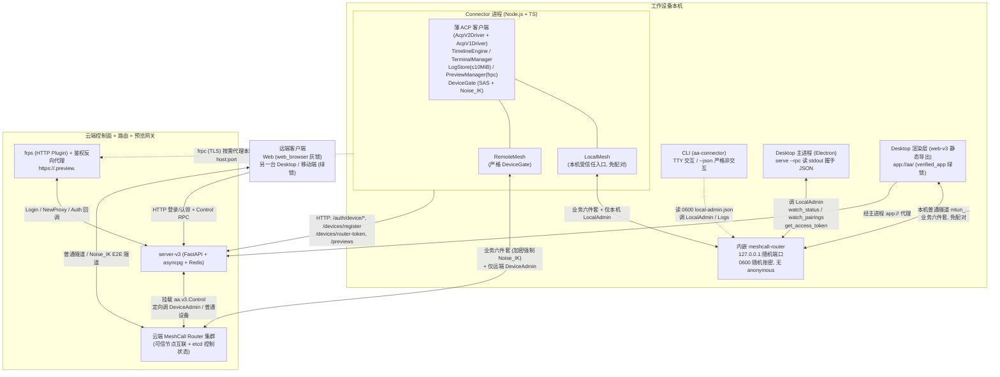

# AA v3 新版全栈架构整理方案（Connector → Desktop → Server → Web）

> 状态：**已定稿**（2026-11-26，作为 v3 干净重写的全栈架构基线）。本文汇总并固化已对齐的核心架构、服务边界、安全模型与框架特性，作为后续制定 `contracts/aa-v3/` 契约与分阶段重写各端的单一真相来源。

---

## 0. 总体设计原则与拓扑

1. **离线一等公民（Local-First）**：Desktop 的离线状态完全建立在本机 Connector 提供的离线能力之上；零账号、零网络、零 Server 配置即可使用完整的本地 Agent 工作台。Server 是「跨设备互联 + 云端增值能力」的可选在线叠加层。
2. **本机直通、隧道同构**：本机到本机一律通过 Connector 内嵌的本机 `meshcall-router`（`127.0.0.1`）操作，**不需要配对**；并且本机与远端暴露完全相同的业务服务与隧道抽象——**隧道就是让远程操控一台设备像在本机一样**。Web 与 Electron 共用同一套前端（`web-v3`）。
3. **本机与远端物理隔离**：在 Connector 中通过两个独立的 MeshCall `Mesh` 实例（`LocalMesh` vs `RemoteMesh`）隔离权限边界，绝不依赖请求 metadata 判断来源。
4. **两阶段登录、显式无默认加密上线**：Connector 先通过统一 Device Flow 登录获取用户级凭据（此时不注册设备、不连云端）；首次登录某 `(server_url, user_id)` 档案时，必须由用户手动显式选择「是否注册上线」以及「`encrypted` / `normal`（无默认值）」，持久化后才接入云端——零安全空隙窗口。
5. **防中间人且极简的跨设备配对**：废除旧的 `aa-pair://` 二维码/长链接、10 位手输配对码与 `Noise_IKpsk2`，统一改为 **Commit-Reveal + 8 位 Crockford Base32 SAS 核对码 + 双端确认**（Desktop 主审批弹窗，CLI 仅作 headless 兜底），配对后直接走 `Noise_IK_25519_AESGCM_SHA256`。
6. **薄 ACP 客户端**：Connector 不再持久化对话消息正文，也不持久化/重放事件；仅持久化界面元数据与轻量辅助关联元数据，由 ACP 协议（`session/load`）还原内容并合成对外暴露的 `Timeline / Turn / Item(seq) + Meta + Interactions + Subagent/Task 槽位` 模型。
7. **产品形态范围**：Orches 作为独立子产品纳入本方案（支持实验性 Orches 模式与经典模式切换）；移动端前端留到最后再设计，当前仅保持跨端契约干净。



---

## 1. 第一层：Connector（`connector-v3`）

### 1.1 技术栈与 MeshCall 框架特性

- **运行时**：Node.js + TypeScript + `meshcall` (`v0.4.0+`) + `node-pty` + WebCrypto + 内置 `meshcall-router` + 内置 `frpc`（Apache-2.0，随包分发并在 `NOTICE` 保留声明）。
- **MeshCall 能力运用**：
  - 强类型 Zod Schema + `@service` / 完整 `description` 与方法语义标注（`read_only` / `idempotent` / `destructive`），开启 `MESHCALL_STRICT=1`。
  - 所有设备业务与 `DeviceAdmin` 服务为 `targeted: true`（绑定 `instanceId = active_device_id`）；`aa.v3.LocalAdmin` 为 `targeted: false`（单本机实例）。
  - 四种通信形态各司其职：`unary`（查询/操作）、`server_stream`（Timeline 更新、日志流、本机状态/配对审批流、预览状态流，自动信用流控）、`client_stream`（控制面心跳 `presence`）、`duplex`（仅 `Terminals/attach`）。
  - **两张独立网络、两套凭据**：`LocalMesh` 注册在本机边缘 Router，`RemoteMesh` 连云端 Router 集群（见 1.10）；Connector 同时加入两者，任何一方都不是另一方的上行。
  - `LocalRouter` 绑定 `127.0.0.1` 随机端口 + 0600 随机账密（无 `anonymous`），对外签发带 scope 的 `mt_` token 与**本机普通隧道 `mtun_...`**（使渲染层连接本机与连接远端隧道在调用代码上 100% 一致，均无需手动传 `instance`）。
  - 仅 `RemoteMesh` 启用 `DeviceGate`：加密模式在 MeshCall 挂载层启用 `requireE2E: true` + `requireE2EPeer: true` + `authorizeE2EPeer`，仅接受已完成 `Noise_IK_25519_AESGCM_SHA256` 双向认证的已配对客户端（彻底移除 `Noise_IKpsk2`）。

### 1.2 双 Mesh 物理隔离与 8 个服务清单

| 服务 | 挂载位置 | `targeted` | 门控与职责 |
| --- | --- | --- | --- |
| **`aa.v3.LocalAdmin`** | **仅 `LocalMesh`** | `false` | 仅本机宿主（Desktop 主进程 / CLI）凭 `admin_token` 调用：生命周期状态（`status`, `watch_status`）、账号登录与 Token 托管（`auth_status`, `login_start`, `login_poll`, `login_watch`, `get_access_token`, `logout`）、显式声明加密与上线（`online`, `offline`, `switch_mode`, `set_mcp`）、签发本机隧道/Token（`open_local_tunnel`, `issue_local_token`）、跨设备 SAS 配对审批（`list_pairings`, `watch_pairings`, `resolve_pairing`）、已配对白名单管理（`list_clients`, `add_client`, `revoke_client`）、缓存清理（`clear_cache`） |
| **`aa.v3.DeviceAdmin`** | **仅 `RemoteMesh`** | `true` | 控制面无业务内容管理通道（无隧道，加密/普通模式均接受）：`ping`、`close_tunnel_sessions`、`check_update`、`rename` + **SAS 公开交换中转**（`pairing_start`, `pairing_reveal`, `pairing_status`）。严禁读写会话或擅自改模式/白名单 |
| **`aa.v3.Sessions`** | `LocalMesh` + `RemoteMesh` | `true` | 薄 ACP 客户端 + Timeline 对话服务（`list`, `watch_list`, `refresh_list`, `get_snapshot`, `watch`, `get_slot_snapshot`, `watch_slot`, `start_turn`, `steer_turn`, `interrupt_turn`, `answer_interaction`, `fork_turn`, `rewind_turn` 等，详见 1.3） |
| **`aa.v3.Agents`** | `LocalMesh` + `RemoteMesh` | `true` | 从原 `aa.v3.Device` 拆出的独立 Agent 管理服务：安装探测、**设备本地 Agent 设置读写（`agents.json` / `custom-agents.json`）**、**启用 / 禁用 / 重启 ACP 进程**、增删自定义 Agent、安装与登录、CC Switch Provider、订阅用量（详见 1.4） |
| **`aa.v3.Terminals`** | `LocalMesh` + `RemoteMesh` | `true` | 伪终端服务（`list`, `create`, `resize`, `close`, `attach` [duplex]） |
| **`aa.v3.Device`** | `LocalMesh` + `RemoteMesh` | `true` | 设备状态与全局设置（含空闲休眠时长）、**设备级项目实体管理（`projects.json`：`cwd` 持久化、自定义名称、置顶与排序）**、**FS 目录列举/文件读写（支持本地与远程对话直接引用路径）**、Git status/diff、小附件与云盘大文件拉取、已配对客户端查询与撤销（**移除旧 `create_pairing`**） |
| **`aa.v3.Logs`** | `LocalMesh` + `RemoteMesh` | `true` | 持久化轮转日志服务（仅 `list` 与 `watch` 两方法，详见 1.5） |
| **`aa.v3.Previews`** | `LocalMesh` + `RemoteMesh` | `true` | 本地端口 FRP 公网预览服务（`list`, `open`, `update`, `close`, `watch`，详见第 5 节） |

> 业务六件套（`Sessions` / `Agents` / `Terminals` / `Device` / `Logs` / `Previews`）在 `LocalMesh` 上免配对直通；在 `RemoteMesh` 上加密模式仅接受已配对 `Noise_IK` 隧道（拒绝明文、未配对、MCP），普通模式接受客户端隧道（其中 `Agents`、`Terminals`、`Logs`、`Previews` 及 `Device` 写操作一律拒绝 MCP 与控制面直接调用）。

### 1.3 薄 ACP 客户端与 Timeline 模型（`aa.v3.Sessions`）

#### 对外对话数据模型（面向 UI 直接渲染，不暴露 ACP）
1. **主对话 `snapshot`（`get_snapshot({ id, limit?, before_seq?, epoch? })`）**：
   - **`meta`**：会话轻量元数据（`id`, `acp_session_id`, `agent`, `cwd`, `branch`, `title`, `pinned`, `unread`, `created_at`, `updated_at`, `config`, `capabilities`, `forked_from`）。
   - **`load`**：水合状态 `{ state: "loading" | "ready" | "failed", error?: { code, message, retryable } }`。`session/load` 失败（例如 Codex 拒绝加载「创建时所用模型供应商已不在配置中」的会话、ACP 进程启动失败、会话已被外部删除）时返回 `failed` 并附原因，`timeline` 为空、`meta` 照常可用；客户端展示明确的「无法打开」提示与可行操作（重试 / 改回供应商 / 删除），不得无限转圈。
   - **`timeline_epoch`**：本次水合的不透明标识。Timeline 每次经 `session/load` 重新生成（ACP 进程启动/重启/休眠后唤醒、`rewind_turn`、重新加载）都换一个新 epoch，**`seq` 只在同一 epoch 内单调且有意义**。`before_seq` 分页请求须同时带 `epoch`，epoch 不匹配时返回 `epoch_mismatch` 错误，客户端整体重拉 `get_snapshot`；远端设备离线只读缓存同样以 epoch 为单位整体替换。（注：`before_seq` 分页只减少传输量，ACP 侧每次水合仍完整回放历史。）
   - **`timeline: Turn[]` + `cutoff_seq` + `has_more`**：
     - 一个 **`Turn`** 代表用户发出消息到 AI 主动结束（或被打断/出错）的一整轮对话：`{ turn_id, status: "running" | "completed" | "interrupted" | "error", started_at, ended_at?, items: TimelineItem[] }`。
     - 每个 **`TimelineItem`** 持有全局单调递增的 **`seq`**（用户消息、steer 注入消息、文本、思考、工具调用、子代理引用卡片、压缩等），支持按 `before_seq` 向上分页且按整 Turn 对齐不截断。
   - **`interactions`**：非聊天正文的交互与侧边状态——审批（`approvals` 待处理 + 已处理记录，多端抢答首答生效）、非聊天内容错误/告警（`errors`）、`goals`、`plans`、排队消息（`queued`）、上下文用量（`usage`）。
   - **`subagents` / `tasks`（仅摘要与引用！）**：主 `snapshot` 只带槽位摘要（`id, kind: "subagent" | "task", title, agent_type?, status, background, started_at, ended_at?, item_count`），**不把子会话全量消息塞进主快照**；客户端点开需要时再按需调用独立槽位接口 `get_slot_snapshot(session_id, slot_id)` 与 `watch_slot(session_id, slot_id)`，内部采用与主 timeline 相同的结构。
2. **实时订阅 `watch`（`timeline_update` server stream）**：
   - **不持久化事件，不提供事件重放**：`get_snapshot` 保证读到最新状态，`watch` 保证推送订阅时刻之后的最新幂等 upsert；断线、慢消费掉帧或 `rewind_turn` 后客户端直接重拉 `get_snapshot`。
   - 推送事件类型：
     - `turn_upsert`（新增 Turn 并附带初始 items，或更新 Turn 状态）
     - `item_upsert`（新增或更新某个 Turn 内的若干 `TimelineItem`）
     - `slot_upsert`（更新某个 subagent / 后台任务槽位的摘要引用）
     - `meta_upsert`（更新 `meta`）
     - `interactions_upsert`（更新审批、错误、goal、plan、队列、用量）
     - `load_upsert`（水合状态变化：`loading` → `ready` / `failed`）
     - `snapshot_required`（`timeline_epoch` 变化时发出，例如 `rewind_turn`、进程重启后重新水合或整条 timeline 重放，携带新 `epoch`，要求客户端拉取新 `snapshot`）
   - 所有 `watch` 事件都带当前 `epoch`，客户端收到与本地不一致的 epoch 时丢弃该事件并重拉 `get_snapshot`。
3. **写操作**：`start_turn`（带 `client_msg_id` 幂等）、`steer_turn`、`interrupt_turn`、`answer_interaction`、`fork_turn`（按能力）、`rewind_turn`（按能力，广播 `snapshot_required`）、`queue_cancel` / `steer_queued`、`set_config`、`rename`、`pin`、`mark_read`、`delete`。

#### 磁盘持久化边界与会话列表刷新机制（零消息正文，轻量辅助元数据合成）
- **绝不落盘消息正文、工具输出与 diff**；消息内容以 ACP 服务器为唯一真相来源，按需通过 ACP `session/load` 水合到内存并实时投影。
- **会话列表刷新时机（由 Connector 自身编排，事件驱动 + 定时兜底）**：
  1. **SWR 瞬时返回**：客户端请求 `list` / `watch_list` 时，立刻合并 `sessions-meta.json` 与磁盘缓存 `cache/sessions/*.json` 返回，实现侧边栏秒开；
  2. **进程就绪即刷**：任一已启用 Agent 的 ACP 进程刚启动/重启完成（`initialize` 通过）→ 立刻调 `session/list` 更新磁盘缓存并通过 `watch_list` 推送；
  3. **写操作即时同步**：经 AA 创建、删除、重命名、分叉或 Turn 结束后立即更新本地 `meta` 与缓存并推送；
  4. **定期异步兜底刷新（默认每 10 分钟）**：对当前处于 `running` 态的已启用 Agent，若距上次 `session/list` 超过 10 分钟，后台自动异步刷新一次 `session/list` 并写回磁盘缓存，以同步用户在本地终端直接新开的外部会话（**绝不唤醒休眠中的 Agent**）；
  5. **手动强制刷新**：客户端可显式调用 `aa.v3.Sessions/refresh_list({ agent_id? })`（带短防抖）。
- **内存水合与进程同生命周期**：内存中水合出的 Timeline 与对应 ACP 进程绑定，**随 ACP 进程一起销毁**；进程闲置销毁时间由用户设置决定，不另设独立的内存淘汰策略。
- **仅落盘两类轻量数据**：
  1. 驱动侧边栏的会话 `meta`（含 `acp_session_id`、`agent`、`cwd`、`title`、`pinned`、`unread`、`updated_at`、上次 `config`）；
  2. **辅助关联元数据（Sidecar）**：记录 ACP 本身缺失的界面信息——每条消息/每轮的发信设备与作者、精确时间戳、审批处理人与处理设备、`client_msg_id` 映射。水合时按 **`messageId` / `toolCallId` 优先精确匹配**，对暂未发 `messageId` 的旧 ACP v1 Agent 用 **`turn_index` + 摘要兜底** 关联合成。

#### ACP 双驱动架构（硬门槛：必须同时支持 `session/list` 与 `session/load`）
- **硬门槛**：`initialize` 探测时，`loadSession !== true` **或**未声明 `session/list` 能力的 ACP Agent **不支持调用**（会话列表完全来自 `session/list`，打开会话完全依赖 `session/load`，两者缺一不可，不做降级）。
- **双驱动隔离（遵循 ACP 官方 side-by-side 迁移规范）**：
  - **`AcpV2Driver`（主驱动，优先协商 `protocolVersion: 2`）**：原生对接 Claude Code（`@agentclientprotocol/claude-agent-acp`）、Codex（`@agentclientprotocol/codex-acp`）及后续 v2 Agent，完整利用必填 `messageId`、异步 `session/prompt` + `state_update`、基线 Subagent 与 Background Work、多 Plan 与统一 Patch-by-ID。
  - **`AcpV1Driver`（独立可插拔驱动，回退协商 `protocolVersion: 1`）**：对接 Pi（`@openma/pi-acp`）、OpenCode、Gemini CLI、Copilot CLI、Goose、Kimi、Qwen 等，**补齐 2026-11 最新 ACP v1 能力**：`session/load`、`session/list`、可选 `messageId`、Subagent 子会话 opt-in、`usage_update`、预标准扩展 **`_session/steering`**（让 Pi 等在 v1 也能原生 `steer: "native"`）、`session/fork`（unstable）以及 `resource_link`。未来生态迁完 v2 可整文件删除，零侵入主干。

#### 文件与附件对称模型
- **优先直接引用路径**（映射到 ACP `resource_link` / 文件路径引用）：
  - 本机（Desktop 离线或本机直连）：直接引用本地文件路径，不拷贝不上传；
  - 远端控制某台设备：既可从客户端上传附件到被控设备（小文件走 RPC `save_attachment`，大文件走云盘密文中转 `fetch_drive_file`），也可**直接通过 `aa.v3.Device` 的 FS 接口浏览被控设备目录并在对话中引用被控设备上的路径**，与离线模式行为完全对称。

### 1.4 Agent 进程管理与设备本地设置（`aa.v3.Agents`）

- **极简进程生命周期（彻底移除旧版 `Sessions/prepare` 预热池与双进程 `retire` 交接）**：
  - 进程状态清晰收敛为 4 态：`disabled`（未启用） / `starting`（启动与 `initialize` 协商中） / `running`（运行中） / `error`（异常退出，附最后错误并可重启）。
  - 仅保留 3 个用户操作：**启用（打开开关）**、**禁用（关闭开关，停进程并清会话列表缓存）**、**重启（杀掉旧进程并重开，释放旧内存 Timeline，使新配置立即生效）**。
  - **拉起与空闲休眠**：新扫描到的已安装 Agent 默认为 `disabled`（由用户按需打开主力 Agent 开关）；有客户端活跃时，所有已启用 Agent 均保持 `running`；当所有客户端断开且无运行中 Turn/后台任务超过**用户设定的闲置时长**（可配置永不休眠或 N 分钟）时，优雅关闭 ACP 进程（连同内存 Timeline 销毁），下次任一客户端连接时自动拉起全部已启用 Agent。
  - **闲置时长只有一个全局设置**，存于 `dataDir/settings.json`、经 `aa.v3.Device` 读写，作用于全部 Agent；Agent 设置里不再有单独的休眠项。
- **Agent 设置保存在工作设备本地并统一经 RPC 读写**：
  - 持久化在 `dataDir/agents.json`（内置 Agent 本地覆盖）与 `dataDir/custom-agents.json`（自定义 Agent），权限 `0600`，**绝不上传云端 Server，绝不把 `env` 值写入日志**。
  - 设置项包含：`enabled`、`program`/`command`/`args`、`env`、`gateway`、`provider`（所选 CC Switch Provider 的 id）等。
  - **新对话的配置不设默认项**：新建对话沿用该 Agent 在本设备**最近一次新建对话时**的配置（模型、模式等，`dataDir/last-session-config.json`），从未建过时取 Agent 自身的默认值。
  - **「模型与订阅」基于 CC Switch（Powered by CC Switch，MIT）**：
    - Provider 数据就是用户本机 CC Switch 的数据库 `~/.cc-switch/cc-switch.db`（`providers` 表），AA 不另存一份 Provider 列表；AA 可以增删改该表的行（远端与未安装 CC Switch 的设备也能管理），**绝不修改 `is_current`、`live-state.json`、`settings.json`、日志模式或表结构**。
    - 为某个 Agent 选定 Provider **只作用于 AA 拉起的进程**：启动时把该 Provider 的 `settings_config` 转换为 env / 会话 `_meta` / ACP `providers/set`；不切换 CC Switch 的当前项，也不改写 Agent 自身的配置文件。
    - 订阅用量移植自 CC Switch 的实现（保留 MIT 声明）。
  - 通过 `aa.v3.Agents` 的 `list`、`watch`、`refresh_scan`、`get_settings`、`update_settings`、`add_custom`、`remove_custom`、`enable`、`disable`、`restart`、`install`、`sign_in`、`list_providers`/`save_provider`/`remove_provider`、`subscription_usage` 统一读写；本机与已授权远端客户端完全同构，**一律拒绝 MCP 与控制面直接调用**。变更启动类参数（`command`/`args`/`env`/`gateway`）时标记 `restart_required` 或按请求参数立即重启进程。

### 1.5 持久化轮转日志服务（`aa.v3.Logs`）

- **本地存储**：`dataDir/logs/`（目录 `0700`，文件 `0600`），递增段号 NDJSON（`connector-000001.ndjson`…，无 rename 竞态），**单段 ≤ 2 MiB × 最多 5 段 = 总大小严格上限 10 MiB**；归集内嵌 `local-router` 与 `frpc` stderr；内存维护 500 条环形缓冲。
- **自动脱敏**：写入前过滤 `token`、`secret`、`password`、`key`、`authorization`、`cookie` 字段与 `mt_`/`mtun_`/`Bearer ` 前缀，单条截断 ≤ 8 KiB。
- **RPC 契约（仅 2 个方法）**：
  - `list({ limit?, before_seq?, min_level?, source? })` → `{ entries, has_more }`
  - `watch({ tail?, after_seq?, min_level?, source? })` → server_stream of `LogEntry`
- **stdio 约束**：RPC 模式（`serve --rpc`）**运行日志绝不写进 stdio**；CLI 前台模式写磁盘并默认输出到 `stderr`（支持 `--quiet`）；Connector 离线/崩溃时 `aa-connector logs` 自动回退直读 `dataDir/logs/`。

### 1.6 缓存架构（真相 / 磁盘缓存 / 纯内存缓存三层分离）

严格分离不可重建的持久真相（`dataDir/`）与可随时删除重建的派生缓存（`dataDir/cache/`，0700/0600，支持 `aa-connector cache clear`）：
- **存储方式**：按模块拆分的独立小 JSON 文件 + 原子写入（临时文件 → `rename`），统一带 `{ schema_version, updated_at, source_fingerprint?, data }` 信封；不上 SQLite（避免 Node/Electron 跨平台原生编译坑），损坏或版本不符直接丢弃重建。
- **绝不进磁盘缓存**：对话消息正文 / 工具输出 / diff、任何私钥 / Token / API Key / 用户 `env` 值。

| 缓存项 | 位置 | 缓存内容 | 刷新与失效策略 |
| --- | --- | --- | --- |
| Agent 安装探测 | `cache/agents-scan.json` | 已安装路径、版本、登录方式 | 启动后后台扫一次；短窗（30s）命中，超窗异步重扫；安装/卸载/手动刷新/改自定义 Agent 立即失效 |
| Agent 能力与配置项 | `cache/agent-caps/<agent_id>.json` | ACP 版本、`capabilities`、`configOptions`（模型/模式列表） | 新建对话页先返缓存秒开；每次 `initialize` / `config_option_update` 写回；二进制 `mtime`/版本变化或改配置/CC Switch 立即失效 |
| 已启用 Agent 会话列表 | `cache/sessions/<agent_id>.json` | `session/list` 轻量摘要（`acp_session_id, cwd, title, updated_at`） | SWR 秒开；进程就绪即刷、写操作即时更新、**运行态 Agent 超过 10 分钟未刷则后台定期异步刷新**（不唤醒休眠进程）、支持手动刷新；禁用 Agent 时删除缓存 |
| 订阅用量 | `cache/usage/<agent_id>.json` | 订阅额度与重置时间 | 60s TTL；手动刷新或 Turn 结束后节流刷新；登录/Provider 变更失效 |
| Git 分支摘要 | 纯内存（不落盘） | 会话目录分支名 | 10~30s TTL，打开会话或 Turn 结束后懒刷新 |
| 水合 Timeline / Slot | **纯内存（绑定 ACP 进程，绝不落盘）** | `Turn[] / Item(seq)[] / Interactions / Subagent Slots` | 首次打开经 `session/load` 水合，运行期实时推更新，`rewind` 重拉，**随 ACP 进程销毁** |

> **客户端（Web / Desktop）缓存边界**：本机设备完全依赖 Connector 缓存，前端不囤本地副本；前端 IndexedDB 仅缓存**远端设备离线时的只读降级视图**，远端恢复在线后整体替换。

### 1.7 多 Server / 多账号档案隔离与设备换绑

**默认数据目录统一以 CLI 为准**：Desktop 与独立 CLI 统一默认使用 **`~/.agents-anywhere/connector-v3`**（仍支持 `AA_CONNECTOR_DATA_DIR` / `--data-dir` 覆盖），确保运行 Desktop 时，终端直接执行 `aa-connector status` / `logs` / `pair` 可无缝连接同一本机 Connector。

```text
dataDir/
├── machine.json                           # 机器级稳定 UUID (machine_id)，仅本机离线身份，绝不上报任何 Server
├── active-profile.json                    # 当前活跃的 (server_url, user_id) 指针，离线时为 null
├── settings.json (0600)                   # 机器级全局设置（如空闲休眠时长、默认目录等）
├── projects.json (0600)                   # 机器级项目实体（cwd、自定义名称、置顶、sort_key）
├── sessions-meta.json                     # 机器级对话 meta（含 pinned/sort_key）+ 辅助关联元数据（不含消息正文）
├── agents.json / custom-agents.json (0600)# 机器级 ACP Agent 本地设置（含启用开关与 env）
├── last-session-config.json               # 每个 Agent 最近一次新建对话时的配置（新对话沿用）
├── local-router-auth.json (0600)          # 本机 meshcall-router 随机账密
├── local-admin.json (0600)                # 运行中 Connector 本机发现文件（取代 admin.sock）
├── logs/connector-NNNNNN.ndjson (0600)    # ≤ 10 MiB 轮转日志
├── cache/ (0700)                          # 可随时安全删除重建的派生磁盘缓存
│   ├── agents-scan.json
│   ├── agent-caps/<agent_id>.json
│   ├── sessions/<agent_id>.json
│   └── usage/<agent_id>.json
└── profiles/<sha256(server_url + user_id)>/   # 严格按 (server, account) 隔离
    ├── auth.json (0600)                   # 用户级 access_token / refresh_token / access_level / user
    ├── binding.json (0600)                # enroll_online, mode(无默认), device_id, device_secret, e2e_keypair, allow_mcp, device_name
    ├── paired-clients.json (0600)         # 该档案独立的远端已配对客户端公钥白名单
    └── pending-login.json (0600)          # 非交互式 login start 临时态（完成后删）
```

- **首次登录某 `(server_url, user_id)`**：档案下无 `binding.json` → 强制要求用户显式选择「是否注册上线」以及（若上线）「`encrypted` 或 `normal`（无默认）」→ 持久化后再上线。
- **设备 ID 策略（按档案独立 UUID）**：`machine_id` 只作本机离线身份（本机隧道等），**绝不上报给任何 Server**。每个 `(server_url, user_id)` 档案首次注册上线时都新生成独立的 UUID `device_id`、全新 X25519 密钥对与空白白名单，写入该档案的 `binding.json`；服务端返回该 ID 已被占用时重新生成。不同 Server / 账号之间无法通过设备 ID 关联同一台机器，且**零主键冲突、零密钥串号、零旧配对泄漏**。
- **退出登录 vs 解绑**：
  - **普通退出（Logout）**：立即断开云端 `RemoteMesh` 与 `presence`，向 Server 吊销 `refresh_token` 并删除 `auth.json`，退回离线态；保留该档案的 `binding.json` / 密钥 / 白名单，便于**同一账号再次登回**时免重做手机 SAS 配对（若设备已在云端被删，探测失效后自动清空档案重选）。
  - **退出并解绑（`--unbind`）**：通知 Server 删除设备记录并彻底删除本机对应 `profiles/<id>/` 目录。

### 1.8 双接口规范（彻底淘汰 `admin.sock`）

- **接口一：RPC 模式（`aa-connector serve --rpc [--shutdown-on-stdin-close]`）**
  - 日志绝不写 stdio（`stderr` 仅保留 RPC 就绪前的启动致命错误）；就绪后向 `stdout` 输出**单行 JSON**：
    `{ v: 1, event: "ready", router_url, http_url, admin_token, local_tunnel: { credential, device_id, expires_at }, logged_in, online, mode, e2e_public_key, connector_version, data_dir }`。
  - 宿主后续全部通过本机 `meshcall-router` 调 `aa.v3.LocalAdmin` 与业务六件套。
- **接口二：CLI 模式（Headless 运维、脚本、云编排）**
  - 默认 TTY 文本模式允许交互；带 `--json` / `--non-interactive` 或非 TTY **强制非交互**（单条命令一个原子动作，状态通过参数 / 环境变量 / `dataDir` 文件传递，输出 `{ ok, data | error }` 或 NDJSON，带规范退出码）。
  - 核心命令：`serve`、`login [start|poll|status]`、`logout [--unbind]`、`online --mode <encrypted|normal>`、`offline`、`status`、`mode`、`mcp`、`agents [list|enable|disable|restart|settings]`、`logs [--lines N] [--follow]`、`pair [watch|list|approve|reject]`、`clients [list|add|revoke]`、`previews [list|open|update|close]`、`cache clear`、`local-token`。

### 1.9 跨设备 SAS 配对协议（加密模式）

仅加密模式设备需要配对（普通模式直接接受客户端隧道）。Server 只中转公开信息，**视为不可信信道**：协议保证恶意 Server 无法在用户不察觉的情况下插入中间人。

**角色与密钥**：客户端 `C`（Web / 另一台 Desktop / 移动端）持有静态 X25519 密钥对 `(c_priv, c_pub)`；设备 `D`（Connector 当前档案）持有 `binding.json` 中的 `(d_priv, d_pub)`。

**流程（经 `aa.v3.Control` → `aa.v3.DeviceAdmin` 中转）**：

| 步骤 | 方向 | 内容 |
| --- | --- | --- |
| 1. `pairing_start` | `C → D` | `pairing_id`（C 生成的 128-bit 随机数）、`c_pub`、`client_label`（设备名/浏览器、平台）、**承诺** `commit = SHA-256("aa-v3/sas/commit" ‖ pairing_id ‖ c_pub ‖ nonce_c)`，其中 `nonce_c` 为 32 字节随机数，**此时不发送** |
| 2. 响应 | `D → C` | `device_id`、`d_pub`、`nonce_d`（32 字节随机数，明文） |
| 3. `pairing_reveal` | `C → D` | `nonce_c`；D 重新计算并校验 `commit`，不一致立即作废该 `pairing_id` 并计入失败次数 |
| 4. 计算核对码 | 双方各自 | `sas = SHA-256("aa-v3/sas/code" ‖ pairing_id ‖ device_id ‖ c_pub ‖ d_pub ‖ nonce_c ‖ nonce_d)`，取前 40 bit 编码为 8 位 Crockford Base32，按 `XXXX-XXXX` 展示 |
| 5. 双端人工确认 | — | C 端用户核对后点「确认一致」，C 才信任 `d_pub`；D 端 Desktop 弹窗（或 CLI `pair approve <id>`）展示同一核对码与 `client_label`，经 `LocalAdmin/resolve_pairing` 同意后才把 `c_pub` 写入该档案 `paired-clients.json` |
| 6. 建立隧道 | `C ↔ D` | C 以 `d_pub` 发起 `Noise_IK_25519_AESGCM_SHA256`；首次握手成功即配对完成，`pairing_status` 返回 `completed` |

**安全要点**：
- **承诺先于对方随机数**：C 在看到 `nonce_d` 之前就已锁定 `nonce_c`，D 发出 `nonce_d` 时不知道 `nonce_c`，中间人无法预先挑选随机数凑出两边相同的核对码；单次尝试的成功概率为 2⁻⁴⁰。
- **核对码绑定全部上下文**：`pairing_id`、`device_id` 与双方公钥都进入哈希，替换任一公钥都会使两端核对码不同。
- **Server 传来的状态一律不作为信任依据**：D 只以本机用户的 `resolve_pairing` 为准，C 只以本端用户的「确认一致」为准；Server 伪造的 `confirmed` / `approved` 状态不改变任何一方的白名单或信任。
- **单次与时效**：每个 `pairing_id` 只能 reveal 一次，从 `pairing_start` 起 120 秒内未完成双端确认即过期；核对码不一致只能重新发起（新的 `pairing_id` 与新随机数），不允许在同一会话内重试。
- **防反复撞码（由 Connector 本地强制，不依赖 Server）**：每个档案同时最多 3 个待处理配对；10 分钟内被拒绝、过期或承诺校验失败累计 5 次后，暂停接受新配对 10 分钟，并在 `watch_pairings` 推送告警。每次尝试都需要设备端真人审批，攻击者无法自动化撞码。
- **撤销**：`LocalAdmin/revoke_client` 或 `Device` 撤销接口从白名单删除 `c_pub`，并通过 `DeviceAdmin/close_tunnel_sessions` 立即断开该客户端现有隧道。

### 1.10 MeshCall 网络：云端 Router 集群与本机边缘 Router

- **云端 Router 集群（高可用）**：一组互相可达的可信 Router 节点，控制状态（Token、隧道、吊销、实例所在节点、成员关系）存放在 etcd，节点之间转发调用；连上任意一个节点即加入整个网络。Server（`aa.v3.Control`）、Connector 的 `RemoteMesh` 与远端客户端都经负载均衡地址连任一节点，**不由客户端在多个独立 Router 之间选路**（放弃 MeshCall #87 的客户端多 Router 方案）。无状态的单 Router 做不到高可用，因为 Token、隧道与吊销只存在签发它的 Router 内存里。
- **本机边缘 Router（`LocalRouter`）**：即 Connector 内嵌的 `meshcall-router`，**始终由 Connector 启动**（不再是可选开关）。职责：本机 IPC（Connector ↔ Desktop 主进程 / CLI）与本地优先（本机客户端免配对直连）。它与云端集群无关：既不加入集群，也不作为集群的上行或下级节点。
- **局域网直连（下一期）**：在边缘 Router 上增加一个独立的局域网监听，与 `127.0.0.1` 本机监听分开；局域网路径对两种模式都要求 `Noise_IK`（普通模式设备先经云端隧道登记客户端公钥），设备局域网地址经 E2E 通道交给已配对客户端，mDNS 默认关闭、开启时使用不透明且轮换的标识。云端签发的 `mtun_` 凭据在边缘 Router 上无效，需另行签发。首版只交付经云端集群的远程控制。
- **MeshCall 侧待定**：etcd 不可用时集群的降级行为；一元调用幂等去重如何跨节点生效。

---

## 2. 第二层：Desktop（`desktop-v3`）

- **Electron 安全与协议特性**：
  - 渲染窗口 `contextIsolation: true`、`sandbox: true`、`nodeIntegration: false`、`webSecurity: true`；所有 IPC 校验来源为 `app://aa/`；OS Keychain 走 `safeStorage`（Linux 拒 `basic_text`）；本地签名包属于 **`verified_app`（绿锁）**。
  - `app://aa/` 托管 `web-v3` 静态导出并反代 `/api/control/*` & `/api/remote`（免 CORS），`webRequest` 剥离 WebSocket `Origin` 头；**修正 `resolveStaticFile` 使真实静态文件优先于动态 `_` 占位符**。
- **极薄主进程（删除 `admin-client.ts`、`connector.log` 接管、`qrcode`、5 秒轮询、停机重启注册）**：
  1. 以 `ELECTRON_RUN_AS_NODE=1` 拉起 `aa-connector serve --rpc --shutdown-on-stdin-close`，解析 stdout 就绪 JSON；
  2. 连本机 `LocalRouter` 调 `aa.v3.LocalAdmin`：订阅 `watch_status`（驱动托盘与前端状态）和 **`watch_pairings`（跨设备 SAS 配对主审批端：后台时弹原生系统通知并唤起窗口弹出审批框）**；
  3. **账号单点登录托管**：Desktop 不维护第二套登录栈，通过 `LocalAdmin/login_start(access_level="full")` 触发浏览器 OAuth 授权，并通过 `LocalAdmin/get_access_token` 获取 Connector 自动续期的完整用户级 Token 去调 Server 服务；登出/换号与 Connector 原子同步；
  4. 向渲染层下发本机普通隧道 `{ routerUrl, credential, deviceId }`（Connector 重启或切换活跃档案时通过 `onLocalConnection` 推送刷新），让渲染层直连本机业务六件套。

---

## 3. 第三层：Server（`server-v3`）

- **框架与并发特性**：Python 3.12 + FastAPI + Pydantic v2 + SQLAlchemy Core/`asyncpg` + `redis.asyncio` + MeshCall（经负载均衡地址连云端 Router 集群任一节点，不在客户端做多 Router 选路，见 1.10；严格守住 `test_architecture.py` 分层；`aa.v3.Control` 中所有方法在 MeshCall `WorkerLoop` 线程执行，必须经 `_on_app_loop` / `_stream_on_app_loop` 回切 FastAPI 主循环）。
- **统一 Device Flow 登录 & 两档自签 Token（同时兼容 `auth_mode = local | oidc`）**：
  - 端点：`POST /auth/device/start`（返回 `device_code` + 8 位 Crockford Base32 `user_code` `XXXX-XXXX` + `verification_uri` + `verification_uri_complete`）、`GET /auth/device/preview`、`POST /auth/device/claim`（网页点击或自动化以用户身份调）、`POST /auth/device/poll`（原子消费一次性返回凭据）。
  - **两档 `access_level`（由 `server-v3` 自己签发并管理刷新与撤销）**：
    - `device`（CLI / 自动化默认）：授予**除用户安全外的全部业务权限**（`/auth/me|refresh|logout`、`/auth/router-token`、`/devices/register`、`/drive/*`、`/previews/*`、`/assistant/conversations*`）；**明确禁止** `/auth/device/claim|preview`、`/mcp/grants*`、`/oauth/authorize`、`/assistant/encryption`、`/assistant/tokens`、`/admin/*`。
    - `full`（Desktop 宿主，强制需真人经浏览器确认页同意）：授予**完整用户级权限 Token**，使 Desktop 登录一次即可使用全部服务端能力。
  - **OIDC 状态同步**：在 `auth_mode = "oidc"` 下，服务端通过**定期回查上游 OIDC**（以及 Token 刷新/后台任务检查）同步用户的封禁状态与 `entitlements` 快照。
- **设备注册与上线强约束**：
  - `POST /devices/register` 接收客户端/Connector 生成的 UUID `device_id`（校验未被其他用户占用）、**强制必填 `mode_hint: "encrypted" | "normal"`（无默认值）**，加密模式必填 `e2e_public_key_hint`；未声明有效模式拒绝签发设备 Router Token 与上线。
- **控制面 `aa.v3.Control` 扩展**：
  - `TUNNEL_SCOPES` 统一包含 6 个业务服务：`aa.v3.Sessions`、`aa.v3.Agents`、`aa.v3.Terminals`、`aa.v3.Device`、`aa.v3.Logs`、`aa.v3.Previews`。
  - 新增 3 个 SAS 配对公开信息中转方法：`pairing_start`、`pairing_reveal`、`pairing_status`（校验设备归属后转发 `DeviceAdmin`，服务端不接触私钥也不参与决策）。
  - 普通设备聚合与缓存代理：针对经典模式下「列出所有未加密设备的最近会话与项目」等跨设备 RPC，`server-v3` 作为代理层扇出查询在线普通设备，并在 **Redis** 中按 `(user_id, device_id)` 缓存每台普通设备的轻量项目/会话摘要（不存正文、**绝不缓存加密设备**），通过扇出回填与设备变化通知保持新鲜，既实现侧边栏秒开也支持普通设备短暂离线时的只读展示；加密设备推送依然严格剥离一切正文。

---

## 4. 第四层：Web（`web-v3`）

- **一套 Next.js 代码双形态运行**：
  - Web 浏览器（`output: "standalone"`）：`web_browser`（灰锁），私钥存 IndexedDB，所有设备走云端隧道。
  - Desktop 内嵌（`AA_DESKTOP_EXPORT=1` + `output: "export"`）：`verified_app`（绿锁），凭据由主进程/Connector 托管，**本机设备走本机普通隧道，远端设备走云端隧道**。
- **统一设备传输层**：
  - 抽象出「设备来源（Local + Cloud，按 `device_id` 去重且本机永优先）」与「隧道获取（本机拿 `LocalRouter` `mtun_...` / 远端普通拿云端 `mtun_...` / 远端加密拿云端 `mtun_e2e....` + `Noise_IK`）」；
  - 拿到 `Mesh` 之后，会话、终端、文件浏览/引用、Agent 管理、日志面板、端口预览全部 **100% 同一套前端代码**。
- **核心交互与去原型化页面**：
  1. **Desktop「这台电脑」**：离线即用；点击登录走单点 OAuth 授权；首次登录该 `(server, account)` 弹出清晰的无默认二选一引导（是否上线？端到端加密 vs 普通模式）；彻底移除 `pairSelf`、二维码、`aa-pair://`。
  2. **跨设备 SAS 配对**：客户端点「请求配对」→ 自动 Commit-Reveal 交换 → 两端同时展示大号 **`K7M2-9P4X`** 安全核对码 → 客户端点「确认一致」+ 设备端 Desktop 全局审批弹窗点「同意配对」→ 立即建 `Noise_IK` 隧道（无界面 CLI 指引折叠在客户端弹窗底部次要位置）。
  3. **设备认领页 `/claim`**（顶层静态路由，不与 `/devices/[deviceId]` 冲突）：支持 `?code=XXXX-XXXX` 预填与手输 8 位码，清晰展示 `device` / `full` 授权级别与来源信息。
  4. **统一设备日志面板（`aa.v3.Logs`）**、**统一端口预览面板（`aa.v3.Previews`）**、**对话内远程/本地 FS 文件选择器（直接引用被控设备路径）**、**管理后台 `/admin/previews`**。

---

## 5. 跨层能力：Web 预览（FRP + 鉴权网关 + 精确到人后台策略）

- **域名隔离**：独立通配符子域 `https://<preview_id>.<preview_domain>`（每个预览随机子域），防 dev server 窃取主站登录态：
  - **推荐 `preview_domain` 使用与主站不同的可注册域名**（例如主站 `aa.example.com`、预览 `*.aa-preview.net`），使预览与主站跨站（cross-site）而不仅是跨源；
  - 若自托管只能用主站下的子域（`*.preview.<domain>`），则预览与主站同站：主站所有 Cookie 必须为 host-only（`__Host-` 前缀、不带 `Domain`），不得设置到父域 `.<domain>`，否则会被发往预览子域；
  - 公共部署将 `preview_domain` 提交到 Public Suffix List，使浏览器把每个预览子域视为独立站点，一个预览无法给父域或其他预览写 Cookie。
- **FRP 动态签发与加密**：
  - Connector 凭业务级用户 Token 调 `POST /previews` 申请槽位，服务端返回 `url`、`frp_server_addr`、`frp_tls_config`（TLS 加密，支持 CA/mTLS）、一次性 `preview_ticket` 与唯一 `subdomain`；
  - `frps` 通过 **HTTP Plugin** 回调 `server-v3` 校验 `Login`（票据有效）与 `NewProxy`（限定 `http` 类型且子域严格匹配）；
  - Connector 侧 `local_host` 默认 `127.0.0.1`，允许自定义本机可达的 `host:port`（如 Docker 容器 / WSL / 局域网测试机），由内置 `frpc`（Apache-2.0）按需拉起并在关闭/退出时清理。
- **入口鉴权与后台权限控制（两档权限，精确到人）**：
  - 访问权限暂设两档：**`private`**（默认，仅设备所属用户本人登录可访，跨子域一次性跳转换取子域鉴权 Cookie，WebSocket/HMR 天然穿透）与 **`public`**（完全公开，附 `X-Robots-Tag: noindex, nofollow`）；
  - **`private` 鉴权 Cookie 隔离**（防一个预览的 dev server 伪造或读取另一个预览、主站的凭据）：
    - Cookie 名为 `__Host-aa_preview`，属性 `HttpOnly; Secure; SameSite=Lax; Path=/`，**不带 `Domain`**（浏览器强制 host-only，只发往签发它的那一个预览子域），值绑定 `preview_id` 与用户，网关校验子域与 Cookie 中的 `preview_id` 一致；
    - 一次性跳转：主站签发 60 秒内单次有效的 `code` 跳到 `https://<preview_id>.<preview_domain>/__aa/auth?code=…`，网关兑换后 `302` 到原路径以去掉 URL 中的 `code`，避免经 `Referer` / 历史记录泄漏；
    - 网关转发给 dev server 前**从 `Cookie` 请求头中剥离 `__Host-aa_preview`**，dev server 永远拿不到鉴权凭据；同时丢弃上游响应里名称以 `__Host-aa_` 开头、或带 `Domain` 指向父域的 `Set-Cookie`；
  - 三级策略覆盖（对齐现有云盘策略范式）：① 全局开关（`preview_enabled`、`preview_public_enabled`）→ ② Entitlements（`aa.preview_allow_private`、`aa.preview_allow_public`、`aa.preview_max_active`、`aa.preview_max_ttl_minutes`）→ ③ **管理后台精确到人授权**（`preview_policies`，`/admin/previews`：管理员可针对任意单个用户分别授予/撤销「开启 `private` 预览」权限、「开启 `public` 预览」权限、设置并发与 TTL 限额，并实时查看所有活跃预览、一键强制下线）。
  - 自托管部署（`docker/v3/`）中 `frps` + 预览网关作为**可选模块**，未配置时系统零依赖正常运行。
  - 加密设备安全提示：恶意服务端无法命令设备开预览（`aa.v3.Previews` 受 `DeviceGate` 保护）；用户主动开某端口预览时明确提示「仅该端口的 HTTP 预览流量经服务端网关中转，其余会话/终端/文件仍端到端加密」。

---

## 6. Orches 子产品与双工作台模式

### 6.1 Orches 核心定位与运行架构（不再是侧边栏）

- **产品定位**：独立的一级编排子产品（不再作为侧边栏挂载），运行在浏览器前端（Electron Desktop 加载同一套页面），仅在页面打开时运行。
- **同步与加密底座**：沿用类 Effi 侧边助手的**对话级整包同步**（4 个 CRUD 接口 + Redis Pub/Sub 跨端变更通知 + 本地双指纹 `hash` / `synced` / `agreed` 冲突裁决）与**任意密码 KEK/DEK 多设备端侧加密**。
- **两项核心运行能力**：
  1. **前端 Pi SDK + MCP 接入 AA + 网盘联动**：
     - 浏览器内运行 `@earendil-works/pi-agent-core` + `@earendil-works/pi-ai`；
     - 通过 Streamable HTTP MCP 接入 AA `/mcp`（及外部 MCP），调度连接到 AA 且符合条件的设备 Agent；
     - 与限额云盘深度联动：`/Orches` 文件夹映射为云端虚拟文件系统（Cloud VFS，本地 OPFS/IndexedDB 热缓存 + 按哈希异步同步，开启加密时用账号 DEK 加密），`/Transfers` 与 `drive:/…` 用于与各工作设备进行大文件中转。
  2. **实验性 QuickJS-WASM 沙箱 + 注入 `aa` 服务对象**：
     - 保持严格沙箱隔离（独立 Worker 内运行 QuickJS-WASM，零 DOM、零 IndexedDB、零直连网络、带内存与执行超时上限，绝不暴露用户 Token / 设备密钥 / E2EE 私钥）；
     - 除工作区 `vfs` 桥之外，在 QuickJS 中注入受控的 **`aa` 服务对象**（如 `aa.devices`、`aa.projects`、`aa.sessions`、`aa.drive` 等），支持 Orches 用脚本**程序化批量调用**连接到 AA 且符合条件的 Agent 并与网盘联动（单次脚本设调用次数限额，写操作/高风险动作受权限与确认策略约束）。
     - **可调用的设备与 `/mcp` 完全相同**：仅普通模式且开启 `allow_mcp` 的设备；本机直连设备与已配对的加密设备一律不可经 `aa` 对象调用（加密设备本就拒绝 MCP 与控制面调用，沙箱不另开前端通道绕过这一边界）。

### 6.2 双工作台模式（经典模式 vs 实验性 Orches 模式，双向对称侧栏翻页）

- **经典模式（默认，延续 AA v2 形态）**：
  - 侧边栏第 1 页展示所有未加密设备（及客户端直连的本机/已配对加密设备）的最近会话、项目与设备列表；
  - 依赖 `server-v3` 代理跨普通设备的聚合 RPC 并在 Redis 缓存普通设备轻量会话/项目列表，保证秒开；
  - 点击侧边栏的 **「Orches」** 入口 → **侧边栏向左翻页（drill-down）进入 Orches 子页面**（顶部带 `← 返回`，下方为新建与完整 Orches 对话列表），主内容区同步切入 `/orches`；点击 `← 返回` 翻回经典模式视图。
- **实验性 Orches 模式（开关启用）**：
  - 启用后，侧边栏第 1 页**只显示 Orches 的对话**（及当前 Orches 对话关联的设备会话）；
  - 侧边栏同时列出设备入口，**点击某台设备 → 侧边栏翻页（drill-down）进入该设备视图**，即可直接操作该设备上的项目与 Agent，点击 `← 返回` 翻回 Orches 列表。
- 两种模式共用同一套侧栏翻页机制（仅第 1 页与第 2 页互换），保持完全一致的交互心智。
- **快捷键 `⌘J`**：不再有右侧 Orches 侧边栏；`⌘J` 改为跳转到 Orches（经典模式下侧栏翻到 Orches 页、主区进入 `/orches`，再按一次返回原视图）。

### 6.3 Orches 模型凭据：Tokens Anywhere 集成与 BYOK 云同步

- **本地存储与沙箱红线**：
  - Web 端存浏览器本机 IndexedDB；Desktop 端经 `safeStorage` 存 OS 系统钥匙串（IndexedDB 仅留占位符）；
  - 任何 API Key 均**绝不注入 QuickJS-WASM 沙箱**。
- **主推：Tokens Anywhere 单账号托管 Key 复用**：
  - OAuth 2.0 + PKCE（S256）连接 Tokens Anywhere → 申请 App 绑定的 Managed Key → 经 `PUT /assistant/tokens` 在 `server-v3` 加密存储唯一一份（每账号一份，服务端负责 `refresh_token` 定期自动续期，多端并发连接自动 RFC 7009 吊销多余授权）；
  - 其他端登录同一 AA 账号后经 `GET /assistant/tokens`（仅限**完整用户会话**——Web 登录态或 Desktop 持有的 `full` 档 Token；响应带 `Cache-Control: no-store`，绝不发给第三方 MCP 或 `device` 档受限 Token）免重复授权直接复用同一把 Managed Key，并调 `GET /v1/models?protocol=any` 发现可用模型与协议端点喂给 Pi SDK；断开时 `DELETE /assistant/tokens` 同步吊销托管 Key；
  - **Desktop 回调修正**：Web 端使用 `https://<web-origin>/oauth/tokens/callback`；Desktop（`app://aa` 源无法被外部浏览器回调）改为拉起系统浏览器授权并通过已注册 Deep Link **`agents-anywhere://oauth/tokens/callback`**（或本机临时回环端口）回跳完成交换。
- **兜底：BYOK（用户自填第三方 API Key）**：
  - **禁止明文上云**：未开启 Orches 端侧加密时，BYOK Key 仅保存在本机；
  - **端侧加密同步**：开启 Orches 端侧加密后，将 BYOK 配置（`providers / apiKeys`）用账号多设备共享的 **DEK（`AES-256-GCM`）** 加密后同步至云端，换设备输同一 Orches 密码即可安全解密同步，服务端全程不可见明文。

---

## 7. 项目机制、设备色标与自定义持久化排序

### 7.1 项目实体（设备级持久化 `cwd`）
- **一个项目 = 工作设备上的一个规范化绝对路径 `cwd`**，持久化保存在工作设备 Connector 的 `dataDir/projects.json`（通过 RPC 读写）：
  `{ id, cwd, name, pinned, sort_key, archived, created_at, updated_at }`
- 默认 `name` 取目录名，**支持用户自定义项目名称**。
- **多 Agent 共存**：一个项目下可包含多种 Agent（Claude Code、Codex、Pi 等）的多个对话——业务层级统一为 **`设备 → 项目 (cwd) → 对话（每条对话标注对应 Agent 图标）`**。
- 扫描 `session/list` 或新建对话遇到新 `cwd` 时自动登记项目，也支持手动添加目录、重命名、置顶、排序与归档。

### 7.2 设备颜色标识（在线状态与项目归属一体呈现）
- 每台设备分配一个专属彩色标识（语义色板自动分配，允许用户自定义并按账号持久同步）：
  - **彩色圆点** = 该设备**在线**；
  - **灰色圆点** = 该设备**离线**。
- 跨设备与侧边栏视图中，**每个项目前面显示所属设备对应颜色的圆点**——彩色标明项目归属哪台在线设备，灰色表示所属设备已下线。

### 7.3 可自定义且持久化的列表顺序（Fractional Indexing）
- 参考 Cursor / Codex / Zed / Linear / Slack / Notion 的多端协同实践，采用 **Fractional Indexing（字典序分数索引 `sort_key`）+ `pinned`**：
  - 每次拖拽调整顺序仅修改被拖动那 1 条记录的 `sort_key = midpoint(prev, next)`，避免整数重排引起的全表写与多端并发冲突。
- **持久化分层**：
  - **设备内项目顺序 & 项目内对话顺序**（`pinned` + `sort_key`）：持久化在工作设备 Connector（`projects.json` / `sessions-meta.json`），经 RPC 读写，离线与多端一致；
  - **跨设备全局 UI 偏好**（设备顺序、设备自定义颜色、排序模式、全局置顶顺序）：保存在账号级轻量偏好（离线 Desktop 存本地，登录后随账号同步；只记 ID/颜色/顺序键，不含正文）；
  - **Orches 对话列表顺序**：同样用 `pinned` + `sort_key` 随 Orches 元数据同步。

---

## 8. 契约与代码生成（代码即契约）

v3 不再手写一份与代码平行的 JSON Schema 契约目录；**定义类型的源代码就是契约**，其余各端的类型与客户端一律由它生成，CI 重新生成并比对差异（`git diff --exit-code`）来发现漂移。

| 接口 | 契约来源 | 生成物 |
| --- | --- | --- |
| Connector 的 MeshCall 服务（`aa.v3.LocalAdmin` / `DeviceAdmin` / 业务六件套） | `connector-v3` 中的 Zod Schema + `@service` 定义（含 `description` 与 `read_only` / `idempotent` / `destructive` 标注，`MESHCALL_STRICT=1`） | `meshcall generate` 生成 TypeScript 客户端供 `web-v3` / `desktop-v3` 使用；移动端届时生成 Swift / Kotlin 客户端 |
| Server 的 MeshCall 服务（`aa.v3.Control`） | `server-v3` 中的 Pydantic 模型 + `@service` 定义 | 同上，生成 TypeScript 客户端 |
| Server 的 HTTP 端点（`/auth/*`、`/devices/*`、`/previews`、`/drive/*`、`/assistant/*`、`/admin/*` 等） | Pydantic v2 请求/响应模型，FastAPI 导出 OpenAPI | 由 OpenAPI 生成 `web-v3` 与 `connector-v3` 使用的 TypeScript 类型；`openapi.json` 快照入库便于审阅变更 |
| 外部格式（`frps` HTTP Plugin 回调、ACP、Tokens Anywhere） | 对方的规范 | 手写 Pydantic / Zod 模型，不生成 |

- **生成物入库**：生成的客户端与 OpenAPI 快照随代码一起提交，评审时直接看接口差异；不要手改生成物。
- **`contracts/` 只放代码表达不了的东西**：跨语言测试向量（SAS 承诺与核对码、Crockford Base32 编码、会话合并规则等 fixtures），以及多步协议的说明（SAS 配对、Device Flow）。
- **变更流程**：改接口先改源头的 Schema / 模型，再重新生成并同步所有受影响的端；不兼容的变更通过新的服务版本名（如 `aa.v3.X` → 新版本）或 MeshCall 的 `deprecated` 标注过渡。

---

## 9. 已定稿决策汇总 & 局部待确认细节

### 已定稿决策（v3 干净重写基线）
- **重写策略**：直接按本文档**干净重写 v3**，不保留旧版 alpha 兼容包袱（彻底清理 `admin.sock`、`aa-pair://`、10 位手输配对码、`Noise_IKpsk2`、扁平 `Message[] + Control` 与 `sessions.json` 全量消息持久化）。
- **默认数据目录**：Desktop 与 CLI 统一以 CLI 为准，默认 `~/.agents-anywhere/connector-v3`。
- **会话发现与刷新**：自动扫描所有已启用（enabled）ACP Agent 的 `session/list` 并与本地 `meta` 合并；运行态 Agent 超过 10 分钟未刷新则由 Connector 定期异步刷新写入磁盘缓存（不唤醒休眠进程）。
- **Agent 进程与本地设置**：拆出独立 `aa.v3.Agents` 服务；设置持久化在工作设备本机并统一经 RPC 读写；进程状态收口为启用 / 禁用 / 重启 + 用户设定的空闲休眠，内存水合的 Timeline 随 ACP 进程一起销毁。
- **Web 预览权限**：暂设 `private` / `public` 两档，管理后台可精确到人分别授予开启 `private` 或 `public` 预览的权限，并支持实时下线；`frpc`（Apache-2.0）随包内置分发。
- **OIDC 状态同步**：服务端自签 `device` / `full` Token，定期回查上游 OIDC 同步账号状态与 `entitlements`。
- **移动端**：移动端前端留到最后再设计。
- **ACP 硬门槛**：同时支持 `session/list` 与 `session/load` 的 Agent 才可用，不做降级。
- **Timeline 版本**：`snapshot` 带 `timeline_epoch`，`seq` 仅在同一 epoch 内有效；`snapshot` 带水合状态 `load`，加载失败明确报错。
- **设备 ID**：每个 `(server, account)` 档案独立生成 UUID `device_id`，`machine_id` 不上报。
- **跨设备配对**：Commit-Reveal SAS 协议细节见 1.9。
- **预览鉴权**：推荐独立可注册域名，`__Host-` host-only Cookie，网关剥离鉴权 Cookie 后再转发给 dev server，见第 5 节。
- **契约**：代码即契约（Zod / Pydantic → MeshCall 客户端与 OpenAPI），不手写平行契约目录，见第 8 节。
- **MeshCall 拓扑**：云端为基于 etcd 的可信 Router 集群；本机边缘 Router 始终由 Connector 启动、与集群无关；局域网直连放到下一期，见 1.10。
- **经典模式服务端缓存**：Server 在 Redis 中按 `(user_id, device_id)` 缓存普通设备的轻量项目/会话摘要（标题、`cwd`、更新时间；TTL + 扇出回填 + 变化触发刷新），不存正文、不落 PG、不缓存加密设备。这是「Server 不存会话数据」原则对普通设备摘要的明确例外。
- **新对话配置**：沿用该 Agent 最近一次新建对话时的配置，不设 `default_config`。
- **进程休眠**：只有一个全局闲置时长；任一客户端连接即拉起全部已启用 Agent。
- **Provider**：直接读写 CC Switch 数据库的 `providers` 行，选择只作用于 AA 拉起的进程。
- **`⌘J`**：改为跳转到 Orches。
- **QuickJS `aa` 对象权限**：可调用的设备与 `/mcp` 相同（仅普通模式 + 开启 `allow_mcp`），见 6.1。
- **本机信任边界**：能操作用户电脑的就是用户本人；读得到 `dataDir` 中 0600 文件的本机进程（含 CLI）可经 `LocalAdmin/get_access_token` 拿到与 Desktop 相同的 Token，暂不按调用方分级。

### 局部待拍板细节（动工到对应模块前确认）
1. **自定义对话排序交互范围**：支持全列表在「按最近活跃 / 自定义拖拽排序」间切换，还是仅「置顶区自由拖拽 + 未置顶区按最近活跃冒泡」。

