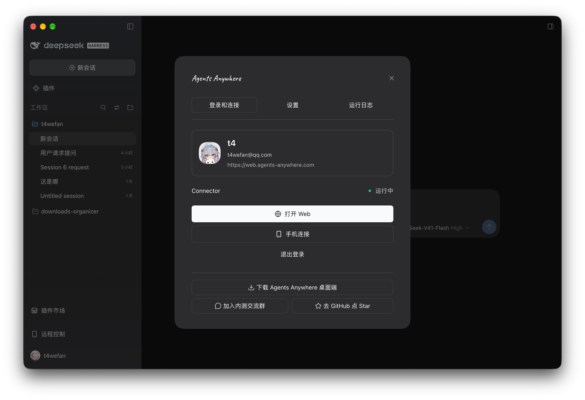
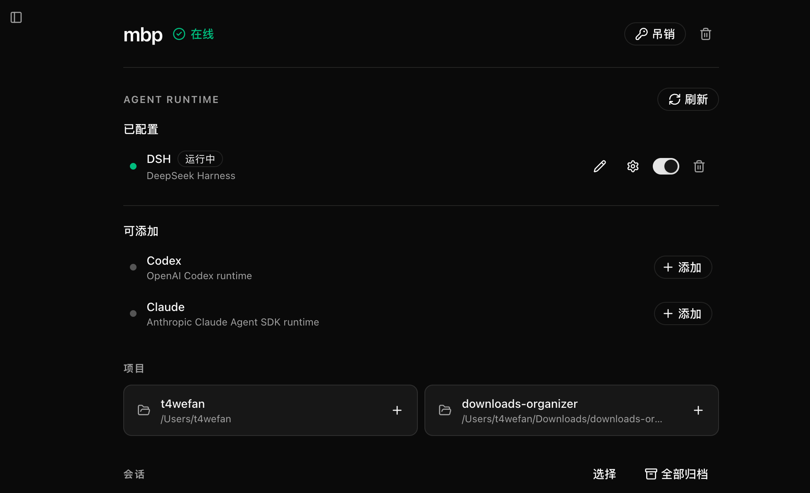

# Agents Anywhere for DSH

在 DeepSeek Harness（DSH）中连接 Agents Anywhere，从手机、平板或 Web 查看 DSH 会话、继续对话、回复提问和审批请求。Agent 仍在安装 DSH 的工作设备上运行；远程使用时，这台设备需要保持开机、联网，并让 DSH 与 Connector 正常运行。

插件以 npm 包 `@agents-anywhere/dsh-bridge-next` 发布，按你使用的 DSH 选择一种方式：

| 你在用 | 怎么装 |
| --- | --- |
| DeepSeek 官方的 DeepSeek Harness Desktop | 没有内置本插件，[在「插件」页面输入包名安装](#在-deepseek-harness-desktop-中安装)，或把一段提示词交给 DSH 里的 AI 代装 |
| 开源客户端 [DSH Desktop](https://github.com/anywhere-labs/dsh-desktop) | 已内置，[直接启用](#在-dsh-desktop-中启用)，不要再装 npm 包 |
| 命令行安装的 DSH | [用 `dsh plugin` 命令安装](#用命令行安装) |

## 可以做什么

- 在其他设备上查看 DSH 会话与运行进度，发送消息或继续已有会话。
- 根据 DSH 和当前会话的能力选择模型、权限与 Agent 模式，发送文字、图片或普通文件，回复输入请求与单次操作审批。
- 使用 Agents Anywhere Cloud 或自己的服务实例；在插件中查看连接状态、管理本机 Connector 和桥接日志。
- 在“运行日志 → 启动前诊断”展开当前插件或 Bridge 启动失败的错误码与调用栈位置；Connector 未启动或本地日志文件无法读取时，已捕获的启动故障仍可查看，无需开启 DSH Desktop 开发者日志。成功重试后清除当前故障；更早的错误可通过宿主日志排查。
- 如果 Agents Anywhere Desktop 正在运行，转到该应用完成连接；否则可以直接在插件中登录并连接本机设备。Agents Anywhere Desktop 和 DSH Desktop 是两个不同的应用。

## 在 DSH Desktop 中启用

本节适用于内置本插件的 [DSH Desktop](https://github.com/anywhere-labs/dsh-desktop)。该应用已集成此插件，**不需要另行下载或执行 npm 安装命令**。在 DSH Desktop 的“插件”页面找到“远程控制”并启用，然后从左侧边栏“设置”上方打开“远程控制”。部分 Desktop 版本的开关位于“桌面设置”的“手机连接”区域；请以当前应用显示的入口为准。



首次使用时选择 Agents Anywhere Cloud，或输入自己部署的服务端地址，然后在浏览器中完成登录和授权。按照页面引导添加 Agent，并按需连接手机。若插件检测到 Agents Anywhere Desktop 正在运行，会引导你到该应用继续设置，避免两个应用同时管理同一台工作设备的连接。

插件随 DSH Desktop 一同打包和更新；请通过 Desktop 的发布渠道升级，不要对内置插件叠加独立 npm 安装。

## 在 DeepSeek Harness Desktop 中安装

DeepSeek 官方的 DeepSeek Harness Desktop 没有内置本插件，需要从 npm 安装。两种方式任选其一。

### 方式一：在「插件」页面输入包名

1. 在左侧边栏打开「插件」，点击「添加插件」。
2. 在包名输入框中填入：

   ```text
   @agents-anywhere/dsh-bridge-next
   ```

   然后点击「安装」。下载慢或连不上时，在「安装源」中改选「中国大陆镜像源」再试。
3. 如果安装停下并提示「允许这些脚本并重试」，列表中应只有 `@dataiku/uv`（它为插件提供 uv 程序），点击该按钮继续。列表里出现其他包名时，先不要允许，到 [Issues](https://github.com/anywhere-labs/Agents-Anywhere/issues) 反馈。
4. 安装完成后点击「立即启用」，然后重启 DeepSeek Harness Desktop。
5. 从左侧边栏「设置」上方打开「远程控制」，按提示登录并连接。

### 方式二：让 DSH 里的 AI 代为安装

DSH 的 AI 通过 `plugin_manager` 工具管理插件，这个工具在 Creator 模式下可用，每次安装都会先请求你批准。新建一个会话，把下面这段提示词原样发给它：

```text
请帮我在当前 DSH profile 中安装 Agents Anywhere 插件，要求如下：

1. 插件的 npm 包名是 @agents-anywhere/dsh-bridge-next，安装 npm 上的最新版本，不要改用其他包名。
2. 使用 plugin_manager 工具。如果当前会话没有这个工具，告诉我切换到 Creator 模式，或者改到「插件」页面手动安装；不要用 shell 命令修改 profile 文件。
3. 先用 list_bundles 检查是否已经安装。已安装时告诉我当前版本；需要升级时，经我同意后先用 remove_bundle 卸载旧版本，再安装新版本。
4. 用 install_bundle 安装并启用。如果因为依赖的安装脚本被拦下而失败，把等待允许的包名告诉我；只有列表中只有 @dataiku/uv 时，才在我确认后批准它并重试。
5. 如果提示版本不兼容（incompatible-version），不要添加版本豁免，告诉我当前的 DSH 版本和插件要求的版本范围。
6. 不要改动其他插件、profile 配置或会话文件。
7. 完成后告诉我安装的插件版本，并提醒我重启 DeepSeek Harness Desktop，然后从左侧边栏打开「远程控制」登录。
```

### 升级与卸载

- 通过「插件」页面安装的插件暂时不会自动更新。升级时在「插件」页面卸载 Agents Anywhere for DSH，再按上面的步骤重新安装；也可以把上面的提示词再发给 AI，它会先卸载旧版本。
- 升级 Agents Anywhere Desktop 或 Connector 的 MINOR 版本（例如从 2.0.x 升到 2.1.0）时，插件要一起升级，否则本机连接会一直停在等待状态。
- 卸载插件不会删除账号、设备连接和设置，它们保存在用户目录的 `~/.agents-anywhere/dsh-bridge-next/`，重新安装后可以继续使用。想同时清除这些数据，先在插件的「设置 → 维护」中执行「恢复出厂设置」，再卸载。

## 用命令行安装

使用命令行安装的 DSH 时，用官方插件命令从 npm 安装。下面以 `desktop` Profile 为例，Profile 名称不同时替换掉：

```bash
dsh plugin --profile desktop add @agents-anywhere/dsh-bridge-next
```

安装完成后重启对应的 DSH 实例，从左侧边栏打开「远程控制」，按提示登录并连接。升级时先卸载再安装：

```bash
dsh plugin --profile desktop remove @agents-anywhere/dsh-bridge-next
```

```bash
dsh plugin --profile desktop add @agents-anywhere/dsh-bridge-next
```

## 版本兼容

- 不写版本号时，安装的是 npm 上的最新版本。需要固定版本时，在包名后加上版本号，例如 `@agents-anywhere/dsh-bridge-next@2.1.0`。
- 插件支持的 DSH 版本以所装插件版本的 `peerDependencies` 为准。当前源码支持 DSH `0.2.0-rc.1` 及之后的 0.2.x 版本（`>=0.2.0-rc.1 <0.3.0-0`），开发与测试基线为 `0.2.1-rc.2`；范围内的其他版本只做声明，不在自动化检查中验证。
- DSH 在安装和启动插件时都会检查这个范围，不满足时拒绝安装或跳过加载。不要为本插件添加版本豁免；更新 DSH 或换用兼容的插件版本。
- DSH Desktop 内置的插件和自身版本配套，版本号带 `-desktop` 后缀，和 npm 上的包不是同一个构建。

## 确认 DSH 已接入

完成连接后，在 Agents Anywhere 的设备页面可以看到设备在线，以及 DSH 运行时的状态。下图展示了 DSH 正在运行的设备；如果状态未出现或显示断开，先检查工作设备上的 DSH 和 Connector。



插件提示“连接服务器超时”时，表示请求 Agents Anywhere 服务端超过 20 秒仍未完成，不代表 Connector 进程崩溃；检查所选后端地址和本机网络后，在插件中重新启动 Connector。Connector 启动后立即停止时，在插件“运行日志 → 启动前诊断”中查看原因。

## 使用条件与数据范围

- 远程连接需要 Agents Anywhere 账号和可访问的服务端。自托管时输入后端地址；手机扫码时，手机也需要能够访问该服务。
- 会话、时间线和附件等数据会按所用功能经过或保存在 Agents Anywhere Server；自托管时由你部署的服务处理。模型账号与费用遵循所用模型服务的规则。
- 账号与设备凭据保存在本机插件数据目录，不放入页面跳转 URL。设备凭据失效或设备被删除时，插件会提示重新连接或创建，不会静默注册新设备。
- 如果 DSH 原生历史读取失败，对应会话的历史可能无法同步；其他会话仍可工作。在“桥接日志”中查看原因，修复原生历史后重试。插件不会自行修改 DSH 会话文件。

## 开发与进一步阅读

本仓库源码和 npm 已发布包可能处于不同版本。源码构建、链接安装、headless 检查、配置和实现细节见[技术说明](https://github.com/anywhere-labs/Agents-Anywhere/blob/main/dsh-bridge-next/TECHNICAL.md)。

[开发计划](https://github.com/anywhere-labs/Agents-Anywhere/blob/main/dsh-bridge-next/DEVELOPMENT_PLAN.md) · [Onboarding 方案](https://github.com/anywhere-labs/Agents-Anywhere/blob/main/dsh-bridge-next/ONBOARDING_PLAN.md) · [验证记录](https://github.com/anywhere-labs/Agents-Anywhere/blob/main/dsh-bridge-next/VERIFICATION.md) · [Agents Anywhere 使用文档](https://github.com/anywhere-labs/Agents-Anywhere/blob/main/docs/README.md)
